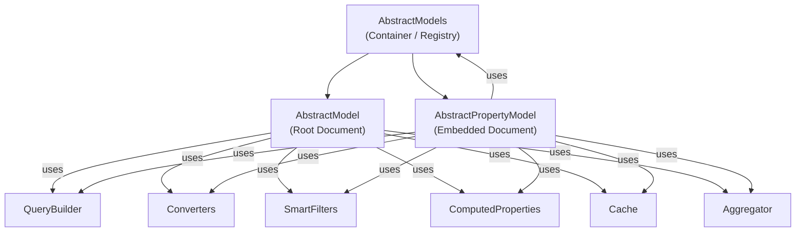

# `@liqd-js/mongodb-model` — Library Overview

## Architecture

The library provides a type-safe, opinionated MongoDB abstraction layer with two main model classes, a container/registry, and a rich helper ecosystem. All code lives in the [old/](file:///Users/tomaskorenko/Projects/Github/webergency-utils/mongodb-model/old) folder.



---

## Core Components

### 1. `AbstractModels` — [index.ts](file:///Users/tomaskorenko/Projects/Github/webergency-utils/mongodb-model/old/index.ts)

The top-level container and entry point. Responsibilities:

| Capability | Details |
|---|---|
| **MongoClient pooling** | Static `Map<string, MongoClient>` deduplicates connections by connection string. Default pool: 0–100, snappy compression, 15s idle timeout. |
| **Model registry** | `[REGISTER_MODEL]` / `[GET_PARENT]` symbol-keyed methods register model instances and resolve parent models for property models. |
| **Flow scope** | Exposes `scope.start/assign/set/get/execute` — wrappers around `@liqd-js/flow` for async context propagation (locales, traceID, experimentalFlags, benchmarks, access control). |
| **Transactions** | `transaction()` wraps `client.startSession().withTransaction()`. |

### 2. `AbstractModel<DBE, DTO, Extensions>` — [model.ts](file:///Users/tomaskorenko/Projects/Github/webergency-utils/mongodb-model/old/model.ts)

Abstract base for **root-level MongoDB documents** (collection-level).

| Method | Description |
|---|---|
| `create(dbe, id?, options?)` | Insert with optional `duplicateIgnore` (returns existing `_id` on E11000). |
| `createFrom(data, id?, options?)` | **Stub** — throws `Method not implemented`. |
| `get(id(s), conversion?, filtered?)` | Batched fetch via `@liqd-js/aggregator` (auto-batching by tick). 6 overloads: single/array × default/named conversion × filtered. |
| `find(options, conversion?, sort?)` | Single-document lookup via aggregation pipeline. |
| `list(options, conversion?)` | Paginated list with cursor-based pagination (prev/next), count, smart filters, computed properties, projection, query optimization. Returns `WithTotal<Array<DTO & { $cursor }>>`. |
| `aggregate<T>(pipeline, options?)` | Raw aggregation with optional prepended model pipeline. |
| `count(pipeline, options?)` | Count via `$count` stage. |
| `update(id, update, options?)` | Single-document update with optional `documentBefore`/`documentAfter` snapshots. Uses transactions for `documentAfter`. |
| `updateMany(ids, update)` | Multi-ID update. |
| `updateOne(match, update, options?)` | **Stub** — throws `Method not implemented`. |
| `delete(id)` | Delete by ID (with access filter check). |
| `accessFilter()` | Protected hook — returns filter applied to every query (ACL). |
| `resolveSmartFilter(smartFilter)` | Resolves named filter methods → `{ filter, pipeline }`. |
| `resolveComputedProperties(properties)` | Resolves named computed property methods → `{ fields, pipeline }`. |
| `dbeID(id)` / `dtoID(id)` | ID conversion hooks (e.g., `string ↔ ObjectId`). |
| `id()` | New ID generator (default: `new ObjectId().toString()`). |
| `pipeline(options, conversion?)` | Builds the core aggregation pipeline from all options. |

### 3. `AbstractPropertyModel<RootDBE, DBE, DTO, Extensions>` — [property-model.ts](file:///Users/tomaskorenko/Projects/Github/webergency-utils/mongodb-model/old/property-model.ts)

Abstract base for **embedded/nested sub-documents** (e.g., `engagements[].applications[]`).

Same CRUD surface as `AbstractModel` but operates on embedded arrays via:

| Capability | Details |
|---|---|
| **Path parsing** | Constructor parses `engagements[].applications[]` → `[{path: 'engagements', array: true}, {path: 'applications', array: true}]` |
| **Unwind pipeline** | Automatically generates `$unwind` + `$replaceWith` stages to extract sub-documents |
| **Prefixed operations** | All filters, updates, projections are auto-prefixed to the nested path |
| **Parent delegation** | Smart filters and computed properties bubble up to parent models via `GET_PARENT` |
| **Array filter updates** | Uses MongoDB `arrayFilters` for targeted updates in nested arrays |
| **Root access** | Supports `_root.` prefix in filters/projections to reference the root document |
| **Filter splitting** | Splits filter conditions across unwind stages for optimal query performance |

### 4. Converter System

Converters transform raw DB entities to DTOs or other shapes:

```typescript
type AbstractModelConverters<DBE> = {
    from?   : { [key: string]: (data: any) => Omit<DBE, '_id'> }  // inbound
    dto     : { converter, projection?, computedProperties?, cache? }  // default outbound
    [key]   : { converter, projection?, computedProperties?, cache? }  // named outbound
}
```

Each named converter can have its own:
- **Projection** — MongoDB projection applied during query
- **Computed properties** — Additional `$addFields`/`$lookup` pipeline injected before conversion
- **Cache settings** — Per-converter cache configuration

### 5. Smart Filters

Reusable, named query fragments. Each filter method returns `{ filter?, pipeline? }`:

- `filter` → merged into `$match` stage
- `pipeline` → appended as additional pipeline stages

Property models support **hierarchical smart filter resolution** — unknown filters bubble up to the parent model.

### 6. Computed Properties

Similar to smart filters but for derived fields. Each computed property method returns `{ fields?, pipeline? }`:

- `fields` → injected as `$addFields`
- `pipeline` → prepended lookup/computation stages

Supports three invocation styles:
- Array of property names (no params)
- Function returning array of property names
- Object mapping property names to params

---

## Helpers

### External (Public API) — [helpers/external/](file:///Users/tomaskorenko/Projects/Github/webergency-utils/mongodb-model/old/helpers/external)

| Helper | Description |
|---|---|
| `i18n(obj)` / `multiI18n(obj)` | Locale resolution from flow context |
| `deleteNullishProperties(obj)` | Deep recursive null/undefined removal |
| `deleteUndefinedProperties(obj)` | Deep recursive undefined-only removal |
| `objectHash(obj, options?)` | Deterministic hash (SHA1/SHA256/plain) via `@liqd-js/fast-object-hash` |
| `objectHashID(obj)` | Truncated hash → `ObjectId` |
| `objectSet/objectGet` | Deep path-based set/get on objects |
| `objectFlatten(obj)` | Flatten nested object to dot-notation keys |
| `ModelError` | Base error class with model name prefix |
| `ModelQueryError` | Query-specific error |
| `ModelConverterError` | Converter-specific error (includes conversion name + entity ID) |

### Internal (Private) — [helpers/internal/](file:///Users/tomaskorenko/Projects/Github/webergency-utils/mongodb-model/old/helpers/internal)

| Helper | Description |
|---|---|
| `flowStart/flowGet/flowSet/flowExecute` | `@liqd-js/flow` wrappers for async context |
| `map(ids, entries, getID)` | Order-preserving ID→entry mapping |
| `convert(model, converter, dbe, conversion)` | Safe converter invocation with error wrapping |
| `Benchmark` | Step-based timing utility for perf profiling |
| `LOG / DUMP / LOG_FILE` | Debug logging (console + file-based via flow context) |
| `Log` | File-based log queue (async, serialized writes) |
| `resolveBSONObject/resolveBSONValue` | `{$oid}` → `ObjectId`, `{$date}` → `Date` resolution |
| `addPrefixToFilter/Pipeline/Update` | Path-prefixing for property model operations |
| `projectionToProject/projectionToReplace` | Projection format conversion for `$project` / `$replaceWith` |
| `optimizeMatch(filter)` | Flattens `$and`/`$or` trees, merges conditions, simplifies `$in`→`$eq` |
| `mergeProperties(objects)` | Conflict-aware property merging for filter optimization |
| `generateCursorCondition(cursor, sort)` | Cursor-based pagination → `$gt`/`$lt` filter generation |
| `getCursor(dbe, sort)` | Encode current document position as Base64 cursor |
| `splitFilterToStages(filter, paths)` | Split filter conditions across unwind stages |
| `getSubPaths(paths)` | Generate unwind sub-paths from property model path |
| `getUsedFields(pipeline)` | Static analysis of field usage in pipeline |
| `collectAddedFields(pipeline)` | Track fields added by `$addFields`/`$lookup` |
| `toUpdateOperations(update)` | Normalize `Partial<T>` → `{ $set, $unset }` |
| `isExclusionProjection(projection)` | Detect inclusion vs exclusion projections |

### QueryBuilder — [query-builder.ts](file:///Users/tomaskorenko/Projects/Github/webergency-utils/mongodb-model/old/helpers/internal/query-builder.ts)

Central pipeline assembly. Takes all parameters (filter, smart filter, computed properties, sort, cursor, skip, limit, sample, pipeline, projection) and assembles them into a final MongoDB aggregation pipeline in the correct order.

Also handles:
- Count pipeline generation (strips irrelevant trailing stages)
- Count limit support
- Deduplication of added fields between computed properties and smart filters

---

## Type System — [types/](file:///Users/tomaskorenko/Projects/Github/webergency-utils/mongodb-model/old/types)

### Key Types

| Type | Purpose |
|---|---|
| `MongoRootDocument` | `Document & { _id: any }` |
| `MongoPropertyDocument` | `Document & ({ id: any } \| { _id: any })` |
| `ModelExtensions<DBE, SmartFilters, ComputedProperties>` | Configuration bag for `AbstractModel` |
| `PropertyModelExtensions<DBE, SmartFilters, ComputedProperties>` | Configuration bag for `AbstractPropertyModel` |
| `ModelListOptions<DBE, Filters>` | Options for `list()` — filter, smartFilter, cursor, pipeline, count, sample, countLimit |
| `PropertyModelListOptions<RootDBE, DBE, Filters>` | Same but with `_root` projection support |
| `ModelSmartFilter<T>` | Extracts public method names as optional filter keys |
| `ExpandPaths<T>` | Recursive dot-path expansion for MongoDB update typing |
| `PathValue<T, Path>` | Extract value type at a dot-separated path |
| `ModelUpdateDocument<T>` | Type-safe update document with BSON type support |
| `MongoBSONTypes<T>` | Augment types to accept `{ $oid }` / `{ $date }` alternatives |
| `WithTotal<T>` | Augments array type with optional `total` property |
| `FirstType<T>` / `SecondType<T>` | Tuple element extraction |

---

## Dependencies

| Package | Purpose | Version |
|---|---|---|
| `mongodb` | MongoDB driver | ^7.0.0 |
| `@liqd-js/aggregator` | Auto-batching by event loop tick | ^1.0.0 |
| `@liqd-js/flow` | Async context propagation | ^1.5.0 |
| `@liqd-js/cache` | In-memory caching with TTL/LRU | ^0.0.4 |
| `@liqd-js/fast-object-hash` | Deterministic object hashing | ^2.0.2 |
| `@liqd-js/mongodb-query-optimizer` | Pipeline optimization (experimental) | 0.0.1-alpha.8 |
| `snappy` | Wire compression | ^7.3.3 |

---

## Flow Context Keys Used

| Key | Type | Purpose |
|---|---|---|
| `locales` | `Set<string>` | i18n locale resolution order |
| `log` | `boolean` | Enable debug logging |
| `benchmark` | `boolean` | Enable perf benchmarking |
| `traceID` | `string` | File-based query logging correlation |
| `experimentalFlags` | `{ logQueries?: string, 'query-optimizer'?: boolean }` | Feature flags |

---

## File Map

```
old/
├── index.ts              → AbstractModels + re-exports
├── model.ts              → AbstractModel (470 lines)
├── property-model.ts     → AbstractPropertyModel (677 lines)
├── types/
│   ├── index.ts          → barrel
│   ├── external.ts       → public types (135 lines)
│   └── internal.ts       → internal types (74 lines)
└── helpers/
    ├── index.ts          → barrel
    ├── external/
    │   ├── index.ts      → barrel
    │   ├── errors.ts     → ModelError hierarchy (29 lines)
    │   └── utils.ts      → object/hash utilities (197 lines)
    └── internal/
        ├── index.ts      → barrel
        ├── benchmark.ts  → Benchmark class (39 lines)
        ├── log.ts        → Log file writer (22 lines)
        ├── mongo.ts      → core MongoDB utilities (1224 lines)
        ├── query-builder.ts → QueryBuilder (96 lines)
        └── utils.ts      → flow, map, LOG, DUMP (102 lines)
```

**Total source:** ~2,900 lines (excluding tests)
