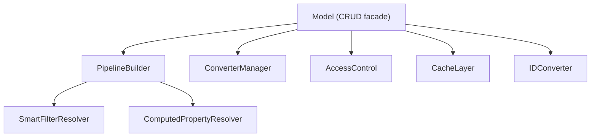

# `@liqd-js/mongodb-model` v2 — Suggestions

## 1. Architecture: Break the God-Classes

### 1.1 Decompose `AbstractModel` and `AbstractPropertyModel`

Both model classes are monolithic (~470 and ~677 lines) and violate SRP. Each model is simultaneously responsible for:

- CRUD operations
- Pipeline assembly
- Smart filter resolution
- Computed property resolution
- Caching
- Access control
- Converter invocation
- ID conversion
- Benchmarking / logging

**Suggestion:** Extract these into focused, composable concerns:



- **`PipelineBuilder`** — single responsibility: assemble aggregation pipeline from options. Currently split between `QueryBuilder` and the model classes themselves (both `model.ts:pipeline()` and `property-model.ts:pipeline()` do significant work before handing off to `QueryBuilder`).
- **`ConverterManager`** — owns converter registry, invocation, error wrapping.
- **`AccessControl`** — wraps `accessFilter()` hook, could support deny-fast (returning `false` to skip query entirely — there's a TODO for this at [model.ts:395](file:///Users/tomaskorenko/Projects/Github/webergency-utils/mongodb-model/old/model.ts#L395)).
- **`CacheLayer`** — encapsulates cache key generation, get/set, invalidation.

### 1.2 Reduce Code Duplication Between Model Classes

`AbstractModel` and `AbstractPropertyModel` share ~60% identical code:

| Duplicated Area | Lines |
|---|---|
| `get()` with 6 identical overloads | ~30 lines × 2 |
| `list()` pipeline construction + conversion + cursor | ~80 lines × 2 |
| `aggregate()` + `count()` | ~30 lines × 2 |
| `resolveComputedProperties()` | ~40 lines × 2 |
| `resolveSmartFilter()` | ~30 lines × 2 |
| Aggregator setup in constructor | ~40 lines × 2 |
| Cache key generation | identical |

**Suggestion:** Create a shared `BaseModel` or use composition with a `ModelOperations` class that both models delegate to.

### 1.3 Decouple from `@liqd-js/*` Ecosystem

The library has hard dependencies on 5 `@liqd-js` packages. For a general-purpose library, consider:

| Dependency | Alternative |
|---|---|
| `@liqd-js/flow` | Node.js native `AsyncLocalStorage` (stable since Node 16) |
| `@liqd-js/aggregator` | Implement a simple tick-batching aggregator (it's ~50 lines of code) or use `dataloader` |
| `@liqd-js/cache` | `lru-cache` (widely adopted, well-maintained) |
| `@liqd-js/fast-object-hash` | `object-hash` or a custom implementation |
| `@liqd-js/mongodb-query-optimizer` | This is alpha — either mature it or remove it |

> [!IMPORTANT]
> `@liqd-js/flow` → `AsyncLocalStorage` is the highest-impact change. It eliminates a hard dependency and uses a Node.js built-in that is universally understood.

---

## 2. Bug Fixes & Correctness Issues

### 2.1 Session Leak in `transaction()` — [index.ts:63-66](file:///Users/tomaskorenko/Projects/Github/webergency-utils/mongodb-model/old/index.ts#L63-L66)

```typescript
public async transaction<T = void>( transaction: WithTransactionCallback<T> ): Promise<T>
{
    return await this.client.startSession().withTransaction( transaction );
}
```

The session is **never ended**. `startSession()` creates a server-side session that must be explicitly closed via `session.endSession()`. Under load, this leaks sessions until the server-side timeout (30 minutes).

**Fix:**
```typescript
public async transaction<T = void>( fn: WithTransactionCallback<T> ): Promise<T>
{
    const session = this.client.startSession();

    try
    {
        return await session.withTransaction( fn );
    }
    finally
    {
        await session.endSession();
    }
}
```

### 2.2 Access Control Bypass via Incorrect Check — [model.ts:175-187](file:///Users/tomaskorenko/Projects/Github/webergency-utils/mongodb-model/old/model.ts#L175-L187)

In `update()`, `updateMany()`, and `delete()`, the access check uses `get()`:

```typescript
const canUpdate = await this.get( id, 'dbe' );
if ( !canUpdate ) { return { matchedCount: 0, modifiedCount: 0 } }
```

Problems:
1. **Race condition** — Between the `get()` check and the actual `updateOne()` call, another request could change the document's access-relevant fields.
2. **Silent failure** — Returns `{ matchedCount: 0 }` instead of throwing, making it indistinguishable from "document doesn't exist".
3. **Performance** — Executes an extra query for every mutation.
4. **Multiple TODO comments** confirm this is known-broken: `// TODO: do properly`

**Suggestion:** Embed the access filter directly into the mutation query:
```typescript
const res = await this.collection.updateOne(
    { _id: this.dbeID( id ), ...( await this.accessFilter() || {} ) },
    toUpdateOperations( update )
);
```

### 2.3 `update()` Transaction Usage — [model.ts:189-199](file:///Users/tomaskorenko/Projects/Github/webergency-utils/mongodb-model/old/model.ts#L189-L199)

The `documentAfter` option wraps the update in a transaction, but `documentBefore` (without `documentAfter`) doesn't. This means you can get a `documentBefore` snapshot that doesn't match the actual state at mutation time.

Also, `findOneAndUpdate` already returns the document before/after — no transaction needed:

```typescript
const result = await this.collection.findOneAndUpdate(
    { _id: this.dbeID( id ) },
    toUpdateOperations( update ),
    { returnDocument: options?.documentAfter ? 'after' : 'before' }
);
```

### 2.4 `createFrom()` and `updateOne()` are Stubs

Both throw `Method not implemented` at runtime. These should either be implemented or removed from the abstract class — having them throw at runtime is a trap.

### 2.5 `connect()` is Fire-and-Forget — [index.ts:37](file:///Users/tomaskorenko/Projects/Github/webergency-utils/mongodb-model/old/index.ts#L37)

```typescript
this.client.connect(); // No await, no error handling
```

If the initial connection fails, the first query will fail with an obscure error. The new version should either:
- `await` the connection in an explicit `init()` method
- Or rely on MongoDB driver's lazy connection (v5+ auto-connects on first operation)

> [!NOTE]
> Since MongoDB driver v5, calling `connect()` is optional — the driver auto-connects on first operation. The explicit `connect()` call can be removed entirely.

### 2.6 Cache Returns References, Not Clones — [model.ts:67-71](file:///Users/tomaskorenko/Projects/Github/webergency-utils/mongodb-model/old/model.ts#L67-L71)

There's a TODO comment in Slovak: `// TODO: cache - vracat clone nie referenciu`

Cached documents are returned by reference. If a converter mutates the DBE object, it corrupts the cache. The new version should `structuredClone()` on cache hits.

---

## 3. Type Safety Improvements

### 3.1 Eliminate `any` Escape Hatches

The codebase has **heavy** `any` usage, especially in:

| Location | Issue |
|---|---|
| Smart filter resolution | `smartFilter: any` throughout |
| `resolveComputedProperties` | All params are `any` |
| `addPrefixToFilter/Value` | `Filter = Record<string, any>` |
| Pipeline stages | `any[]` everywhere |
| `optimizeMatch` | Operates on `any` |
| `convert` function | Return type is `unknown` |

**Suggestion:** Introduce branded types for pipeline stages:

```typescript
type MatchStage = { $match: Filter<any> };
type UnwindStage = { $unwind: string | { path: string, preserveNullAndEmptyArrays?: boolean } };
type PipelineStage = MatchStage | UnwindStage | AddFieldsStage | /* ... */;
```

### 3.2 `MongoPropertyDocument` ID Inconsistency

```typescript
export type MongoPropertyDocument = Document & ({ id: any } | { _id: any });
```

This union means you never know whether a property document uses `id` or `_id`. The aggregator code has `dbe._id ?? dbe.id` fallbacks scattered everywhere. Pick one convention and enforce it.

**Suggestion:** Property documents should always use `id` (not `_id`). Enforce this with:
```typescript
export type MongoPropertyDocument = Document & { id: any };
```

### 3.3 Converter Return Type Safety

Currently the converter is typed as `(dbe: DBE) => unknown | Promise<unknown>`. This means the DTO type has no connection to what the converter actually returns. The library already uses `ReturnType<converter>` to infer the DTO, but the `unknown` return allows converters to return literally anything.

**Suggestion:** Make the converter generic over its return type and enforce `DTO` agreement at the type level.

---

## 4. New Capabilities

### 4.1 Middleware / Hooks System

Currently there's no way to hook into lifecycle events (pre/post create, update, delete). The `accessFilter()` is the only hook.

**Suggestion:** Add a middleware pipeline:

```typescript
model.use( 'beforeCreate', async( ctx ) => { /* validate, enrich, audit */ });
model.use( 'afterUpdate', async( ctx ) => { /* invalidate cache, emit event */ });
model.use( 'beforeDelete', async( ctx ) => { /* soft delete check, cascade */ });
```

### 4.2 Bulk Write Operations

The library has `create()` and `updateMany()` but no `createMany()` or `bulkWrite()`. For bulk inserts/updates, users must loop.

### 4.3 Soft Deletes

The current `delete()` does a hard `deleteOne()`. Consider a built-in soft-delete mode:
- `deletedAt` timestamp field
- Auto-filter in all reads
- `restore()` method
- `forceDelete()` for actual removal

### 4.4 Change Streams

No support for MongoDB change streams. This is increasingly important for real-time applications.

### 4.5 Schema Validation

No validation layer. Converters can fail at runtime if the DB contains unexpected data. Consider integrating a schema validation library (e.g., `zod`, `typebox`, or `valibot`) for:
- Input validation on `create()`/`update()`
- Output validation on converter results
- Runtime type checking with descriptive errors

### 4.6 Proper Event System

Replace the ad-hoc `LOG_FILE` + `Benchmark` approach with a proper event emitter:

```typescript
model.on( 'query', ({ pipeline, duration, collection }) => { /* ... */ });
model.on( 'cache:hit', ({ key, collection }) => { /* ... */ });
model.on( 'cache:miss', ({ key, collection }) => { /* ... */ });
```

### 4.7 Aggregation Pipeline Typing

Consider adding a typed pipeline builder that provides autocomplete and validation:

```typescript
model.aggregate()
    .match({ status: 'active' })
    .lookup({ from: 'users', localField: 'userId', foreignField: '_id', as: 'user' })
    .unwind('$user')
    .project({ name: 1, 'user.email': 1 })
    .exec();
```

---

## 5. API Design Improvements

### 5.1 Unify `get()` Overloads

The current 6 overloads for `get()` are complex and error-prone:

```typescript
get( id )                           → DTO | null
get( id, conversion )               → Converted | null
get( ids )                          → (DTO | null)[]
get( ids, conversion )              → (Converted | null)[]
get( ids, conversion, true )        → Converted[]         // filtered
get( ids, conversion, false )       → (Converted | null)[]
```

**Suggestion:** Use an options object instead:

```typescript
get( id: ID, options?: { as?: K, filter?: boolean } )
getMany( ids: ID[], options?: { as?: K, filter?: boolean } )
```

### 5.2 Make `list()` Return Type Cleaner

Currently, `total` is attached via `Object.defineProperty` as a non-enumerable property on the array, and `$cursor` is mixed into each DTO. This is fragile and doesn't serialize.

**Suggestion:** Return a proper pagination object:

```typescript
type ListResult<T> = {
    items   : T[]
    total?  : number
    cursors : { next?: string, prev?: string }
}
```

### 5.3 Separate `createFrom` Cleanly

The stub `createFrom()` suggests a need for inbound converters (API input → DBE). This should be a first-class feature, not an afterthought.

### 5.4 Error Codes

`ModelError` and subtypes only carry messages. Add error codes for programmatic handling:

```typescript
export class ModelError extends Error
{
    constructor( public code: string, model: object, message: string, cause?: Error )
    {
        super( `[${code}] ${model.constructor.name}: ${message}`, { cause });
    }
}
```

### 5.5 Remove `require()` Usage

Several files use `require()` instead of ESM imports:

- [utils.ts:6](file:///Users/tomaskorenko/Projects/Github/webergency-utils/mongodb-model/old/helpers/internal/utils.ts#L6): `const fs = require('fs')`
- [utils.ts:8](file:///Users/tomaskorenko/Projects/Github/webergency-utils/mongodb-model/old/helpers/internal/utils.ts#L8): `const Flow = require('@liqd-js/flow')`
- [utils.ts:42](file:///Users/tomaskorenko/Projects/Github/webergency-utils/mongodb-model/old/helpers/internal/utils.ts#L42): `const { inspect } = require('util')`
- [model.ts:9](file:///Users/tomaskorenko/Projects/Github/webergency-utils/mongodb-model/old/model.ts#L9): `const Aggregator = require('@liqd-js/aggregator')`

These should all be ESM `import` statements. The `fs` import in utils.ts is imported but never used directly (only used in `log.ts`).

---

## 6. Performance Improvements

### 6.1 Connection Lifecycle

The static `Clients` map never evicts connections. Long-running servers that connect to multiple databases will accumulate connections forever.

**Suggestion:** Use `WeakRef` or explicit `disconnect()` support. Or better yet, accept `MongoClient` as an injected dependency instead of managing connections internally.

### 6.2 Cursor Streaming for Large Result Sets

`list()` always calls `.toArray()`, loading all results into memory. For large datasets, support streaming:

```typescript
async *stream( options: ListOptions ): AsyncGenerator<DTO>
{
    const pipeline = await this.buildPipeline( options );

    for await( const doc of this.collection.aggregate( pipeline ))
    {
        yield await this.convert( doc );
    }
}
```

### 6.3 Batch Pipeline Execution

`list()` with `count: true` executes two separate aggregation pipelines. MongoDB's `$facet` can run both in a single query, though with caveats (memory limits). Consider it for smaller datasets.

### 6.4 Remove Dead Code

Several features are conditionally enabled via flow context:
- Query optimizer (`experimentalFlags['query-optimizer']`) — still alpha
- File logging (`experimentalFlags['logQueries']`) — should be replaced with the event system
- Benchmark logging (`flowGet('benchmark')`) — should use the event system

Clean these out and replace with the proper event/observability system.

---

## 7. Testing & Developer Experience

### 7.1 Testability

The current constructors are hard to test because they:
- Require a live `MongoClient` (no DI for the database)
- Auto-connect in the constructor
- Use global `Flow` state

**Suggestion:** Accept a `Db` or `Collection` object in constructors (not connection strings). Support a mock mode for unit tests.

### 7.2 Test Infrastructure

Current tests in [test/](file:///Users/tomaskorenko/Projects/Github/webergency-utils/mongodb-model/test) connect to a real MongoDB instance and contain hardcoded ObjectIds and credentials. The new version should:

- Use `mongodb-memory-server` for isolated tests
- Have proper setup/teardown
- Cover edge cases (empty results, errors, concurrent access)
- Test the pipeline builder independently of the database

### 7.3 Missing Dedicated Test Suites

There are no tests for:
- `addPrefixToFilter` / `addPrefixToPipeline` / `addPrefixToUpdate`
- `optimizeMatch` (this is ~130 lines of complex logic with zero tests)
- `generateCursorCondition`
- `splitFilterToStages`
- Converter error handling
- Cache behavior
- Transaction support

---

## Summary Priority Matrix

| Priority | Category | Impact | Effort |
|---|---|---|---|
| 🔴 Critical | Session leak fix | High | Low |
| 🔴 Critical | Access control bypass fix | High | Medium |
| 🟠 High | Break god-classes | High | High |
| 🟠 High | Eliminate code duplication | High | Medium |
| 🟠 High | Replace `@liqd-js/flow` with `AsyncLocalStorage` | Medium | Medium |
| 🟠 High | Clean up `any` types | Medium | High |
| 🟡 Medium | Middleware / hooks system | High | Medium |
| 🟡 Medium | Clean `list()` return type | Medium | Low |
| 🟡 Medium | Unify `get()` API | Medium | Low |
| 🟡 Medium | Cache clone-on-read | Medium | Low |
| 🟡 Medium | Test infrastructure | High | Medium |
| 🟢 Low | Cursor streaming | Medium | Low |
| 🟢 Low | Bulk operations | Medium | Low |
| 🟢 Low | Change streams | Medium | Medium |
| 🟢 Low | Schema validation | Medium | Medium |
| 🟢 Low | Typed pipeline builder | Low | High |
