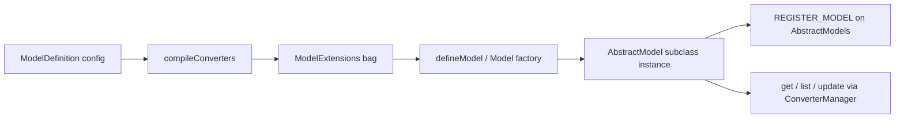

# Model Definition DX - Plan

## Goal Capsule

- **Objective:** Ship a user-friendly model definition API so library consumers can create root and property models with auto basic converters, declarative converter recipes, and optional class subclasses when domain methods are needed — without matching v1 API signatures.
- **Product authority:** This plan owns model definition DX only. Broader library v2 work (CRUD surface redesign, models container/registry, app-layer access wrappers) is surrounding context, not active scope.
- **Stop conditions:** Do not redesign `get`/`list`/update signatures, rewrite the models container, or migrate `usage/` in this plan — stop when definition helpers, recipes, typing, and tests satisfy R1–R16 and AE1–AE5.
- **Open blockers:** None.

---

## Product Contract

**Product Contract preservation:** unchanged — planning resolved deferred questions in Key Technical Decisions without altering R1–R16 meaning.

### Summary

Add `defineModel` / `definePropertyModel` for method-free models and `Model` / `PropertyModel` as subclass bases when domain methods are needed.
Default converters are auto `dto` (`_id` → `id`) and `dbe` (identity); named converters use recipes (`pick` / `omit` / `extends` / rename / `custom`).
Entity DBE/DTO shapes stay in the consumer's types package; the library infers conversion unions from the definition.

### Problem Frame

Consumers today subclass abstract model classes with heavy generic bags and pair each model with a separate `XConverters.create(models)` factory — even when conversion is only `_id` → `id`.
Property models add path-string wiring and the same converter ceremony.
`src/` already started structural decomposition (pipeline, converters, access control) but has no definition helper.
The cost is boilerplate and cognitive load at every new model, not missing CRUD power.

### Key Decisions

- **Definition-only scope** — this ship is how models are declared, not how queries read. (session-settled: user-directed — chosen over full-library / CRUD / property-only brainstorms: one coherent unit) Governs R1–R16.
- **Full definition surface including recipes** — helpers, bases, property parallels, and converter recipes land together. (session-settled: user-directed — chosen over thinner MVPs: complete DX first) Governs R5–R10.
- **Class for methods, not a methods bag** — method-free models use `defineModel` / `definePropertyModel`; methods use `extends Model(...)` / `extends PropertyModel(...)`. (session-settled: user-directed — chosen over `methods` in config or dual attach styles: natural `this` typing) Governs R3, R4, R11.
- **Public base names `Model` and `PropertyModel`** — not `modelBase` / `propertyModelBase`. (session-settled: user-directed — chosen over prior base names: clearer public API) Governs R3, R4.
- **Minimal auto converters** — simple default is `dto` (`_id` → `id`, pass through) and `dbe` (identity). (session-settled: user-directed — chosen over pick/omit or suggest-set defaults: smallest useful auto set) Governs R5, R6.
- **Recipes include rename** — suggest-style `id` / `label` mappings are in recipe scope, not only pick/omit/extends/custom. (session-settled: user-approved — chosen over cutting rename to a later ship: needed for Tag/Skill-style suggest DTOs) Governs R7.
- **Config factory approach** — one definition shape that grows with config; not schema-first fields and not a registry-first container rewrite. Governs R1, R2.
- **Types stay with the consumer** — DBE/DTO come from the app types package; converter outputs come from recipe inference or `custom` return types; method types live on the subclass. Governs R12, R13.

### Requirements

**Definition surface**

- R1. The library exposes `defineModel` to create a root-document model instance from a config object without requiring a consumer class.
- R2. The library exposes `definePropertyModel` to create an embedded/property model instance from a config that includes a nested path (same spirit as today's `engagements[].applications[]`).
- R3. The library exposes `Model` as the subclass base for root models that need domain methods; it accepts the same config shape as `defineModel`.
- R4. The library exposes `PropertyModel` as the subclass base for property models that need domain methods; it accepts the same config shape as `definePropertyModel`.

**Converters**

- R5. When converters are omitted, the definition provides a `dto` converter that maps `_id` to `id` and passes other fields through, and a `dbe` converter that returns the document unchanged.
- R6. Consumers may declare additional named converters on the definition; named keys participate in typed conversion selection for read APIs the model already exposes.
- R7. Converter recipes support at least: `pick`, `omit`, `extends` (another named converter), field rename (for suggest-style id/label mappings), and `custom` (full function escape hatch).
- R8. Job-scale relation-heavy conversions are expressed with `custom`; recipes are not required to auto-fetch related documents.
- R9. A definition may mix recipes and `custom` converters in the same converters map.
- R10. Separate `XConverters.create(models)` factory classes are no longer required for models that can be expressed with auto converters and recipes.

**Methods and typing**

- R11. Domain methods are added by subclassing `Model` or `PropertyModel`; method-free models do not require a class.
- R12. Consumers supply DBE (and DTO when needed) as type parameters or equivalent definition generics; the library does not own application entity schemas.
- R13. TypeScript support must infer conversion-name unions and return types from the definition's converters map (including recipe and `custom` return types) without the v1 `ReturnType<typeof XConverters['create']>` generic bag.
- R14. Graduating a `defineModel` / `definePropertyModel` export to a subclass is a consumer re-export via `extends Model(...)` / `extends PropertyModel(...)` with the same config; the library does not provide a silent in-place upgrade path.

**Parity and boundaries**

- R15. Root and property definition surfaces share the same converter-recipe and optional filters / computed-properties attachment pattern so consumers learn one DX.
- R16. Existing behavioral capabilities of models (CRUD, filters, computed properties, access hooks as already designed in the library) remain reachable through the definition config or subclass; this plan does not redesign those behaviors.

### Actors

- A1. **Library consumer (app author)** — defines models in application code (e.g. Ramp `usage/` patterns); primary beneficiary of reduced boilerplate.
- A2. **Library maintainer** — implements and publishes the definition API on `@webergency-utils/mongodb-model`.

### Key Flows

- F1. Define a simple root model
  - **Trigger:** A1 needs a Skill/Tag-style collection with no domain methods.
  - **Actors:** A1
  - **Steps:** Call `defineModel` with collection identity and DBE/DTO types; omit converters; use the returned instance for reads/writes with default `dto` / `dbe`.
  - **Outcome:** Model works without a class or converters file.
  - **Covered by:** R1, R5, R11, R12

- F2. Define a complex root model with methods
  - **Trigger:** A1 needs Job-style domain methods and named converters.
  - **Actors:** A1
  - **Steps:** Subclass `Model` with config (recipes and/or `custom`, filters, computed properties); implement methods on the class; register the instance on the app models container as today.
  - **Outcome:** One definition site owns converters and methods; no separate converters factory class required when recipes/`custom` suffice.
  - **Covered by:** R3, R6–R11, R13

- F3. Define a property model
  - **Trigger:** A1 needs an embedded path model (e.g. applications under jobs).
  - **Actors:** A1
  - **Steps:** Use `definePropertyModel` when method-free, or subclass `PropertyModel` when methods are needed; supply collection, path, and converters as for root models.
  - **Outcome:** Same DX as root models with path semantics preserved.
  - **Covered by:** R2, R4, R15

- F4. Graduate from helper to class
  - **Trigger:** A1 starts with `defineModel` and later needs a domain method.
  - **Actors:** A1
  - **Steps:** Replace the export with `class X extends Model(sameConfig) { ... }`; update call sites that depended on the const export if needed.
  - **Outcome:** Explicit migration; behavior and converters unchanged aside from added methods.
  - **Covered by:** R14

### Acceptance Examples

- AE1. Simple model without converters file
  - **Covers R1, R5, R10, R11.**
  - **Given:** A consumer defines a root model with only collection + DBE/DTO types.
  - **When:** They `get` with default conversion and with `'dbe'`.
  - **Then:** Default result has `id` from `_id` and no `_id` unless the DTO includes it; `'dbe'` returns the stored document shape unchanged; no subclass and no converters module are required.

- AE2. Recipe + custom mix
  - **Covers R7, R8, R9.**
  - **Given:** A model declares `suggestDTO` via rename/pick recipes and `dto` via `custom` that performs relation loads.
  - **When:** Reads use `'suggestDTO'` and `'dto'`.
  - **Then:** Suggest conversion uses recipe output only; dto conversion uses the custom function; both conversion names type-check on the read API.

- AE3. Methods via `Model`
  - **Covers R3, R11, R13.**
  - **Given:** A subclass of `Model` with named converters and a domain method that calls `this.get` / `this.list`.
  - **When:** The method runs.
  - **Then:** `this` is typed as the model (CRUD + converters + method); no `methods` config bag is required.

- AE4. Property parallel
  - **Covers R2, R4, R15.**
  - **Given:** A property model defined with collection + nested path via `definePropertyModel` or `PropertyModel`.
  - **When:** The consumer uses the same converter recipe patterns as a root model.
  - **Then:** Embedded path behavior works and converter DX matches root models.

- AE5. Graduation is explicit
  - **Covers R14.**
  - **Given:** A model was exported as `defineModel(...)`.
  - **When:** A domain method is needed.
  - **Then:** The consumer must introduce a `Model` subclass with the same config; the library does not mutate the original const into a class.

### Success Criteria

- A Skill/Tag-style model can be defined in a few lines without a converters file or subclass.
- A Job-style model can attach domain methods via `extends Model(...)` with converters declared in the same config (recipes and/or `custom`).
- Property models use the parallel `definePropertyModel` / `PropertyModel` surface without a different mental model for converters.
- TypeScript consumers get conversion-name and return-type inference without the v1 converters generic bag.
- Planning can implement against R1–R16 and AE1–AE5 without inventing definition product behavior.

### Scope Boundaries

**In scope**

- `defineModel`, `definePropertyModel`, `Model`, `PropertyModel`
- Auto `dto` / `dbe`
- Converter recipes: pick, omit, extends, rename, custom
- Shared attachment of smart filters / computed properties in definition config (as already supported by the library model surface)
- Breaking API relative to v1 abstract-class + converters-factory pattern

**Deferred for later**

- Redesign of `get` / `list` / update public signatures
- Models container / registry rewrite (`createModels`-style bootstrap)
- App-layer Ramp wrappers (access filter conventions, soft-delete defaults)
- Relation-auto-fetching declarative converters beyond `custom`
- Silent upgrade from helper instance to class
- Migrating `usage/` models to the new definition API

**Outside this product's identity**

- Schema-first field catalogs that replace the consumer types package as source of truth for DBE/DTO

### Dependencies / Assumptions

- Assumption: Consumer apps continue to own DBE/DTO types (e.g. `@ramp-global/types` in current usage).
- Assumption: `src/` partial v2 internals (converter manager, pipeline builder, model classes) are a viable implementation substrate; planning chooses how to wire definition helpers onto them.
- Dependency: Grounding from `old/`, `usage/`, `OVERVIEW.md`, and `SUGGESTIONS.md` for behavioral parity expectations outside definition DX.

### Outstanding Questions

**Deferred to Planning (resolved in Planning Contract KTDs)**

- Exact public TypeScript signatures — resolved in KTD1, KTD2.
- `extends` recipe + async parents — resolved in KTD3.
- Default `dto` `_id` handling — resolved in KTD4.
- Registry wiring — resolved in KTD5.

### Sources / Research

- `OVERVIEW.md` — old architecture: AbstractModels, AbstractModel, AbstractPropertyModel, converters, smart filters, computed properties.
- `SUGGESTIONS.md` — decomposition and DX direction for v2.
- `usage/` — real consumer patterns: `AbstractRampModel` / `AbstractRampPropertyModel`, `XConverters.create(models)`, Skill/Tag vs Job/Application complexity.
- `src/` — partial reimplementation already containing ConverterManager, PipelineBuilder, AccessControl, AbstractModels.
- `src/tests/model.get.test.ts` — Vitest patterns for model tests with mocked collections.

<!-- ce-section: work-relationships -->
### How This Work Fits Together

This plan owns **model definition DX** for library v2.
The broader reimplementation understanding below is contextual, not a committed roadmap — later plans may revise, split, merge, or discard it.

- **Model definition DX** (this plan) — helpers, bases, recipes, typing
  - **Enables:** migrating `usage/`-style apps off v1 abstract classes and converters factories
  - **Can proceed independently of:** CRUD signature redesign and container rewrite
- Later candidates (not active scope)
  - **Public query/CRUD surface redesign** — Depends on definition DX for how conversion names attach; Can proceed independently for behavioral fixes already in `src/`
  - **Models container / registry DX** — Shares definition config concepts; Can proceed independently once models are definable
  - **App-layer access / soft-delete conventions** — Outside library core identity for this package; lives in consumer abstract bases today

---

## Planning Contract

### Key Technical Decisions

- KTD1. **`defineModel` / `definePropertyModel` signature** — `(models, collection, config)` returns a ready model instance; config holds optional `converters`, `smartFilters`, `computedProperties`, and for property models `path`. Rationale: matches today's `(models, collection, extensions)` constructor while dropping the consumer subclass for simple cases. Governs R1, R2, R12.

- KTD2. **`Model` / `PropertyModel` as higher-order class factories** — `Model<DBE, DTO>(config)` and `PropertyModel<RootDBE, DBE, DTO>(config)` return an anonymous class extending `AbstractModel` / `AbstractPropertyModel`; consumer subclasses add methods. Constructor signature: `(models, collection)` only — config is closed over by the factory. Rationale: preserves natural class-method DX (R11) without a separate `methods` bag; mirrors how consumers already write `class X extends AbstractModel`. Governs R3, R4, R11, R14.

- KTD3. **Recipe compilation is synchronous; `extends` resolves against the same converters map** — compile recipes to `AbstractModelConverters` before model construction; `extends: 'dto'` copies the parent converter function after the parent recipe is compiled. Async `custom` parents are allowed — the child `extends` recipe wraps the parent's compiled async converter. Circular `extends` is a compile-time error. Governs R7, R9.

- KTD4. **Default `dto` omits `_id` and adds string `id`** — spread remaining DBE fields, set `id` from `dbe._id.toString()` (or existing `dtoID` hook if model overrides it later). Matches AE1 and Tag/Skill consumer expectations. Governs R5, AE1.

- KTD5. **Registration unchanged** — compiled models still call `models[REGISTER_MODEL](this, collectionName[, pathPrefix])` inside `AbstractModel` / `AbstractPropertyModel` constructors; definition helpers do not introduce a second registry. Governs R16.

- KTD6. **Recipe DSL shape (directional)** — recipes are values in the `converters` map:

  | Recipe | Purpose |
  | --- | --- |
  | omitted / `'auto'` | use default dto/dbe (root) or inherited defaults |
  | `{ pick: readonly keys[] }` | select fields from DBE |
  | `{ omit: readonly keys[] }` | drop fields from DBE |
  | `{ extends: 'parentKey', pick?, omit? }` | derive from another named converter |
  | `{ rename: { outField: sourceField } }` | suggest-style mappings; `_id` → `id` uses string conversion |
  | `{ custom: (dbe) => T }` | full escape hatch |

  Rationale: covers Tag `suggestDTO`, Skill identity, Job role variants without a separate converters class file. Governs R7, R10.

- KTD7. **Type inference via config generic** — export `ModelDefinition<DBE, DTO, TConverters>` and `InferConverters<TConverters>` so `get`/`list`/`getMany` infer conversion keys and return types from the config literal (especially `custom` return types and `as const` pick lists). Keep `AbstractModel` as internal implementation; public surface is `defineModel`, `Model`, etc. Governs R13.

### High-Level Technical Design

Definition flow:

Shared modules:

- `src/default-converters.ts` — auto dto/dbe functions
- `src/converter-recipes.ts` — recipe types + `compileConverters(config, ctx)`
- `src/define-model.ts` — `defineModel`, `Model`, shared config types
- `src/define-property-model.ts` — `definePropertyModel`, `PropertyModel`

`AbstractModel` / `AbstractPropertyModel` remain the runtime engine; definition helpers only compile config and construct subclasses.

### Assumptions

- `AbstractModel` constructor continues accepting a fully materialized `ModelExtensions` object — no change to CRUD/pipeline behavior in this plan.
- Recipe type inference will be best-effort for `pick`/`omit`/`rename`; consumers needing exact DTO types for complex shapes annotate `custom` return types explicitly.
- `usage/` migration examples are documentation-only follow-up, not implementation units here.

### Sequencing

1. Default converters + recipe compiler (no public API yet)
2. Definition types + inference utilities
3. Root definition helpers (`defineModel`, `Model`)
4. Property definition helpers (`definePropertyModel`, `PropertyModel`)
5. Public exports + tests

---

## Implementation Units

### U1. Default converters and recipe compiler

- **Goal:** Compile declarative converter recipes into `AbstractModelConverters` maps with auto dto/dbe defaults.
- **Requirements:** R5, R7, R9, KTD3, KTD4, KTD6
- **Dependencies:** none
- **Files:** `src/default-converters.ts` (create), `src/converter-recipes.ts` (create), `src/types/definition.ts` (create)
- **Approach:**
  1. Implement `defaultConverters<DBE>()` returning `{ dto, dbe }` per KTD4.
  2. Define recipe union types and `compileConverters(recipes?, ctx)` that merges with defaults.
  3. Support `pick`, `omit`, `extends`, `rename`, `custom`; detect circular `extends`.
  4. Accept optional `ctx` with `dtoID(dbeId)` for rename/id mapping (defaults to `toString()`).
- **Patterns to follow:** `src/converters.ts` (`ConverterManager` input shape), `usage/models/tag/converters.ts` (suggest rename shape)
- **Test scenarios:**
  - Covers AE1. Default dto maps `_id` to `id` and omits `_id`; dbe returns same reference shape.
  - `pick` includes only listed fields plus mapped `id` when `_id` picked implicitly.
  - `omit` removes listed fields from dto output.
  - `extends: 'dto'` with additional `omit` produces derived converter.
  - `rename: { id: '_id', label: 'name' }` produces `{ id, label }`.
  - `custom` converter is passed through unchanged.
  - Circular `extends` throws descriptive error at compile time.
- **Verification:** `src/tests/converter-recipes.test.ts` passes; compiled converters invoke correctly on sample DBE objects.

### U2. Definition config types and inference utilities

- **Goal:** TypeScript types so definition config drives conversion-name unions and return types on read APIs.
- **Requirements:** R12, R13, KTD7
- **Dependencies:** U1
- **Files:** `src/types/definition.ts`, `src/types/external.ts` (extend exports), `src/types/index.ts`
- **Approach:**
  1. Add `ModelDefinition`, `PropertyModelDefinition`, `ConverterRecipes` types.
  2. Add `InferConverterMap<TRecipes>` and `ConversionNames<TDef>` utilities.
  3. Wire inferred types into helper return types (stubs OK until U3/U4 land).
- **Patterns to follow:** existing `ExtractSmartFilters` / `ReturnType` patterns in `src/types/external.ts`
- **Test scenarios:**
  - Type-only tests via `expectTypeOf` (if available) or compile-time fixture file asserting `get(id, 'suggestDTO')` return type for a sample config.
  - `custom` return type propagates to `get` result type.
- **Verification:** `npm run build` succeeds with strict TypeScript; fixture types compile without the v1 `ReturnType<typeof XConverters['create']>` bag.

### U3. Root model definition helpers

- **Goal:** Ship `defineModel` and `Model` for root documents.
- **Requirements:** R1, R3, R11, R14, KTD1, KTD2, KTD5
- **Dependencies:** U1, U2
- **Files:** `src/define-model.ts` (create), `src/model.ts` (minimal export alias if needed), `src/index.ts`
- **Approach:**
  1. `defineModel(models, collection, config)` — compile config, instantiate anonymous `AbstractModel` subclass, return instance.
  2. `Model(config)` — return class extending `AbstractModel`; consumer `class Job extends Model<JobDBE, JobDTO>(jobDef) { ... }`.
  3. Pass compiled `converters`, `smartFilters`, `computedProperties` to `super(models, collection, extensions)`.
  4. Preserve `REGISTER_MODEL` side effect from existing constructor.
- **Patterns to follow:** `src/tests/model.get.test.ts` (subclass + converters wiring), `usage/models/skill/index.ts` (minimal model)
- **Test scenarios:**
  - Covers AE1. `defineModel` with empty config returns model whose `get` uses auto dto/dbe.
  - Covers AE3. Subclass of `Model(config)` can call `this.get` inside a method with correct typing.
  - Covers AE5. `defineModel` instance and `Model` subclass with same config produce equivalent converter behavior.
  - Optional `smartFilters` / `computedProperties` in config still reach resolvers (smoke: constructor does not throw).
- **Verification:** `src/tests/define-model.test.ts` passes with mocked collection.

### U4. Property model definition helpers

- **Goal:** Ship `definePropertyModel` and `PropertyModel` with shared recipe/config shape.
- **Requirements:** R2, R4, R15, KTD1, KTD2, KTD5
- **Dependencies:** U1, U2, U3
- **Files:** `src/define-property-model.ts` (create), `src/property-model.ts` (minimal touch if needed), `src/index.ts`
- **Approach:**
  1. Mirror U3 for `AbstractPropertyModel` — add required `path` in config.
  2. `definePropertyModel(models, collection, config)` and `PropertyModel(config)` factory.
  3. Ensure `REGISTER_MODEL` uses path prefix identical to current `AbstractPropertyModel` behavior.
- **Patterns to follow:** `usage/models/application/index.ts` (path + converters), `src/property-model.ts`
- **Test scenarios:**
  - Covers AE4. Property model with path `engagements[].applications[]` registers under expected registry key.
  - Recipe converters behave identically to root model on embedded DBE shape.
  - `PropertyModel` subclass supports domain method calling `this.get`.
- **Verification:** `src/tests/define-property-model.test.ts` passes.

### U5. Public exports and documentation touchpoints

- **Goal:** Expose the definition API from the package entrypoint; document breaking-change surface minimally.
- **Requirements:** R1–R4, R10, R16
- **Dependencies:** U3, U4
- **Files:** `src/index.ts`, `OVERVIEW.md` (short "Definition API" subsection only if already editing — optional)
- **Approach:**
  1. Export `defineModel`, `definePropertyModel`, `Model`, `PropertyModel`, recipe types from `src/index.ts`.
  2. Keep `AbstractModel` / `AbstractPropertyModel` exported for advanced consumers but mark as lower-level in type docs comments only.
  3. Do not rename existing exports used by `src/tests/*`.
- **Test scenarios:**
  - Import graph smoke: `import { defineModel, Model } from '@webergency-utils/mongodb-model'` resolves in a test re-export file.
- **Verification:** `npm run build` produces `.d.ts` with new exports; existing tests still pass.

---

## Verification Contract

| Gate | Command | Applies to |
| --- | --- | --- |
| Unit tests | `npm test` | all units |
| Typecheck + emit | `npm run build` | U2, U5 |
| Coverage (optional) | `npm run coverage` | after U5 if adding substantial branches |

**Quality gates before merge:**

- All new tests in `src/tests/define-model.test.ts`, `src/tests/define-property-model.test.ts`, `src/tests/converter-recipes.test.ts` pass.
- No regressions in existing `src/tests/*.test.ts`.
- AE1–AE5 behaviors covered by tests listed in units above.

---

## Definition of Done

**Global**

- [ ] R1–R16 satisfied by shipped public API in `src/index.ts`
- [ ] AE1–AE5 covered by automated tests
- [ ] `artifact_readiness: implementation-ready` plan matches implemented surface
- [ ] `npm test` and `npm run build` pass on branch

**Per unit**

- [ ] **U1** — recipe compiler + defaults tested
- [ ] **U2** — definition types compile; inference fixtures pass
- [ ] **U3** — `defineModel` + `Model` tested (AE1, AE3, AE5)
- [ ] **U4** — property parallels tested (AE4)
- [ ] **U5** — exports published; existing tests green

**Explicitly not done in this plan**

- [ ] `usage/` model migration
- [ ] Container/registry rewrite
- [ ] CRUD API redesign
