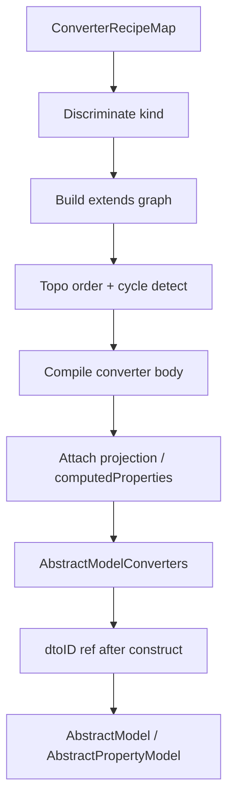

# Definition DX Hardening - Plan

## Goal Capsule

- **Objective:** Make the shipped model-definition DX correct and Job-capable — fix broken `extends` composition, resolve converter parents order-independently, bind `dtoID` properly, and support per-converter `projection` / `computedProperties` via a hybrid recipe + raw-converter surface.
- **Product authority:** This plan owns hardening of the definition helpers and recipe compiler only. Broader library v2 work (CRUD redesign, container rewrite, app-layer access wrappers) remains surrounding context, not active scope.
- **Stop conditions:** Stop when recipe correctness, `dtoID` binding, hybrid converter metadata, and acceptance examples below are satisfied; do not migrate `usage/` or redesign query APIs here.
- **Open blockers:** None.

---

## Product Contract

**Product Contract preservation:** unchanged — planning resolved deferred HOW questions in Key Technical Decisions without altering R1–R12 meaning.

### Summary

Harden the definition DX compile pipeline so declarative converters compose correctly and can carry the same per-converter options the runtime already understands (`projection`, `computedProperties`).
`dtoID` defaults to the model instance method, with an optional config override.
A raw `{ converter, … }` form remains the escape hatch for Job-scale hand-written converters.

### Problem Frame

The first definition-DX ship left `extends` unusable: pure `{ extends }` throws a false circular error, and `{ extends, pick }` is misclassified as a DBE pick.
Parents resolve only if already compiled, so declaration order silently fails.
Helpers compile with `String(id)`, so subclass `dtoID` overrides never reach auto/`rename`/`pick` ids.
Recipes never emit `projection` or converter-level `computedProperties`, so Ramp-style models cannot leave hand-built converter maps.

### Key Decisions

- **Full hardening in one coherent unit** — correctness, `dtoID`, and hybrid metadata ship together. (session-settled: user-directed — chosen over correctness-only or correctness+dtoID: Job-scale needs metadata too) Governs R1–R12.
- **One compile-pipeline rewrite** — treat discrimination, topo `extends`, and metadata attach as one recipe-compiler surface (`dtoID` bind is separate — see KTD5/U2). (session-settled: user-approved — chosen over split PRs or raw-as-main-path: avoids rewriting compile twice) Governs R1–R8.
- **Hybrid converter surface** — optional `projection` / `computedProperties` on any recipe, plus raw `{ converter, projection?, computedProperties? }` (with `{ custom, … }` as a thin alias). (session-settled: user-directed — chosen over siblings-only or custom/raw-only: strongest for simple and Job-scale) Governs R5–R8.
- **Instance `dtoID` by default, config override when set** — recipe id mapping uses the live model `dtoID` unless config supplies one. (session-settled: user-directed — chosen over compile-only or instance-only: matches subclass overrides and rare compile hooks) Governs R9, R10.
- **Order-independent `extends`** — resolve parents by dependency; cycles still error. (session-settled: user-directed — chosen over declaration-order-only: declaration order must not change meaning) Governs R3, R4.

<!-- ce-section: work-relationships -->
### How This Work Fits Together

This plan hardens the definition DX shipped in `docs/plans/2026-09-02-001-feat-model-definition-dx-plan.md`.
The broader v2 understanding below is contextual, not a committed roadmap.

- **Definition DX hardening** (this plan) — recipe correctness, `dtoID`, hybrid converter metadata
  - **Depends on:** definition helpers and recipe compiler from the prior plan
  - **Enables:** migrating Job-scale converter maps onto definition config without losing projection / computed-property behavior
  - **Can proceed independently of:** CRUD signature redesign and container rewrite
- Later candidates (not active scope)
  - **Public query/CRUD surface redesign** — Can proceed independently
  - **Models container / registry DX** — Can proceed independently once definition maps are trustworthy
  - **`from` inbound converters in the recipe DSL** — Shares converter map concepts; deferred
  - **`usage/` migration** — Depends on this hardening for faithful Job converters

### Requirements

**Correctness**

- R1. Pure `{ extends: 'parent' }` recipes compose from the named parent converter and do not throw a circular error when no cycle exists.
- R2. Recipes that combine `extends` with `pick` and/or `omit` apply those transforms to the parent converter’s output, not as a DBE-only pick/omit.
- R3. `extends` resolution is order-independent across the converters map; only true cycles throw a descriptive circular error.
- R4. Recipe kind discrimination prefers `extends` / `rename` / `custom` / raw `converter` over optional sibling keys such as `pick` so combined forms are not misrouted.

**Hybrid converter metadata**

- R5. Any declarative recipe may optionally declare `projection` and/or `computedProperties`; compiled converters expose those fields to the existing runtime.
- R6. A raw form `{ converter, projection?, computedProperties? }` is accepted in the converters map and compiles through unchanged aside from `dtoID` context where applicable.
- R7. `{ custom: fn, projection?, computedProperties? }` remains valid and equivalent to the raw form for the function body.
- R8. Model-level `smartFilters` / `computedProperties` in definition config continue to work; converter-level `computedProperties` are distinct and attach per named conversion.

**dtoID binding**

- R9. Unless config overrides it, auto/`pick`/`omit`/`rename` id mapping uses the model instance’s `dtoID` at conversion time (including plain `defineModel` / `definePropertyModel` instances).
- R10. Definition config may supply a `dtoID` override; when set, recipe id mapping uses that function instead of the instance method.

**Compatibility / non-regression**

- R11. Existing passing behaviors (default auto dto/dbe, standalone pick/omit/rename/custom without extends bugs, property helpers) continue to pass with updated tests that catch the prior false greens.
- R12. `from` inbound converters, CRUD API shape, models container, and `usage/` migration are unchanged by this plan.

### Acceptance Examples

- AE1. Pure extends
  - **Covers:** R1, R3
  - **Given:** `suggestDTO: { rename: { id: '_id', label: 'name' } }` and `listItemDTO: { extends: 'suggestDTO' }` in either declaration order
  - **When:** converters are compiled and `listItemDTO` runs on `{ _id: '1', name: 'Tag', type: 'x' }`
  - **Then:** result is `{ id: '1', label: 'Tag' }` with no throw

- AE2. Extends + pick (true composition)
  - **Covers:** R2, R4
  - **Given:** the same `suggestDTO` and `listItemDTO: { extends: 'suggestDTO', pick: ['label'] }`
  - **When:** `listItemDTO` runs
  - **Then:** result is `{ label: 'Tag' }` (not `{ id: '1' }` from a DBE pick)

- AE3. True cycle
  - **Covers:** R3
  - **Given:** `a: { extends: 'b' }` and `b: { extends: 'a' }`
  - **When:** converters are compiled
  - **Then:** a descriptive circular error is thrown (not a false “unknown parent” or self-loop on first name alone)

- AE4. Recipe projection reaches runtime options
  - **Covers:** R5
  - **Given:** a named recipe with `projection: { name: 1 }`
  - **When:** the model is defined and that conversion is inspected
  - **Then:** `converters[name].projection` equals the declared projection

- AE5. Raw converter escape hatch
  - **Covers:** R6, R7
  - **Given:** a map entry `{ converter: fn, projection: { title: 1 }, computedProperties: ['normalizedSalary'] }` (or equivalent `custom` + siblings)
  - **When:** converters are compiled
  - **Then:** the compiled entry preserves `converter`, `projection`, and `computedProperties`

- AE6. Instance dtoID override
  - **Covers:** R9
  - **Given:** a `Model` subclass that overrides `dtoID` to a non-`String` mapping, no config `dtoID`
  - **When:** auto `dto` converts a document
  - **Then:** `id` equals the subclass `dtoID` result

- AE7. Config dtoID override
  - **Covers:** R10
  - **Given:** definition config supplies `dtoID` and the class also overrides `dtoID`
  - **When:** auto `dto` converts a document
  - **Then:** `id` equals the config function’s result

### Scope Boundaries

- In scope: recipe compiler correctness; hybrid metadata; raw converter form; `dtoID` bind on root and property definition helpers; tests that replace false-green extends coverage.
- Deferred for later: recipe DSL for `from` converters; `usage/` migration; stronger end-to-end type inference polish beyond what’s needed to compile the new forms.
- Outside this product’s identity here: CRUD/`get`/`list` redesign; models container rewrite; Ramp access/soft-delete wrappers.

### Dependencies / Assumptions

- Runtime already reads `converters[name].projection` and converter-level `computedProperties` from `AbstractConverterOptions` (`src/types/internal.ts`); this plan only makes definition compile emit them.
- Prior plan’s public names (`defineModel`, `Model`, `definePropertyModel`, `PropertyModel`, recipe kinds) stay; this plan hardens behavior rather than renaming the API.

### Outstanding Questions

None blocking. Deferred HOW items resolved in Planning Contract KTDs.

### Sources / Research

- Grounding dossier (session): recipe stack seeding, pick-before-extends discriminant, `String(id)` compile hook, `AbstractConverterOptions` fields — verified against `src/converter-recipes.ts`, `src/define-model.ts`, `src/define-property-model.ts`, `src/types/internal.ts`.
- Prior plan: `docs/plans/2026-09-02-001-feat-model-definition-dx-plan.md` (KTD3/KTD4 anticipated dtoID hook and extends composition).
- Consumer pressure: `usage/models/job/converters.ts` and `usage/models/application/converters.ts` rely on per-converter `projection` / `computedProperties`.

---

## Planning Contract

### Key Technical Decisions

- KTD1. **Discriminate by required kind keys first** — detect recipes in order: `'auto'` → raw `{ converter }` → `{ custom }` → `{ extends }` → `{ rename }` → `{ pick }` → `{ omit }`. Optional siblings (`pick`/`omit`/`projection`/`computedProperties`) never select the kind. Governs R2, R4, R5–R7.
- KTD2. **Topo-compile `extends`** — build a dependency graph from `extends` edges (defaults `dto`/`dbe` are pre-seeded); compile in dependency order; on cycle emit `ConverterRecipeError` listing the cycle path. Unknown parent (not in map and not a default) still errors. Governs R1, R3. (session-settled: user-directed — chosen over declaration-order-only: declaration order must not change meaning)
- KTD3. **Attach metadata after body compile** — for every recipe (including `'auto'` overrides and raw/`custom`), copy optional `projection` / `computedProperties` onto the compiled `AbstractConverterOptions` object. Governs R5–R8. (session-settled: user-directed — hybrid siblings + raw escape)
- KTD4. **Rename may apply optional `pick` after rename** — if a rename recipe also lists `pick`, filter the renamed output keys; do not treat that object as a pick recipe. Prefer `extends` + `pick` for deriving from another named converter. Governs R4. (session-settled: user-approved — chosen over disallowing rename+pick: confirmed at plan scoping)
- KTD5. **`dtoID` via mutable bind ref** — compile converters against `ctx.dtoID` that reads a shared `{ current }` ref. After `super(...)` in definition-constructed classes, if config has no `dtoID`, set `current = (id) => this.dtoID(id)`; if config has `dtoID`, leave `current` as that function for the model’s lifetime. Applies to `defineModel`, `Model`, `definePropertyModel`, and `PropertyModel`. Governs R9, R10. (session-settled: user-directed — instance default + config override; plan scoping confirmed rebind for plain define helpers too)
- KTD6. **Config gains optional `dtoID`** — add `dtoID?: (id: unknown) => string` on root and property definition configs (`RootModelDefinition` / `PropertyModelDefinition` / define configs). Governs R10.
- KTD7. **Types for hybrid recipes** — extend recipe object types with optional `projection?` / `computedProperties?`; add `RawConverterRecipe` with required `converter`; keep `custom` as alias for function body. Map entries remain `ConverterRecipe | RawConverterRecipe`. Governs R5–R7.

### High-Level Technical Design



Shared modules stay `src/converter-recipes.ts`, `src/default-converters.ts`, `src/types/definition.ts`, `src/define-model.ts`, `src/define-property-model.ts`.
Runtime `AbstractModel` / `ConverterManager` unchanged except consuming richer compiled options.

Directional recipe shape (not implementation spec):

```ts
converters: {
  dto: 'auto',
  basicDTO: { pick: ['name'], projection: { name: 1 } },
  suggestDTO: { rename: { id: '_id', label: 'name' } },
  listItemDTO: { extends: 'suggestDTO', pick: ['label'] }, // order-independent
  adminDTO: {
    custom: async (dbe) => ({ ... }),
    projection: { title: 1 },
    computedProperties: ['normalizedSalary'],
  },
  // or raw:
  // adminDTO: { converter: fn, projection: {...}, computedProperties: [...] }
}
```

### Assumptions

- `compileConverters` remains synchronous; async work stays inside converter functions.
- Shared converter maps across multiple model instances that override `dtoID` differently are unsupported — each definition helper owns its bind ref.
- The bind ref is per defined class (shared by all instances of that class); last constructor rebind wins. Instance-sensitive `dtoID` needs a single live instance per class or a config-level `dtoID` override.
- No change to public CRUD option shapes (`{ as: 'dto' }` etc.).

### Sequencing

1. Types + discriminant + topo + metadata in recipe compiler (with tests that fail today’s false greens)
2. `dtoID` bind ref + config field on definition helpers
3. Root + property helper wiring and AE6/AE7 coverage
4. Export / build verification

---

## Implementation Units

### U1. Recipe compiler correctness and hybrid metadata

- **Goal:** Fix discriminant/`extends`/topo and emit optional projection / computedProperties / raw converter forms.
- **Requirements:** R1–R8, R11; KTD1–KTD4, KTD7
- **Dependencies:** none
- **Files:** `src/types/definition.ts`, `src/converter-recipes.ts`, `src/tests/converter-recipes.test.ts`
- **Approach:**
  1. Extend recipe types with optional metadata siblings and `RawConverterRecipe`.
  2. Rewrite discrimination per KTD1; fix circular stack to track visiting parents (not seed with self).
  3. Topo-sort `extends` dependencies; compile defaults first; preserve unknown-parent errors.
  4. After compiling each body, attach `projection` / `computedProperties` when present.
  5. Replace false-green extends test; add AE1–AE5 compiler-level cases (including reverse declaration order and rename+pick).
- **Patterns to follow:** existing `ConverterRecipeError`; `AbstractConverterOptions` in `src/types/internal.ts`.
- **Test scenarios:**
  - Covers AE1. Pure extends either declaration order.
  - Covers AE2. Extends + pick yields parent-output pick (`label`), not DBE pick.
  - Extends + omit yields parent-output omit (not DBE-only omit).
  - Covers AE3. Mutual extends throws cycle path error.
  - Covers AE4/AE5. Projection and raw/`custom` metadata preserved on compiled entry.
  - Rename + pick filters renamed keys.
  - Standalone pick/omit/rename/custom and auto dto/dbe still pass (R11).
- **Verification:** `src/tests/converter-recipes.test.ts` green; `npm test` for this file.

### U2. dtoID bind ref and definition config

- **Goal:** Wire instance `dtoID` (default) and config override into compiled converters for root and property helpers.
- **Requirements:** R6 (dtoID context on compiled/raw converters), R9, R10; KTD5, KTD6
- **Dependencies:** U1
- **Files:** `src/types/definition.ts`, `src/define-model.ts`, `src/define-property-model.ts`, `src/tests/define-model.test.ts`, `src/tests/define-property-model.test.ts` (dtoID cases may live here or shared)
- **Approach:**
  1. Add optional `dtoID` on definition configs.
  2. Introduce a small bind-ref helper used by both define modules: compile with `dtoID: (id) => ref.current(id)`; after `super`, rebind unless config override set.
  3. Ensure `defineModel` / `definePropertyModel` instances rebind to `this.dtoID` the same as `Model` / `PropertyModel` subclasses.
- **Patterns to follow:** current `buildExtensions` / `buildPropertyExtensions` structure; `AbstractModel.dtoID` default identity cast.
- **Test scenarios:**
  - Covers AE6. `Model` subclass override affects auto dto `id`.
  - Covers AE7. Config `dtoID` wins over subclass override.
  - Mirror AE6/AE7 on `PropertyModel` / `definePropertyModel` (instance override + config override).
  - Smoke: `defineModel` without override still produces string ids via instance `dtoID` path (no throw; id stable).
- **Verification:** define-model / define-property-model tests green.

### U3. Exports and full verification

- **Goal:** Confirm public types/exports still resolve; full suite and build clean.
- **Requirements:** R11, R12
- **Dependencies:** U1, U2
- **Files:** `src/index.ts` (only if new types need explicit re-export), `src/types/index.ts` as needed
- **Approach:**
  1. Ensure `RawConverterRecipe` / updated definition types flow through existing `export *` paths.
  2. Run full test + build; no `usage/` changes.
- **Test scenarios:**
  - Existing suite remains green.
  - `npm run build` emits `.d.ts` without new TS6133/TS4094 regressions from helper return types.
- **Verification:** `npm test` and `npm run build` pass.

---

## Verification Contract

| Gate | Command | Applies to |
| --- | --- | --- |
| Unit tests | `npm test` | all units |
| Typecheck + emit | `npm run build` | U1–U3 |

**Quality gates before merge:**

- AE1–AE7 covered by automated tests.
- Prior false-green extends case replaced so AE2 would fail on the old discriminant bug.
- No regressions in existing `src/tests/*.test.ts`.

---

## Definition of Done

**Global**

- [ ] R1–R12 satisfied by shipped behavior
- [ ] AE1–AE7 covered by automated tests
- [ ] `artifact_readiness: implementation-ready` plan matches implemented surface
- [ ] `npm test` and `npm run build` pass on branch

**Per unit**

- [ ] **U1** — recipe compiler + hybrid metadata + fixed extends tests
- [ ] **U2** — dtoID bind ref + config override on root/property helpers
- [ ] **U3** — exports + full test/build green
