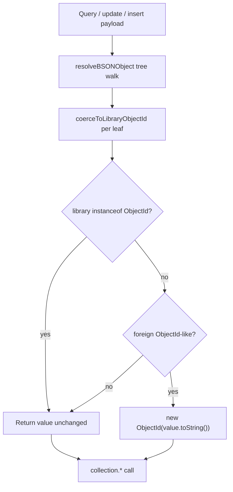

# Cross-Package ObjectId Normalization - Plan

## Goal Capsule

- **Objective:** Make MongoDB queries succeed when the consumer app installs a different copy of the `mongodb` package than this library, by rewriting foreign ObjectId-like values to the library's ObjectId at every payload boundary before the driver is called.
- **Product authority:** This plan owns runtime ObjectId normalization at MongoDB push boundaries only. Peer-dependency migration, monorepo dedupe tooling, and refactors of non-query helpers (`old/`, hash/stringify utilities) are surrounding context, not active scope unless planning finds a query-path dependency.
- **Stop conditions:** Stop when all acceptance examples pass and every audited collection call path normalizes foreign ObjectIds; do not redesign CRUD APIs or model definition DX here.
- **Open blockers:** None.

---

## Product Contract

**Product Contract preservation:** unchanged — planning resolved deferred HOW questions in Key Technical Decisions without altering R1–R7 meaning.

### Summary

Extend the central BSON resolution walk so ObjectId-like values from another `mongodb` install are detected without `instanceof`, re-wrapped with the library's `ObjectId`, and applied to every filter, update, insert, and aggregation payload sent to `collection.*`.

### Problem Frame

Node resolves `mongodb` separately for this library and for the consumer when both depend on it directly.
`instanceof ObjectId` then fails across package copies: `new ObjectId()` in the app is not an instance of the library's `ObjectId` class.
The library gates BSON handling on `instanceof ObjectId` in `resolveBSONValue` and related helpers, so filters and queries built with the consumer's ids are not recognized and do not match documents.

### Key Decisions

- **Central rewrite at MongoDB push (Approach A)** — normalize foreign ObjectIds in the BSON resolution walk and audit bypass paths, rather than replacing every internal `instanceof` site or relying on peer-dependency discipline alone. (session-settled: user-directed — chosen over scattered `instanceof` refactors and package-only fixes: query push is the contract; dual installs must work at runtime) Governs R1–R5.
- **Detect by ObjectId shape, not `instanceof` alone** — treat a value as foreign ObjectId-like when it resembles BSON ObjectId (e.g. `constructor.name === 'ObjectId'` and/or `_bsontype === 'ObjectId'`) but fails the library's `instanceof ObjectId`. Governs R2.
- **Re-wrap via string conversion** — rewrite foreign instances with `new ObjectId(value.toString())` (or equivalent hex-safe conversion), matching existing `$oid` handling. Governs R2, R3.

### Requirements

**Normalization behavior**

- R1. Before any payload reaches `collection.find*`, `collection.update*`, `collection.delete*`, `collection.insert*`, or `collection.aggregate`, every nested ObjectId-like value in that payload must be rewritten to an instance of the library's `ObjectId`.
- R2. The central BSON value resolver must detect foreign ObjectId-like values without relying on `instanceof ObjectId` alone, and return a library-native `ObjectId` for them.
- R3. Native library ObjectIds (those that already pass `instanceof ObjectId` for the library's import) must pass through unchanged — no double allocation or altered bytes when the value is already correct.
- R4. Existing extJSON handling (`{ $oid: string }` → `ObjectId`) must continue to work and must not regress.

**Coverage of push paths**

- R5. Every code path that constructs arguments for `collection.*` must route through the same normalization rule. Paths that today bypass `resolveBSONObject` — including match filters built from `dbeID`, update operators from `toUpdateOperations`, and insert/replace document bodies — must be included in the audit and closed.
- R6. Aggregation pipelines built for list, count, cursor, and custom aggregate entry points must normalize ObjectIds inside `$match`, `$lookup` expressions, and nested stage documents before execution.

**Non-goals for this change**

- R7. Internal helpers used only for hashing, logging, or display (outside MongoDB push) do not need `instanceof` refactors in this work unless a failing acceptance example proves they block a query path.

### Key Flows

- F1. Consumer filter with foreign ObjectId
  - **Trigger:** Consumer passes a filter containing `new ObjectId()` from their `mongodb` copy into a model list/get/update/delete method.
  - **Steps:** Model builds query options → BSON resolver walks filter tree → foreign ObjectId detected and re-wrapped → pipeline or direct filter sent to `collection.*` → query matches the intended document.
  - **Outcome:** Same query semantics as when consumer and library share one `mongodb` install.
  - **Covers:** R1, R2, R5, R6.

- F2. Update match built from `dbeID`
  - **Trigger:** Consumer passes a foreign ObjectId (or string id converted by overridden `dbeID`) into `update` / `delete` / `updateMany`.
  - **Steps:** Match document assembled → normalization runs before `collection.updateOne` / `deleteOne` → driver receives library ObjectId on `_id`.
  - **Outcome:** Single-document mutations succeed with foreign ids.
  - **Covers:** R1, R5.

- F3. Insert with nested foreign references
  - **Trigger:** Document body for `insertOne` / upsert contains foreign ObjectIds in nested fields.
  - **Steps:** Document normalized at push boundary → insert proceeds with library ObjectIds throughout.
  - **Outcome:** Stored document references remain queryable through subsequent filters.
  - **Covers:** R1, R5.

### Acceptance Examples

- AE1. Foreign ObjectId in filter
  - **Covers:** R1, R2, F1.
  - **Given:** Consumer app depends on its own `mongodb` copy; library depends on another; consumer creates `const id = new ObjectId()` from their copy.
  - **When:** Consumer calls a model method with `{ _id: id }` (or equivalent filter containing that id).
  - **Then:** The query returns the matching document (or applies the mutation) as it would with a shared install; no silent empty result from unrecognized ObjectId type.

- AE2. Native ObjectId unchanged
  - **Covers:** R3.
  - **Given:** A value is already an instance of the library's `ObjectId`.
  - **When:** It passes through the BSON resolver on the way to MongoDB.
  - **Then:** The same instance (or byte-equivalent value) is sent to the driver without unnecessary re-wrap.

- AE3. ExtJSON `$oid` still works
  - **Covers:** R4.
  - **Given:** A filter value `{ $oid: '<24-char hex>' }`.
  - **When:** Resolved before query push.
  - **Then:** Becomes a library `ObjectId` with that hex value, as today.

- AE4. Bypass path closed — update by id
  - **Covers:** R5, F2.
  - **Given:** Foreign ObjectId passed to `update(id, …)` where match is `{ _id: dbeID(id) }` without going through list-filter resolution.
  - **When:** Update executes.
  - **Then:** `matchedCount` reflects the target document; foreign id was normalized at push.

### Scope Boundaries

- Deferred for later: migrating `mongodb` to a peer dependency, npm dedupe guidance, and install-time enforcement of a single copy.
- Deferred for later: refactoring all ~26 internal `instanceof ObjectId` sites for hash/stringify helpers unless query acceptance requires it (per R7).
- Outside active scope: `old/` mirror parity, CRUD API redesign, definition DX changes, and consumer `dbeID`/`dtoID` default semantics beyond what push normalization requires.

### Deferred to Follow-Up Work

- Document for consumers that a single `mongodb` install is still preferable even though runtime normalization exists.
- Optional public export of `coerceToLibraryObjectId` if downstream packages build raw filters outside model methods.

### Dependencies / Assumptions

- Assumption: Foreign ObjectId-like values from another `mongodb` copy expose a usable `toString()` / hex representation equivalent to the intended 24-character id.
- Assumption: Dual-package failure is the primary reported symptom; fixing push-boundary normalization addresses consumer queries without requiring them to change how they construct ids.
- Dependency: Existing BSON resolution entry points in `src/helpers/mongo.ts` and their call sites in `src/model.ts`, `src/property-model.ts`, and `src/pipeline-builder.ts`.

---

## Planning Contract

### Summary

Add shape-based foreign ObjectId detection and re-wrap in `resolveBSONValue`, then route every direct `collection.*` argument through `resolveBSONObject` (including match filters, update operators, and insert bodies that bypass it today). Cover with focused unit tests using a synthetic foreign ObjectId stand-in.

### Key Technical Decisions

- **KTD1. OR-based shape detection with hex validation** — treat a non-null object as foreign ObjectId-like when it is not a library `instanceof ObjectId` and either `_bsontype === 'ObjectId'` or `constructor.name === 'ObjectId'`, and `ObjectId.isValid(value.toString())` is true. Governs R2. Rationale: matches BSON cross-realm conventions; hex validation limits false positives from arbitrary `{ constructor: { name: 'ObjectId' } }` objects.
- **KTD2. Single coercion helper** — implement `coerceToLibraryObjectId(value)` in `src/helpers/mongo.ts`; call it from `resolveBSONValue` before the existing early-return branch. Governs R2, R3. Rationale: one implementation point; bypass paths reuse `resolveBSONObject` rather than duplicating coercion logic.
- **KTD3. Close bypass paths via `resolveBSONObject`, not new API** — wrap match filters, `toUpdateOperations` results, and insert/replace document bodies with `resolveBSONObject` at the call site in `src/model.ts` and `src/property-model.ts`. Governs R5. Rationale: reuses the recursive walk; no new public surface; aggregation paths already resolve via `pipeline-builder.ts`.
- **KTD4. Normalize inside `toUpdateOperations` output path** — after building the `$set` / operator document, return `resolveBSONObject(result)` so update payloads with nested foreign ids normalize without touching every caller individually. Governs R5. Rationale: `model.ts` and `property-model.ts` both call `toUpdateOperations`; centralizing here closes two call sites at once. Match filters still need explicit wraps at call sites.

### High-Level Technical Design

**Bypass audit (closed by this plan):**

| Location | Today | Fix |
|---|---|---|
| `src/model.ts` `update` / `delete` match | `{ _id: dbeID(id) }` raw | `resolveBSONObject({ _id: dbeID(id) })` before `#access.match` |
| `src/model.ts` `updateMany` match | `{ _id: { $in: ids.map(dbeID) } }` raw | wrap with `resolveBSONObject` |
| `src/model.ts` `create` insert body | `{ ...dbe, _id: dbeID(_id) }` raw | wrap with `resolveBSONObject` |
| `src/model.ts` / `property-model.ts` updates | `toUpdateOperations(update)` raw | normalize inside `toUpdateOperations` (KTD4) |
| `src/property-model.ts` nested `updateOne` | filter/update with `dbeID` raw | wrap filter and update doc with `resolveBSONObject` |
| `src/pipeline-builder.ts` pipelines | already uses `resolveBSONObject` | extend leaf coercion only (U1) |

List/get/aggregate option paths already call `resolveBSONObject(options)` — foreign ids in consumer filters are covered once U1 lands.

### Open Questions

- **Deferred to implementation:** Whether minified bundles dropping `constructor.name` require documenting `_bsontype` as the supported cross-package signal for consumers building custom id objects (no product behavior change expected).

---

## Implementation Units

### U1. Foreign ObjectId detection and coercion

- **Goal:** Implement shape-based detection and re-wrap in the central BSON resolver.
- **Requirements:** R1, R2, R3, R4.
- **Dependencies:** None.
- **Files:** `src/helpers/mongo.ts`, `src/tests/helpers.test.ts`
- **Approach:**
  1. Add `isLibraryObjectId(value)` — `value instanceof ObjectId` using the library import.
  2. Add `isForeignObjectIdLike(value)` — per KTD1; exclude arrays, Dates, RegExp, null, primitives.
  3. Add `coerceToLibraryObjectId(value)` — if library instance return as-is; if foreign-like return `new ObjectId(value.toString())`; else return value.
  4. In `resolveBSONValue`, replace the early `instanceof ObjectId` branch with `coerceToLibraryObjectId(value)` when the value is object-typed and not handled by extJSON `$oid` / `$date` branches.
  5. Keep `$oid` handling unchanged and ordered before deep object walk.
- **Patterns to follow:** Existing `$oid` → `new ObjectId(value.$oid)` in `resolveBSONValue`; recursive walk in `resolveBSONObject`.
- **Test scenarios:**
  - Covers AE2. Library `ObjectId` passed through `resolveBSONValue` returns same reference.
  - Covers AE3. `{ $oid: '<valid hex>' }` still becomes library `ObjectId` with matching hex.
  - Covers AE1 (unit level). Synthetic foreign stand-in with `_bsontype: 'ObjectId'` and valid hex `toString()` becomes library `instanceof ObjectId` after `resolveBSONObject({ _id: foreign })`.
  - Synthetic foreign with `constructor.name === 'ObjectId'` and valid hex also coerces.
  - Plain object `{ foo: 1 }` unchanged.
  - Nested filter `{ a: { b: foreign } }` coerces at depth.
  - Invalid hex on foreign-like object left unchanged (no throw).
- **Verification:** `npm test -- src/tests/helpers.test.ts` passes; new cases green.

### U2. Normalize update payloads in `toUpdateOperations`

- **Goal:** Ensure update operator documents sent to MongoDB normalize nested foreign ObjectIds.
- **Requirements:** R1, R5.
- **Dependencies:** U1.
- **Files:** `src/helpers/mongo.ts`, `src/tests/helpers.test.ts`
- **Approach:**
  1. At end of `toUpdateOperations`, return `resolveBSONObject(result)` instead of raw result.
  2. When input is already an operator document (`$set`, `$unset`, etc.), still walk the full structure.
- **Patterns to follow:** Existing `toUpdateOperations` plain-object → `$set` wrapping.
- **Test scenarios:**
  - Plain partial update containing foreign ObjectId in a field becomes library ObjectId inside `$set`.
  - Operator-form update `{ $set: { ref: foreign } }` coerces nested value.
  - Non-ObjectId fields unchanged.
- **Verification:** Existing `toUpdateOperations` test still passes; new coercion cases green.

### U3. Close match and insert bypass paths in models

- **Goal:** Route direct match filters and insert bodies through `resolveBSONObject` before `collection.*`.
- **Requirements:** R5, R6; Covers AE4.
- **Dependencies:** U1.
- **Files:** `src/model.ts`, `src/property-model.ts`
- **Approach:**
  1. `src/model.ts`: wrap `create` insert payload; wrap `update` / `delete` / `updateMany` match objects before `#access.match`.
  2. `src/property-model.ts`: wrap `updateOne` / `updateMany` match filters and the inline `updateOne` at nested property path (filter + update document).
  3. Do not change default `dbeID` / `dtoID` identity behavior — normalization happens after `dbeID`.
- **Patterns to follow:** Existing `resolveBSONObject(options)` usage in list/aggregate methods.
- **Test scenarios:**
  - **Integration-style (mock collection):** optional lightweight test if model test harness exists; otherwise rely on U1/U2 unit coverage plus manual verification note.
  - Document in verification contract that AE4 is proven by unit coercion + match wrap code review.
- **Verification:** `npm test` full suite passes; grep confirms no remaining raw `{ _id: this.dbeID(` passed directly to `collection.*` without `resolveBSONObject`.

---

## Verification Contract

- **Unit tests:** `npm test -- src/tests/helpers.test.ts` — all new ObjectId coercion scenarios.
- **Full suite:** `npm test` — no regressions across existing 41+ tests.
- **Build:** `npm run build` — TypeScript emits cleanly.
- **Manual spot-check (optional):** In a consumer with two `mongodb` copies, `model.get({ filter: { _id: foreignId } })` returns a document when the hex matches.

---

## Definition of Done

- R1–R6 satisfied: every audited `collection.*` argument path normalizes foreign ObjectIds.
- AE1–AE4 covered by automated tests (AE4 via U1 coercion + U3 match wraps; integration test optional).
- No change to public API surface unless an export is explicitly added in follow-up.
- Product Contract preservation note remains accurate; no scope creep into `old/` or peer-dependency migration.
