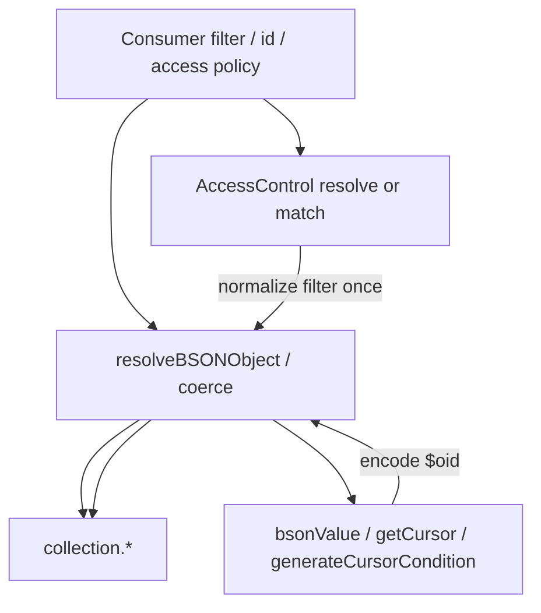

# Runtime Hardening Finish - Plan

## Goal Capsule

- **Objective:** Make the library dual-`mongodb`-install safe on every Mongo-affecting path (including access filters and cursor round-trips), land graceful models `shutdown`, and document that one `mongodb` copy is preferred while dual copies still work at runtime.
- **Product authority:** This plan owns runtime ObjectId correctness under dual package copies, shutdown behavior for `AbstractModels`, and a short consumer install note. Validation/typechecker, full package README/CI maturity, peer-dependency migration, and consumer migration tooling are surrounding context from the broader “next level” brainstorm — not active scope.
- **Stop conditions:** Stop when dual-install correctness acceptance examples pass for push paths, access filters, and cursors; shutdown acceptance examples pass; and the short install note exists. Do not move `mongodb` to a peer dependency or export coercion helpers.
- **Open blockers:** None.

---

## Product Contract

**Product Contract preservation:** unchanged — planning resolved HOW without altering R1–R10 meaning.

### Summary

Finish runtime hardening as one outcome: close ObjectId dual-package holes on every path that can make Mongo or pagination wrong, ship graceful `shutdown`, and add a short README note that prefers a single `mongodb` install without changing how the package depends on it.

### Problem Frame

Consumers may resolve a different `mongodb` copy than the library. `instanceof ObjectId` then fails across package boundaries, so filters and ids that look correct can miss documents. Partial normalization already exists in working tree / prior planning, but access-policy filters and cursor encode/decode can still carry foreign ObjectIds into Mongo or break pagination. Graceful process teardown also needs a first-class `shutdown` contract. Install guidance was deferred earlier and is still missing (no package README today).

### Key Decisions

- **Unified hardening finish** — land ObjectId correctness, shutdown, and a short install note together rather than committing partial ObjectId/shutdown first and hardening later. (session-settled: user-directed — chosen over land-now/harden-next and docs-led dual-copy-unsupported: do not ship known dual-install holes) Governs R1–R10.
- **`mongodb` stays a normal dependency** — prefer one copy via docs only; do not switch to peerDependencies. (session-settled: user-directed — chosen over peerDep and peerDep-with-hard-preference: keep install simple; coercion is the safety net) Governs R8, R9.
- **Coercion helpers stay internal** — no public `coerceToLibraryObjectId` (or equivalent) export. (session-settled: user-directed — chosen over public coerce or public `resolveBSONObject` only: consumers use model APIs) Governs R7.
- **Access filters are first-class push paths** — ObjectIds returned from access policies normalize before Mongo like consumer filters. (session-settled: user-directed — chosen over docs-only or “app must use library ObjectIds”) Governs R2.
- **Correctness audit bar** — cover every path that can make Mongo results or cursor pagination wrong under dual install; skip pure hash/display `instanceof` sites unless they feed a query path. (session-settled: user-approved — chosen over full internal `instanceof` cleanup) Governs R1–R4.
- **Short README install note** — prefer one `mongodb` copy; dual copies still work via runtime normalization; keep `mongodb` as a normal dependency. (session-settled: user-directed — chosen over a dedicated monorepo/dedupe section or minimal one-liner elsewhere) Governs R9.

### Requirements

**ObjectId dual-install correctness**

- R1. Before any payload reaches a Mongo collection call that reads or writes data, nested ObjectId-like values from another `mongodb` copy must be rewritten to the library’s ObjectId (native library ObjectIds and existing `$oid` handling must not regress).
- R2. Filters produced by access policies (named policies / `accessFilter`) must receive the same ObjectId normalization before they are merged into matches or aggregation `$match` stages.
- R3. Cursor encode/decode used for list/stream pagination must round-trip correctly when sort keys contain foreign ObjectId-like values (no silent wrong page / broken cursor under dual install).
- R4. The hole-close pass must audit every public Model and PropertyModel path that can affect Mongo results or cursors under dual install, and close gaps that fail R1–R3; helpers used only for hash, logging, or display stay out unless the audit proves they feed a query or cursor path.

**Shutdown**

- R5. `AbstractModels` exposes idempotent `shutdown` that stops accepting new work, waits for in-flight tracked operations up to an optional timeout, then closes the shared client.
- R6. After shutdown, model queries and transactions fail with a clear shutdown error; a later models instance for the same connection string may obtain a fresh client.
- R7. Coercion / ObjectId normalization helpers used for R1–R4 are not part of the public package API.

**Install guidance**

- R8. The package continues to declare `mongodb` as a normal dependency (not a peer dependency) as part of this work.
- R9. A short README note states that consumers should prefer a single `mongodb` install, that dual copies still work via runtime normalization, and that `mongodb` remains a normal dependency of this package.

**Compatibility**

- R10. This work completes and supersedes the unfinished dual-package ObjectId product intent from `docs/plans/2026-09-02-003-fix-objectid-dual-package-plan.md` for active requirements; peer-dependency migration and public coerce export remain out of scope as in that plan’s deferred items.

### Key Flows

- F1. Foreign ObjectId in consumer filter
  - **Trigger:** App passes a filter containing an ObjectId from its own `mongodb` copy into list/get/update/delete.
  - **Steps:** Payload walks through normalization → library ObjectId reaches the driver → query or mutation hits the intended document.
  - **Outcome:** Same semantics as a shared `mongodb` install.
  - **Covers:** R1, R4.

- F2. Access policy filter with foreign ObjectId
  - **Trigger:** Named access policy returns a filter containing a foreign ObjectId-like value.
  - **Steps:** Access filter is normalized before merge into match / `$match` → driver receives library ObjectIds.
  - **Outcome:** Access scoping works under dual install.
  - **Covers:** R2, R1.

- F3. Cursor pagination with ObjectId sort key
  - **Trigger:** List/stream uses a sort that includes an ObjectId field while dual copies are present.
  - **Steps:** Cursor encodes/decodes without losing identity → next/prev page continues correctly.
  - **Outcome:** Pagination does not break solely because of dual-package ObjectIds.
  - **Covers:** R3.

- F4. Graceful shutdown
  - **Trigger:** App calls `shutdown` (optionally with timeout) during process teardown.
  - **Steps:** New work is rejected; in-flight work drains up to timeout; client closes; later instance can reconnect.
  - **Outcome:** Clean teardown without hanging forever when timeout is set.
  - **Covers:** R5, R6.

### Acceptance Examples

- AE1. Foreign ObjectId in filter matches
  - **Covers:** R1, F1.
  - **Given:** Consumer and library resolve different `mongodb` copies; consumer creates an id from its copy.
  - **When:** That id is used in a model filter or id argument that reaches Mongo.
  - **Then:** The operation affects the intended document (no silent empty miss from unrecognized ObjectId type).

- AE2. Access filter foreign ObjectId
  - **Covers:** R2, F2.
  - **Given:** An access policy returns a filter with a foreign ObjectId-like value.
  - **When:** A read or write applies that policy.
  - **Then:** The merged match uses library ObjectIds and scopes correctly.

- AE3. Cursor round-trip under dual install
  - **Covers:** R3, F3.
  - **Given:** Sort includes an ObjectId field and values may be foreign ObjectId-like at encode or decode time.
  - **When:** A cursor is issued and consumed for the next page.
  - **Then:** Pagination continues on the correct boundary documents.

- AE4. Shutdown rejects new work and is idempotent
  - **Covers:** R5, R6, F4.
  - **Given:** A models instance that has been shut down.
  - **When:** `shutdown` is called again, and a query or transaction is attempted.
  - **Then:** Second shutdown is a no-op close; new work fails with shutdown error; a new instance for the same URI can use a fresh client.

- AE5. README install note present
  - **Covers:** R8, R9.
  - **Given:** Package docs after this work.
  - **When:** A consumer reads the README install guidance.
  - **Then:** They see prefer-one-copy, dual-copy-still-works, and normal-dependency posture — without a peerDependency change in package metadata.

### Scope Boundaries

- In scope: dual-install ObjectId correctness on Mongo-affecting and cursor paths (including access filters); landing/completing graceful `shutdown`; short README install note; completing the unfinished ObjectId product intent from the 003 plan for active R1–R4/R10.
- Deferred: moving `mongodb` to peerDependencies; install-time dual-copy enforcement; public export of coercion helpers; monorepo/dedupe how-to beyond the short note; full `instanceof ObjectId` cleanup in hash/display-only helpers.
- Out of scope: validation/typechecker; full package README/CI/publish maturity; consumer Ramp migration helpers; access-policy feature redesign; CRUD API redesign.

### Assumptions and Open Questions

**Assumptions**

- Foreign ObjectId-like values expose a hex/`toString()` representation equivalent to the intended id (same assumption as the 003 ObjectId plan).
- Existing uncommitted ObjectId coercion and `shutdown` implementations are the starting point; this contract requires they meet R1–R6 after the hole-close pass, not that they be redesigned from scratch.

**Outstanding Questions**

- Resolve Before Planning: none.
- Deferred to implementation: whether minified foreign ObjectId stand-ins that drop `constructor.name` require documenting `_bsontype` as the supported cross-package signal (no product behavior change expected).

<!-- ce-section: work-relationships -->
### How This Work Fits Together

This plan owns **runtime hardening leftovers** from the broader “what puts this library at the next level?” brainstorm. Other areas are contextual candidates, not a committed roadmap.

- Consumer migration readiness — Can proceed independently of this plan; not active scope.
- Validation (typechecker) — Can proceed independently of this plan; not active scope.
- Package maturity (full README / CI / publish) — Shares the README surface with R9 but only the short install note is in scope here; fuller maturity Can proceed independently afterward.
- Prior ObjectId plan (`docs/plans/2026-09-02-003-fix-objectid-dual-package-plan.md`) — This plan Completes / supersedes its unfinished active product intent for dual-install correctness; peerDep and public coerce remain deferred as there.
- Named access policies (`docs/plans/2026-09-04-004-feat-named-access-policies-plan.md`) — Already shipped; this plan Depends on that surface existing so R2 can normalize access filters without redesigning access.

---

## Planning Contract

### Summary

Verify and land the existing ObjectId coercion + `shutdown` work, close remaining dual-install holes (access-filter merge, bare aggregate `$match`, cursor encode via `bsonValue`, property filter stages), keep coerce helpers off the public API, and add a minimal README install note. Prefer normalizing access filters once inside `AccessControl` so all consumers inherit.

### Key Technical Decisions

- **KTD1. Treat uncommitted coerce + shutdown as base** — do not rewrite detection/rewrap or shutdown lifecycle; audit against R1–R6, fill gaps, then land. (session-settled: user-approved — chosen over redesign from scratch: working tree already implements 003 intent) Governs R1, R5, R6, R10.
- **KTD2. Normalize access filters at AccessControl boundary** — after a policy returns a filter object, run it through `resolveBSONObject` before returning from `resolve` / `resolveOrDeny` / `match`, so update/delete/aggregate/property paths inherit. (session-settled: user-approved — chosen over per-call-site wraps: one seam covers R2) Governs R2.
- **KTD3. Fix cursor encode in `bsonValue`** — treat foreign ObjectId-like values like library ObjectIds when encoding cursor sort values to `$oid`; keep public cursor string format (`$oid` JSON) unchanged. Governs R3.
- **KTD4. Close residual push-path gaps after AccessControl fix** — bare aggregate `$match` using access filters, and property-model `#filterStages` combining access + cursor, must either inherit KTD2 or wrap with `resolveBSONObject` before Mongo. Governs R1, R2, R4.
- **KTD5. Minimal README, not full package docs** — create `README.md` with package identity plus the short install/ObjectId note only; fuller README maturity stays deferred. (session-settled: user-approved) Governs R8, R9.
- **KTD6. Coerce stays off package exports** — do not add coerce helpers to `src/index.ts`; tests import from helpers module as today. Governs R7.

### High-Level Technical Design

**Known gaps after current working-tree base (close in this plan):**

| Seam | Gap | Fix owner |
|---|---|---|
| `AccessControl` filter return | foreign ObjectIds in policy filters not coerced | KTD2 / U2 |
| Model bare `aggregate` `$match` | `access.filter` used raw | inherits U2 or wrap in U3 |
| Property `#filterStages` | access + cursor combined without resolve | U3 |
| `bsonValue` | `instanceof ObjectId` only | KTD3 / U4 |
| Public exports | confirm coerce not exported | U5 |
| README | missing | U5 |

### Assumptions

- List/stream paths that pass `accessFilter` through `PipelineBuilder` already resolve the options object; KTD2 still required for `match()` and bare aggregate.
- Driver-returned documents used for cursor encode normally carry library ObjectIds; R3 still requires encode to handle foreign-like values if present.
- No institutional learnings corpus (`docs/solutions/`) exists for this topic.

### Open Questions

- Deferred to implementation: document `_bsontype` as preferred cross-package signal only if tests or consumer reports show `constructor.name` is unreliable under minify (see Product Contract outstanding questions).

---

## Implementation Units

### U1. Land and verify ObjectId coerce + model push wraps

- **Goal:** Confirm working-tree coerce helpers, `toUpdateOperations` normalization, and model/property match/insert wraps meet R1 for consumer filters and id paths; fill any missing tests from the 003 plan.
- **Requirements:** R1, R4, R10; Covers AE1.
- **Dependencies:** None.
- **Files:** `src/helpers/mongo.ts`, `src/model.ts`, `src/property-model.ts`, `src/tests/helpers.test.ts`
- **Approach:**
  1. Review uncommitted coerce + wrap changes against the 003 bypass audit table.
  2. Ensure `resolveBSONValue` / `toUpdateOperations` / create-update-delete wraps remain correct after access work.
  3. Keep helper tests for foreign `_bsontype` / constructor name / nested / invalid hex / native pass-through / `$oid`.
- **Patterns to follow:** Existing helpers tests and 003 U1–U3 approach.
- **Test scenarios:**
  - Covers AE1 (unit). Foreign stand-in in `resolveBSONObject` becomes library `ObjectId`.
  - Native library ObjectId same reference through resolve.
  - `$oid` still becomes library ObjectId.
  - `toUpdateOperations` coerces foreign ids inside `$set` / operator form.
- **Verification:** Helpers ObjectId tests green; grep shows no raw `{ _id: this.dbeID(` passed to `collection.*` without `resolveBSONObject`.

### U2. Normalize access filters in AccessControl

- **Goal:** Every access filter object returned to callers is ObjectId-normalized before merge or `$match`.
- **Requirements:** R2; Covers AE2.
- **Dependencies:** U1.
- **Files:** `src/access-control.ts`, `src/tests/access-control.test.ts`, `src/tests/model.access.test.ts`
- **Approach:**
  1. After `#invoke` yields a non-false filter object, run `resolveBSONObject` before returning from `resolveOrDeny` (and thus `resolve` / `match`).
  2. Deny / unrestricted / missing-name behavior unchanged.
  3. Prefer this single seam over scattering wraps at every model call site (KTD2).
- **Patterns to follow:** Existing access-control unit tests; foreign ObjectId fixtures from helpers tests.
- **Test scenarios:**
  - Covers AE2. Policy returns `{ orgId: foreign }` → resolved filter has library `ObjectId`.
  - `match(base, ctx)` `$and` second clause is library ObjectId.
  - `false` deny and unrestricted (no ACL) paths unchanged.
  - Model update with access filter containing foreign id: collection match argument is library ObjectId (mock collection).
- **Verification:** Access-control and model.access tests green.

### U3. Close residual aggregate and property-stage gaps

- **Goal:** Ensure bare aggregate access `$match` and property-model filter stages cannot push unnormalized access/cursor payloads.
- **Requirements:** R1, R2, R4; Covers AE2.
- **Dependencies:** U2.
- **Files:** `src/model.ts`, `src/property-model.ts`, `src/tests/model.access.test.ts`, `src/tests/property-model.access.test.ts`
- **Approach:**
  1. After U2, bare aggregate using `access.filter` should already be normalized; if any path still builds filters outside AccessControl, wrap with `resolveBSONObject`.
  2. In property `#filterStages` (or equivalent), ensure the combined filter (list filter + access + cursor) is resolved before optimize/pipeline, or rely on AccessControl output plus explicit resolve of cursor condition values.
  3. Audit property update paths that `$and` access filters — confirm post-U2 resolve on the full match remains correct when prefixing is applied.
- **Patterns to follow:** Existing property-model access tests; pipeline-builder resolve of options.
- **Test scenarios:**
  - Bare `aggregate` with access filter containing foreign ObjectId: first `$match` stage values are library ObjectIds.
  - Property list/filter stage with foreign access id reaches Mongo as library ObjectId.
  - Property update with foreign access filter still matches intended docs (mock).
- **Verification:** Model and property access tests covering aggregate/list stages green.

### U4. Cursor encode/decode under foreign ObjectId

- **Goal:** Cursor round-trip works when sort-key values are foreign ObjectId-like at encode time; decode continues to resolve `$oid`.
- **Requirements:** R3; Covers AE3.
- **Dependencies:** U1.
- **Files:** `src/helpers/mongo.ts`, `src/tests/helpers.test.ts`
- **Approach:**
  1. Update `bsonValue` to emit `{ $oid }` for foreign ObjectId-like values (via coerce or `isForeignObjectIdLike`), not only `instanceof ObjectId`.
  2. Keep `getCursor` / `generateCursorCondition` public string shape unchanged.
  3. Rely on existing `resolveBSONObject` around pipeline cursor `$match` for decode; add a unit that proves encode→decode yields library ObjectId in the condition.
- **Patterns to follow:** Existing cursor tests in helpers.test; `$oid` branch in `resolveBSONValue`.
- **Test scenarios:**
  - Covers AE3. Document with foreign ObjectId sort field → `getCursor` → `generateCursorCondition` → after resolve, comparison value is library `ObjectId` with same hex.
  - Library ObjectId encode still produces `$oid` (no regression).
  - Non-ObjectId sort values unchanged.
- **Verification:** Helpers cursor + ObjectId tests green.

### U5. Shutdown land + public API + README install note

- **Goal:** Land `AbstractModels.shutdown` as already designed; confirm coerce helpers are not package exports; add minimal README with install note.
- **Requirements:** R5, R6, R7, R8, R9; Covers AE4, AE5.
- **Dependencies:** U1.
- **Files:** `src/models.ts`, `src/tests/models.test.ts`, `src/index.ts`, `package.json`, `README.md`
- **Approach:**
  1. Verify shutdown tests cover idempotency, reject after close, in-flight wait/timeout, shared-client eviction (existing coverage).
  2. Confirm `package.json` keeps `mongodb` under `dependencies` (not peer).
  3. Confirm `src/index.ts` does not export coerce helpers.
  4. Create `README.md` with package name/purpose and a short “MongoDB dependency” note per R9 (not a full API README).
- **Execution note:** Prefer smoke/assertion review for README and export surface; rely on existing models.shutdown tests for behavior.
- **Patterns to follow:** Curated exports style in `src/index.ts`; concise install notes in sibling webergency-utils packages if referenced later — keep this README minimal.
- **Test scenarios:**
  - Covers AE4. Existing shutdown suite remains green (idempotent, reject query/transaction, timeout, fresh client).
  - Covers AE5. README contains prefer-one-copy + dual-copy-works + normal-dependency wording; `package.json` has no `peerDependencies.mongodb`.
  - Package entry does not export `coerceToLibraryObjectId` / `isForeignObjectIdLike`.
- **Verification:** `npm test` models suite green; manual check of README + `package.json` + `index.ts` exports.

---

## Verification Contract

- Run unit tests for touched areas: helpers (ObjectId + cursor), access-control, model.access, property-model.access, models.shutdown.
- Full suite `npm test` and `npm run build` must pass before considering the work done.
- Grep audit: no coerce helpers in `src/index.ts` exports; no `peerDependencies` mongodb; collection push paths for access filters either go through AccessControl-normalized filters or explicit `resolveBSONObject`.
- Acceptance mapping: AE1→U1, AE2→U2/U3, AE3→U4, AE4/AE5→U5.

---

## Definition of Done

- All Implementation Units U1–U5 complete with their test scenarios green.
- Dual-install ObjectId correctness holds for consumer filters, access filters, and cursor round-trips (R1–R4).
- `shutdown` meets R5–R6 with tests green.
- Coerce helpers remain internal (R7); `mongodb` remains a normal dependency (R8); minimal README install note present (R9).
- Product Contract R1–R10 satisfied; deferred peerDep / public coerce / full README maturity explicitly untouched.
