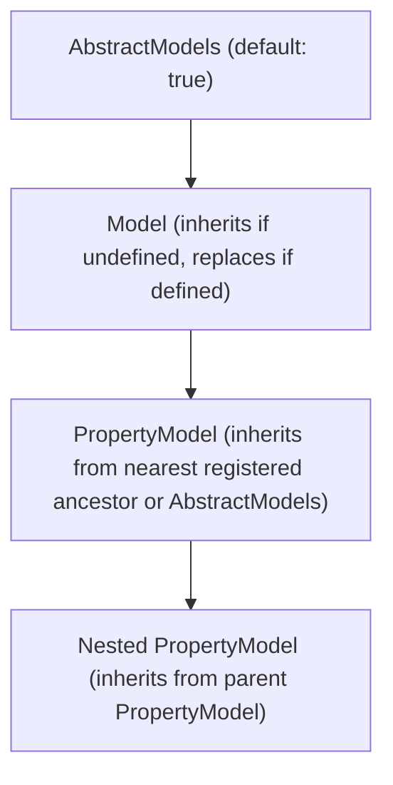
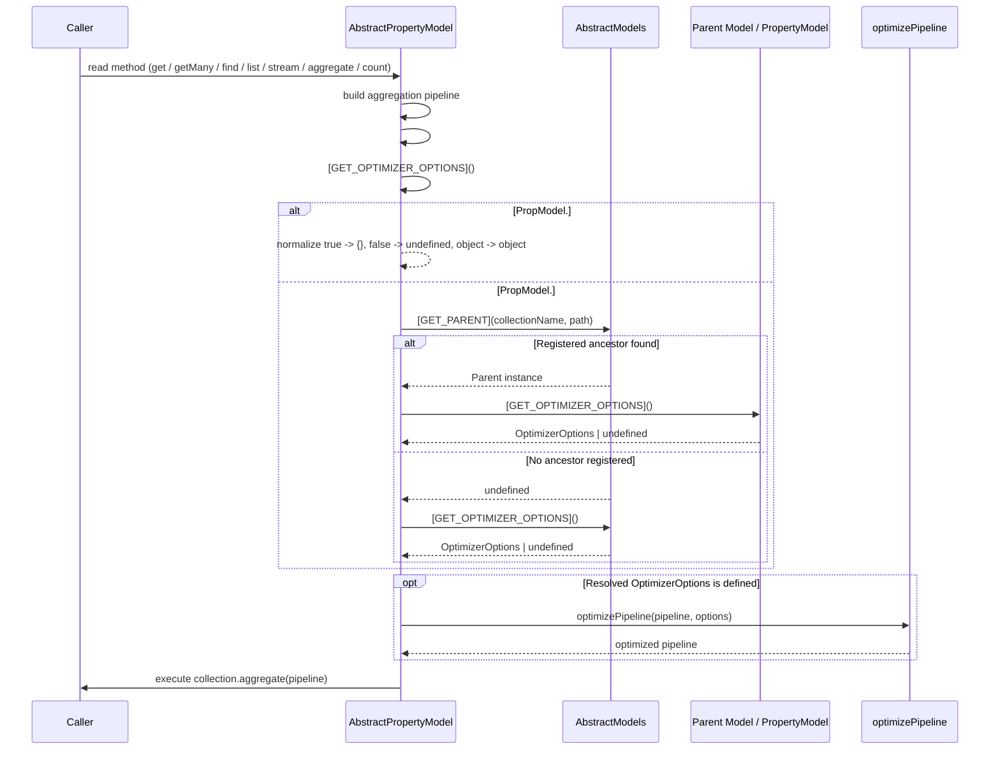

# Configurable Query Optimizer with Hierarchy Inheritance - Plan

## Goal Capsule

- **Objective:** Library consumers get automatic MongoDB read-query optimization out of the box and can tune or disable optimizer guarantees (`strictFieldOrder`, `strictErrors`) at the `Models`, `Model`, or `PropertyModel` level with predictable hierarchy inheritance.
- **Means:** Apply `@webergency-utils/mongodb-query-optimizer` across all read pipelines and resolve `optimizer` configuration down the `AbstractModels` → `AbstractModel` → `AbstractPropertyModel` chain.
- **Product authority:** `ce-brainstorm`
- **Authority hierarchy:** Product Contract (`R*`, `AE*`, Scope Boundaries) governs what must be true; Key Technical Decisions (`KTD*`) govern how units fit together; Implementation Units (`U*`) are the editable execution slices.
- **Stop conditions:** Stop if `@webergency-utils/mongodb-query-optimizer` alters aggregation semantics in existing tests or if stripping `optimizer` from `AbstractModels` options breaks `MongoClient` construction.
- **Execution profile:** `execution: code` — sequential implementation across types/symbols, registry/models, read pipelines, and unit tests.
- **Tail ownership:** Interactive via `ce-work` unless launched autonomously via `/goal` or `lfg`.
- **Open blockers:** None

---

## Product Contract

**Product Contract preservation:** Product Contract unchanged.

### Summary

Enable `@webergency-utils/mongodb-query-optimizer` by default on every read query across root and property models, while leaving write filters untouched. Expose a unified `optimizer?: boolean | OptimizerOptions` setting on `AbstractModels`, `Model`, and `PropertyModel` that inherits from parent to child when omitted and replaces the parent configuration wholesale when set.

### Problem Frame

`@webergency-utils/mongodb-query-optimizer` is installed in `package.json`, but pipeline optimization is currently hidden behind an undocumented runtime flow flag (`experimentalFlags['query-optimizer']`). Even when that flag is set, read coverage is inconsistent: `get` and `getMany` bypass optimization altogether, while `count` optimizes its pipeline before delegating to `aggregate`, triggering a redundant second optimization pass. Consumers also have no declarative way to configure optimizer guarantees (`strictFieldOrder`, `strictErrors`) or disable optimization globally on `AbstractModels`, per collection on `Model`, or per embedded path on `PropertyModel`.

### Key Decisions

- **Enabled by default with `boolean | OptimizerOptions` configuration** (session-settled: user-approved — chosen over disabled-by-default or strict-by-default: gives every read query optimization out of the box while allowing per-level tuning or opt-out). Governs R2, R3.
- **Wholesale replacement at each hierarchy level** (session-settled: user-directed — chosen over shallow-merging `OptimizerOptions` across levels: any explicit `true`, `false`, or `OptimizerOptions` cleanly overrides the parent configuration without hidden flag carry-over). Governs R4, R5.
- **Dynamic ancestor resolution across registered models** — resolving `PropertyModel` inheritance through the registered parent chain at query time ensures constructor instantiation order inside `AbstractModels` subclasses never changes effective configuration. Governs R4, R6.
- **Optimize all read operations once, including internal `.get()` calls, and remove the legacy flow flag** (session-settled: user-directed — chosen over partial read coverage or keeping `experimentalFlags['query-optimizer']`: makes read optimization uniform across the entire read surface including `.get()` calls invoked inside `create` and `update`). Governs R7, R8, R9, R10.
- **Unified `optimizer` config key across all three levels** (session-settled: user-approved — chosen over `queryOptimizer` or a separate positional constructor argument on `AbstractModels`: keeps configuration consistent across `AbstractModels`, class-based models, and `defineModel` / `definePropertyModel`). Governs R2, R3.

### Requirements

**Dependency and Configuration Surface**

- R1. Declare `@webergency-utils/mongodb-query-optimizer` in `package.json` runtime `dependencies` and re-export `OptimizerOptions` from the package entrypoint.
- R2. Accept `optimizer?: boolean | OptimizerOptions` on `AbstractModels` constructor options alongside `MongoClientOptions`, without forwarding the `optimizer` property to the underlying `MongoClient`.
- R3. Accept `optimizer?: boolean | OptimizerOptions` on root `Model` and `PropertyModel` configurations across both class-based and factory-based (`defineModel`, `definePropertyModel`, `Model`, `PropertyModel`) APIs.

**Hierarchy Inheritance Semantics**

- R4. Resolve effective optimizer configuration along the chain `AbstractModels` → root `Model` → parent `PropertyModel` → nested `PropertyModel`, where `undefined` inherits the nearest ancestor's resolved configuration and any defined value (`true`, `false`, or `OptimizerOptions`) replaces the ancestor's configuration wholesale.
- R5. Interpret `true` and the default unconfigured `AbstractModels` state as optimization enabled with empty `OptimizerOptions` (`{}`), `false` as optimization disabled, and an `OptimizerOptions` object as optimization enabled with that exact options object.
- R6. Resolve a `PropertyModel`'s ancestor configuration dynamically against `AbstractModels` so that registering a parent `Model` or parent `PropertyModel` after the child `PropertyModel` still yields the parent's configuration, falling back to `AbstractModels` when no intermediate model is registered for a prefix.

**Read-Query Optimization and Write Exclusion**

- R7. Run `optimizePipeline` with the model's resolved `OptimizerOptions` on the final aggregation pipeline of every read operation (`get`, `getMany`, `find`, `list` including its companion count pipeline, `stream`, `aggregate`, and `count`) when optimization is enabled for that model.
- R8. Optimize each executed read pipeline once per query execution so methods that delegate to another read method (`find` on `AbstractModel`, `count` delegating to `aggregate`) do not run `optimizePipeline` twice on the same pipeline.
- R9. Remove the legacy `flowGet('experimentalFlags')?.['query-optimizer']` check from `AbstractModel` and `AbstractPropertyModel`.
- R10. Do not run `@webergency-utils/mongodb-query-optimizer` on write operations (`create`, `update`, `updateMany`, `delete`), while still optimizing every `.get()` call invoked internally during `PropertyModel.create` or `PropertyModel.update` according to the target model's resolved optimizer setting.

### Acceptance Examples

- AE1. Default inheritance and wholesale override across the hierarchy
  - **Covers R2, R3, R4, R5.**
  - **Given:** `AbstractModels` is configured with `optimizer: { strictErrors: true }`, a root `Model` sets `optimizer: { strictFieldOrder: true }`, a first-level `PropertyModel` omits `optimizer`, and a nested `PropertyModel` sets `optimizer: false`.
  - **When:** Read queries execute on each model.
  - **Then:** The root `Model` and first-level `PropertyModel` call `optimizePipeline(pipeline, { strictFieldOrder: true })` without merging `strictErrors`, and the nested `PropertyModel` does not call `optimizePipeline`.

- AE2. Re-enabling optimization beneath a disabled parent
  - **Covers R4, R5, R6.**
  - **Given:** `AbstractModels` is configured with `optimizer: { strictErrors: true }`, a root `Model` sets `optimizer: false`, and its child `PropertyModel` sets `optimizer: true` (even if instantiated before the root `Model` in the `AbstractModels` subclass constructor).
  - **When:** `get`, `list`, or `aggregate` runs on the root `Model` and on the child `PropertyModel`.
  - **Then:** The root `Model` skips `optimizePipeline`, while the child `PropertyModel` calls `optimizePipeline(pipeline, {})` because `true` replaces the parent's `false` with default options.

- AE3. Read vs. write boundary with internal `.get()` calls
  - **Covers R7, R8, R10.**
  - **Given:** A root `Model` and its `PropertyModel` have optimization enabled.
  - **When:** `PropertyModel.create` or `PropertyModel.update` with `{ documentBefore: true, documentAfter: true }` is executed alongside `Model.update`, `Model.delete`, and `Model.count`.
  - **Then:** The `.get()` pipelines invoked by `PropertyModel.create` and `PropertyModel.update` are optimized via `optimizePipeline`, `Model.count` optimizes its final pipeline once inside `aggregate`, and the MongoDB `updateOne`, `updateMany`, `findOneAndUpdate`, `insertOne`, and `deleteOne` calls are not passed through `@webergency-utils/mongodb-query-optimizer`.

### Scope Boundaries

- Do not optimize filter or update payloads passed to `insertOne`, `findOne` (in `create` duplicate handling), `updateOne`, `updateMany`, `findOneAndUpdate`, or `deleteOne`.
- Do not remove or alter the internal `optimizeMatch` helper in `src/helpers/mongo.ts` used by `PipelineBuilder` and `AbstractPropertyModel` during stage construction.
- Do not add per-query call-site optimizer overrides on `get`, `list`, `find`, `stream`, `aggregate`, or `count` method options unless introduced in a future change.

### Sources / Research

- `package.json` — `@webergency-utils/mongodb-query-optimizer` (`^0.0.5`) dependency declaration.
- `src/models.ts` — `AbstractModels` constructor, `[REGISTER_MODEL]`, and `[GET_PARENT]` hierarchy lookup across collection and dotted property paths.
- `src/model.ts` — `AbstractModel` read methods (`#findAggregator`, `find`, `list`, `stream`, `aggregate`, `count`) and existing `optimizePipeline` call sites.
- `src/property-model.ts` — `AbstractPropertyModel` read methods (`#findAggregator`, `find`, `list`, `stream`, `aggregate`, `count`), `[GET_PARENT]` usage, and `.get()` calls inside `create` and `update`.
- `src/define-model.ts`, `src/define-property-model.ts`, `src/types/external.ts`, `src/types/definition.ts` — extension and definition config types for `Model` and `PropertyModel`.

---

## Planning Contract

### Key Technical Decisions

- KTD1. **Symbol-backed `[GET_OPTIMIZER_OPTIONS]` resolution protocol** (session-settled: user-approved). Add an internal symbol `GET_OPTIMIZER_OPTIONS` in `src/symbols.ts` and implement `[GET_OPTIMIZER_OPTIONS]` on `AbstractModels`, `AbstractModel`, and `AbstractPropertyModel` returning `OptimizerOptions | undefined`. Returning an `OptimizerOptions` object—including `{}` when configured as `true`—indicates optimization is enabled, while returning `undefined` indicates optimization is disabled. Chosen over exposing public resolution helpers on model instances to preserve the clean public surface alongside `REGISTER_MODEL` and `GET_PARENT`. Governs R4, R5, R6.
- KTD2. **Dynamic parent-chain walk via `[GET_PARENT]` with `AbstractModels` fallback** (session-settled: user-directed). When a model's own `#optimizer` is `undefined`, `AbstractModel` delegates to `this.#models[GET_OPTIMIZER_OPTIONS]`, and `AbstractPropertyModel` looks up its nearest ancestor via `this.#models[GET_PARENT]` before falling back to `this.#models[GET_OPTIMIZER_OPTIONS]`. Chosen over caching the parent config in the constructor so that registering child `PropertyModel` instances before parent `Model` or `PropertyModel` instances inside an `AbstractModels` constructor always resolves the live hierarchy. Governs R4, R5, R6.
- KTD3. **Centralized `#optimizePipeline` helper on `AbstractModel` and `AbstractPropertyModel`** (session-settled: user-directed). Replace all scattered `experimentalFlags['query-optimizer']` checks with a private `#optimizePipeline` method on both classes that calls `optimizePipeline` when `[GET_OPTIMIZER_OPTIONS]` returns defined options and returns the pipeline unchanged otherwise. Apply `#optimizePipeline` at every terminal read pipeline execution point—`#findAggregator`, `AbstractPropertyModel.find`, `list` main and count pipelines, `stream`, and `aggregate`—while removing the pre-optimization in `count` because `count` delegates to `aggregate`. Governs R7, R8, R9, R10.
- KTD4. **Unified `OptimizerConfig` type alias and `ModelsOptions` stripping** (session-settled: user-approved). Define `export type OptimizerConfig = boolean | OptimizerOptions` and `export type ModelsOptions = MongoClientOptions & { optimizer?: OptimizerConfig }` in `src/types/external.ts`, re-export `OptimizerOptions`, `OptimizerConfig`, and `ModelsOptions` from `src/index.ts`, and destructure `optimizer` out of `options` in `AbstractModels` before constructing `MongoClient` so `MongoClient` never sees the unknown `optimizer` key. Governs R1, R2, R3.

### High-Level Technical Design

---

## Implementation Units

### U1. Internal Symbol, Type Surface, and Entrypoint Exports

**Goal:** Introduce the `GET_OPTIMIZER_OPTIONS` internal symbol, add `optimizer?: OptimizerConfig` to all model and models configuration types, and export `OptimizerOptions`, `OptimizerConfig`, and `ModelsOptions` from the package entrypoint.

**Requirements:** R1, R2, R3

**Dependencies:** None

**Files:**
- Modify `src/symbols.ts`
- Modify `src/types/external.ts`
- Modify `src/types/definition.ts`
- Modify `src/index.ts`

**Approach:**
- Add `export const GET_OPTIMIZER_OPTIONS = Symbol( 'GET_OPTIMIZER_OPTIONS' );` in `src/symbols.ts` and re-export it in `src/index.ts` alongside `GET_PARENT` and `REGISTER_MODEL`.
- Import `type { OptimizerOptions } from '@webergency-utils/mongodb-query-optimizer'` in `src/types/external.ts`, define `export type OptimizerConfig = boolean | OptimizerOptions` and `export type ModelsOptions = MongoClientOptions & { optimizer?: OptimizerConfig }`, and add `optimizer?: OptimizerConfig` to both `ModelExtensions` and `PropertyModelExtensions`.
- Re-export `OptimizerOptions`, `OptimizerConfig`, and `ModelsOptions` from `src/types/external.ts` and `src/index.ts`.
- Import `OptimizerConfig` in `src/types/definition.ts` and explicitly add `optimizer?: OptimizerConfig` to both `RootModelDefinition` and `PropertyModelDefinition`.

**Patterns to follow:**
- `src/symbols.ts` symbol declaration pattern using `Symbol( '...' )`.
- `src/types/external.ts` `ModelExtensions` and `PropertyModelExtensions` optional field declarations.

**Test scenarios:**
- Scenario 1: Type definitions accept `optimizer: true`, `optimizer: false`, and `optimizer: { strictFieldOrder: true, strictErrors: true }` on `AbstractModels`, `Model`, `PropertyModel`, `defineModel`, and `definePropertyModel`.

**Verification:**
- `npm run build` compiles the updated type definitions without errors.

---

### U2. `AbstractModels` Optimizer Storage and Option Stripping

**Goal:** Accept `optimizer?: OptimizerConfig` in `AbstractModels` constructor options, strip `optimizer` before passing options to `MongoClient`, and resolve the root optimizer configuration via `[GET_OPTIMIZER_OPTIONS]`.

**Requirements:** R2, R4, R5, R6

**Dependencies:** U1

**Files:**
- Modify `src/models.ts`

**Approach:**
- Update `AbstractModels` constructor signature from `options?: MongoClientOptions` to `options?: ModelsOptions`.
- Destructure `optimizer` from `options` and pass only the remaining `MongoClientOptions` to `MongoClient` so the `optimizer` property is never forwarded.
- Store `#optimizer: OptimizerConfig = optimizer` with a default of `true`.
- Implement `[GET_OPTIMIZER_OPTIONS]` on `AbstractModels` so it returns `undefined` when `#optimizer === false`, `{}` when `#optimizer === true`, and `#optimizer` when it is an `OptimizerOptions` object.
- Update the internal `ModelInstance` interface in `src/models.ts` so `[GET_PARENT]` return type includes `[GET_OPTIMIZER_OPTIONS]`.

**Patterns to follow:**
- `src/models.ts` `[REGISTER_MODEL]` and `[GET_PARENT]` symbol method definitions and `#models` private field style.
- Repository formatting rules: Allman braces, spaces inside parentheses, and 4-space indentation.

**Test scenarios:**
- Scenario 1: Constructing an `AbstractModels` subclass with `{ optimizer: { strictErrors: true }, maxPoolSize: 10 }` forwards `{ maxPoolSize: 10 }` to `MongoClient` without the `optimizer` property.
- Scenario 2: `AbstractModels[GET_OPTIMIZER_OPTIONS]` returns `{}` by default, `{}` when `optimizer: true`, `undefined` when `optimizer: false`, and the exact options object when `optimizer: { strictFieldOrder: true }`.

**Verification:**
- `npm run build` succeeds and existing `src/tests/models.coverage.test.ts` passes.

---

### U3. Hierarchy Resolution and Read-Pipeline Optimization in `AbstractModel` and `AbstractPropertyModel`

**Goal:** Wire `optimizer` configuration and dynamic inheritance into `AbstractModel`, `AbstractPropertyModel`, `defineModel`, and `definePropertyModel`, optimize all read pipelines once per execution, and remove the legacy `experimentalFlags['query-optimizer']` check.

**Requirements:** R3, R4, R5, R6, R7, R8, R9, R10

**Dependencies:** U1, U2

**Files:**
- Modify `src/model.ts`
- Modify `src/property-model.ts`
- Modify `src/define-model.ts`
- Modify `src/define-property-model.ts`

**Approach:**
- In `src/model.ts`:
  - Add `#optimizer?: OptimizerConfig` to `AbstractModel`, initialized from `params.optimizer`.
  - Implement `[GET_OPTIMIZER_OPTIONS]` on `AbstractModel` to delegate to `this.#models[GET_OPTIMIZER_OPTIONS]` when `this.#optimizer === undefined`. When `this.#optimizer` is defined, return `undefined` for `false`, `{}` for `true`, or `this.#optimizer` for an options object.
  - Add a private `#optimizePipeline` helper that calls `optimizePipeline` when `this[GET_OPTIMIZER_OPTIONS]` returns defined options and returns `pipeline` unchanged otherwise.
  - Apply `#optimizePipeline` in `#findAggregator` for `get` and `getMany`, in `list` for both the main pipeline and `countPipeline`, in `stream`, and in `aggregate`.
  - Do not call `#optimizePipeline` directly in `AbstractModel.find` or `AbstractModel.count` because both delegate to `aggregate`, which optimizes the final combined pipeline once.
  - Remove the `experimentalFlags['query-optimizer']` checks from `list`, `stream`, `aggregate`, and `count`.
- In `src/property-model.ts`:
  - Add `#optimizer?: OptimizerConfig` to `AbstractPropertyModel`, initialized from `params.optimizer`.
  - Implement `[GET_OPTIMIZER_OPTIONS]` on `AbstractPropertyModel` to look up `this.#models[GET_PARENT]` when `this.#optimizer === undefined`, delegating to the parent's `[GET_OPTIMIZER_OPTIONS]` if found or `this.#models[GET_OPTIMIZER_OPTIONS]` otherwise. When `this.#optimizer` is defined, return `undefined` for `false`, `{}` for `true`, or `this.#optimizer` for an options object.
  - Add a private `#optimizePipeline` helper using `this[GET_OPTIMIZER_OPTIONS]`.
  - Apply `#optimizePipeline` in `#findAggregator`, `find`, `list` main and count pipelines, `stream`, and `aggregate`; this automatically covers internal `.get` calls inside `PropertyModel.create` and `PropertyModel.update`.
  - Remove the pre-optimization in `AbstractPropertyModel.count` because it delegates to `aggregate`, and remove all `experimentalFlags['query-optimizer']` checks.
- In `src/define-model.ts` and `src/define-property-model.ts`:
  - Forward `optimizer: config.optimizer` in the `extensions` object passed to `super` in both `defineModel` and `definePropertyModel`.

**Patterns to follow:**
- `src/property-model.ts` `[GET_PARENT]` lookup pattern on `this.#models`.
- `src/define-model.ts` and `src/define-property-model.ts` extension forwarding into `super`.

**Test scenarios:**
- Scenario 1 (Covers AE1): Default inheritance and wholesale override across `AbstractModels` → `Model` → `PropertyModel` → nested `PropertyModel` pass the expected `OptimizerOptions` or skip `optimizePipeline` when `false` without merging flags across levels.
- Scenario 2 (Covers AE2): A child `PropertyModel` with `optimizer: true` beneath a parent `Model` with `optimizer: false` calls `optimizePipeline` with `{}`, and a child `PropertyModel` with `optimizer: undefined` instantiated before its parent `Model` in `AbstractModels` still inherits the parent `Model` configuration at query time.
- Scenario 3 (Covers AE3): Every read method on both `Model` and `PropertyModel` calls `optimizePipeline` once per executed pipeline, internal `.get` calls in `PropertyModel.create` and `PropertyModel.update` are optimized, and write operations do not pass their write filters or updates to `optimizePipeline`.

**Verification:**
- `npm test` passes.

---

### U4. Unit Test Suite and Coverage Updates

**Goal:** Update existing unit tests that relied on `experimentalFlags: { 'query-optimizer': true }` and add comprehensive unit tests verifying hierarchy inheritance, wholesale overrides, option forwarding, single-pass read optimization, internal `.get` optimization during `PropertyModel.create` and `PropertyModel.update`, and write-operation exclusion.

**Requirements:** R1, R2, R3, R4, R5, R6, R7, R8, R9, R10

**Dependencies:** U1, U2, U3

**Files:**
- Modify `src/tests/model.coverage.test.ts`
- Modify `src/tests/property-model.coverage.test.ts`
- Modify `src/tests/define-model.test.ts`
- Modify `src/tests/define-property-model.test.ts`

**Approach:**
- Update `src/tests/model.coverage.test.ts` and `src/tests/property-model.coverage.test.ts` to replace legacy `experimentalFlags: { 'query-optimizer': true }` flow context setups with direct `optimizer` configuration tests.
- Spy on `optimizePipeline` invocations across `get`, `getMany`, `find`, `list`, `stream`, `aggregate`, and `count` on both `Model` and `PropertyModel`, asserting:
  - Default `AbstractModels` with `optimizer` omitted calls `optimizePipeline` with `{}` on all read methods, including `get` and `getMany`.
  - `count` calls `optimizePipeline` once rather than twice.
  - Four-level hierarchy (`AbstractModels` → `Model` → `PropertyModel` → nested `PropertyModel`) inherits when `optimizer` is `undefined` and replaces wholesale when set to `true`, `false`, or `OptimizerOptions`.
  - Constructor registration order—registering a `PropertyModel` before its parent `Model` or parent `PropertyModel`, or with no intermediate model registered—resolves dynamically at query time.
  - `PropertyModel.create` and `PropertyModel.update` with `documentBefore` and `documentAfter` optimize their internal `.get` pipelines while leaving `insertOne`, `updateOne`, `updateMany`, `findOneAndUpdate`, and `deleteOne` untouched by `@webergency-utils/mongodb-query-optimizer`.
  - `defineModel` and `definePropertyModel` forward `optimizer` configuration properly.

**Patterns to follow:**
- `src/tests/model.coverage.test.ts` and `src/tests/property-model.coverage.test.ts` Vitest mocking and assertion patterns.

**Test scenarios:**
- Scenario 1 (Covers AE1): Verify `optimizePipeline` receives `{ strictFieldOrder: true }` on root `Model` and inheriting child `PropertyModel` when `AbstractModels` has `{ strictErrors: true }`, and is not called on nested `PropertyModel` with `optimizer: false`.
- Scenario 2 (Covers AE2): Verify child `PropertyModel` with `optimizer: true` re-enables optimization with `{}` under a disabled `Model`, and verify reverse registration order in `AbstractModels` constructor still inherits parent `Model` config.
- Scenario 3 (Covers AE3): Verify single-pass `optimizePipeline` execution across `get`, `getMany`, `find`, `list`, `stream`, `aggregate`, and `count`, plus internal `.get` calls in `PropertyModel.create` and `PropertyModel.update`, with zero `optimizePipeline` calls for `Model.create`, `Model.update`, `Model.updateMany`, and `Model.delete`.

**Verification:**
- `npm run coverage:unit`
- `npm run build`
- `npm run typecheck:example`

---

## Verification Contract

- Run `npm test` and confirm all unit test suites pass.
- Run `npm run coverage:unit` and confirm statement, branch, function, and line coverage meet repository thresholds.
- Run `npm run build` and confirm TypeScript compilation succeeds cleanly.
- Run `npm run typecheck:example` and confirm example consumers typecheck without errors.

## Definition of Done

- All requirements `R1`–`R10` and acceptance examples `AE1`–`AE3` are satisfied and covered by passing unit tests.
- No references to `experimentalFlags['query-optimizer']` remain in `src/`.
- `npm test`, `npm run coverage:unit`, `npm run build`, and `npm run typecheck:example` exit 0.
