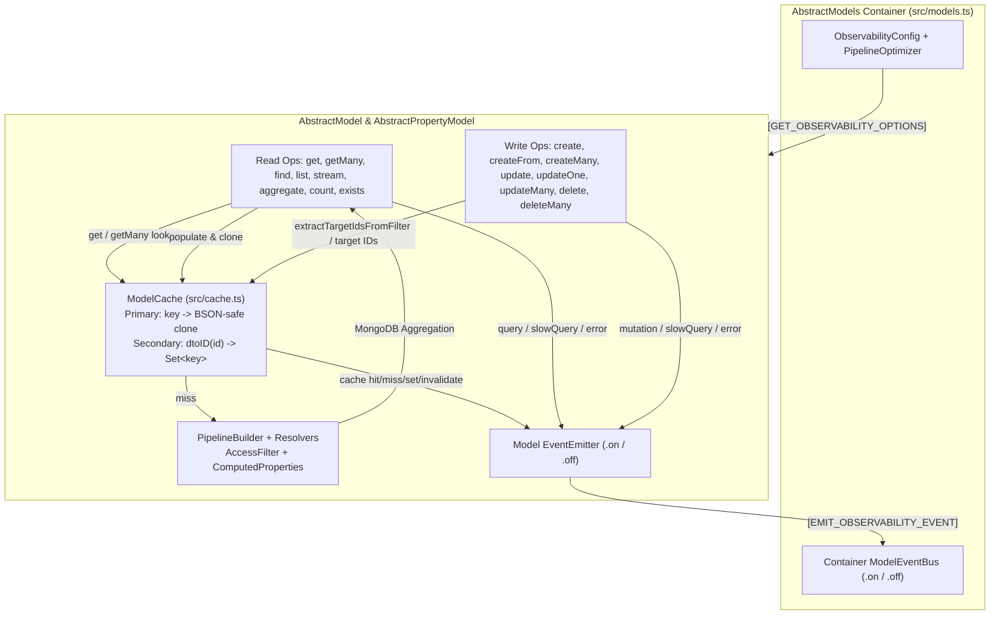

# V2 Parity, Observability, and CRUD Hardening - Plan

## Goal Capsule

**Problem:** The v2 rewrite of `@webergency-utils/mongodb-model` introduces breaking signature changes against `old/` and consumer models in `usage/`, drops model-level caching and `PropertyModel.delete()`, leaves `createFrom` and `updateOne` unimplemented, and contains runtime bugs in access-denial filtering, projection/computed-property resolution, custom pipelines, and foreign `ObjectId` handling.

**Target Outcome:** Deliver a drop-in backward-compatible v2 library that preserves v2 ergonomic improvements, fixes all verified query/access/helper bugs, restores ID-scoped model caching, adds hierarchy-aware customizable observability, and completes symmetric CRUD and query helpers across `AbstractModel` and `AbstractPropertyModel`.

**Constraints / Non-Goals:**
- Existing consumer call sites from `old/` and `usage/` must work without forced migration while v2 option-object and destructuring call sites remain supported.
- All CRUD and query helpers must behave symmetrically across `AbstractModel` and `AbstractPropertyModel`.
- Built-in soft-delete mode, automatic string/ObjectId ID codecs, and model mutation hooks are excluded from scope.
- Application-specific domain utilities from `usage/helpers/` remain outside the core package.

**Hard Failure Signals:**
- Calling `PropertyModel.find()` or `PropertyModel.pipeline()` when `access()` returns `{ denied: true }` leaks subdocuments instead of returning empty results.
- Legacy callers using `model.get(id, 'dbe')`, `model.get(ids, 'basicDTO', true)`, `const items = await model.list()`, or `const { items, total, cursors } = await model.list()` fail at runtime or compile time.
- ID-based mutations (`update`, `updateMany`, `delete`, or ID-targeted `updateOne`/`deleteMany`) leave stale entries for those IDs in the model cache.
- Custom `options.pipeline` stages (`$sort`, `$limit`, `$project`, `$addFields`) either crash `PipelineBuilder` or have their added fields stripped by final `$unset`.

---

## Product Contract

*Product Contract preserved from `ce-brainstorm` (`artifact_readiness: requirements-only` -> `implementation-ready`); aligned file paths, flow package name (`@liqd-js/flow`), access policy type (`access?: string`), and `get(ids)` null-filtering terminology (`filtered` / `filter`) with `src/types/external.ts`, `src/errors.ts`, `src/flow.ts`, and `src/access-control.ts` per Phase 5.1.5 confirmation.*

### Summary

Harden `@webergency-utils/mongodb-model` v2 so existing consumers of the legacy `old/` library can upgrade without breaking changes while gaining v2 capabilities. The work fixes eight verified runtime and access-control defects, restores ID-aware model caching, adds customizable hierarchy-inherited observability across queries, mutations, cache operations, and errors, and completes symmetric CRUD and query helpers on both root and property models.

### Problem Frame

`@webergency-utils/mongodb-model` provides the core MongoDB data-access abstraction (`AbstractModels`, `AbstractModel`, `AbstractPropertyModel`) used by downstream services exemplified in `usage/`. During the v2 refactor in `src/`, several critical regressions and gaps were introduced relative to `old/`:

- **Runtime and security regressions:** Denied access in `PropertyModel` checks `${prefix}._id: { $exists: false }`, which evaluates to true on embedded subdocuments that use `id` instead of `_id`. `Model.list()`, `Model.stream()`, and `Model.find()` ignore converter `projection` or `computedProperties`. Function-form `computedProperties` are ignored by `ComputedPropertyResolver`. `PipelineBuilder` unsets fields added by caller-supplied `options.pipeline` and throws on common stages like `$sort` or `$limit`. Helper functions use raw `instanceof ObjectId`, corrupting BSON `ObjectId` instances across dual-package boundaries.
- **Breaking API divergences:** `get()` no longer accepts legacy positional arguments or ID arrays. `list()` returns `{ items, total, cursors }` instead of a `WithTotal<DTO[]>` array with `$cursor` properties. `AbstractPropertyModel.delete()` and model-level caching (`cache` option + `#clearCache`) were removed. `ModelError` requires a leading `code` parameter that breaks 2-argument `new ModelError(this, message)` calls across consumer models.
- **Incomplete CRUD and observability:** `createFrom()` and `updateOne()` are declared on `ModelType` (`src/types/external.ts`) without implementation (`throw new ModelError('MODEL_NOT_IMPLEMENTED', ...)`). Common operations (`createMany`, `deleteMany`, `exists`, and pipeline-optional `count(options)`) are missing, and observability is limited to ad-hoc console logging and partial query events on `AbstractModel`.

### Key Decisions

- **Unified 4-Track Scope** *(session-settled: user-approved — selected unified delivery of bug fixes, compatibility, observability, and CRUD helpers)*: Address all four tracks in a single cohesive plan because all changes touch the same core classes (`src/model.ts`, `src/property-model.ts`, `src/models.ts`, `src/types/external.ts`) and share pipeline, cache, and event lifecycles. Governs R1, R8, R16, R20, R23.
- **Dual-Compatible `get()` and Hybrid Array `list()`** *(session-settled: user-approved — selected dual-signature `get()` plus hybrid array/object `list()` return value)*: Support both `old/` positional/array signatures and v2 options on `get()` while keeping `getMany()`, and return an enhanced `WithTotal` array from `list()` with non-enumerable `.items`, `.total`, and `.cursors` properties plus per-item `$cursor`. Rejected breaking either legacy array callers or v2 destructuring callers. Governs R1, R2, R3.
- **Model Caching with ID-Scoped Invalidation** *(session-settled: user-directed — evict cached variants by document ID on ID-based mutations including ID-filtered `updateOne`/`deleteMany`, otherwise keep cache)*: Restore optional `cache` configuration on `AbstractModel` and `AbstractPropertyModel` with BSON-safe deep clone protection and secondary indexing by document ID. ID-based mutations evict all cached projection/access variants for the affected IDs, while non-ID filter mutations keep cached entries intact. Governs R20, R21, R22.
- **Hierarchy-Inherited Observability and Event Bus** *(session-settled: user-approved — selected hierarchy-inherited observer config plus typed `.on()` listeners)*: Configure observability at `AbstractModels` with per-model overrides and propagate across `AbstractModels` → `AbstractModel` → `AbstractPropertyModel`. Emit structured `query`, `mutation`, `slowQuery`, `cache`, and `error` events with flow context and converter timing. Governs R16, R17, R18, R19.
- **Focused Core CRUD & Query Surface** *(session-settled: user-directed — include core CRUD/query helpers only; exclude soft-delete, idType codec, hooks, and app-specific usage helpers)*: Implement `PropertyModel.delete()`, `createFrom()`, `updateOne()`, `createMany()`, `deleteMany()`, `exists()`, and `count(options)` symmetrically across `AbstractModel` and `AbstractPropertyModel`. Governs R4, R7, R23, R24, R25, R26, R27, R28.

### Requirements

**Legacy API Parity & Compatibility**

- R1. **Dual-Signature `get()`**: `AbstractModel.get()` and `AbstractPropertyModel.get()` must support legacy single-ID and ID-array positional signatures (`get(id, as?)`, `get(ids, as?, filtered?)`) as well as v2 options objects (`get(id, { as, access })`, `get(ids, { as, filter, access })`), where `filtered` / `filter` controls whether missing (`null`) entries are filtered out while always preserving input ID order.
- R2. **Dedicated `getMany()` Preservation**: `AbstractModel.getMany(ids, options?)` and `AbstractPropertyModel.getMany(ids, options?)` must remain available for callers passing `{ as, filter, access }` options.
- R3. **Hybrid `list()` Return Shape**: `AbstractModel.list()` and `AbstractPropertyModel.list()` must return an `Array<DTO & { $cursor?: string }>` that defines non-enumerable `.total` (`number | undefined`), `.cursors` (`{ prev?: string; next?: string }`), and `.items` (self-referencing array) properties via `Object.defineProperties`, satisfying both `WithTotal<DTO[]>` array consumers and `{ items, total, cursors }` destructuring consumers.
- R4. **Restore `AbstractPropertyModel.delete()`**: `AbstractPropertyModel` must implement `delete(id: ObjectId, options?: { filter?: Filter<any>; access?: string }): Promise<boolean>` using `$pull` (or `$unset` for object leaves) with prefix and access-filter resolution, matching `AbstractModel.delete()` semantics.
- R5. **Backward-Compatible `ModelError` Constructor**: `ModelError` in `src/errors.ts` must support both the legacy 2/3-argument signature `new ModelError(model, message, cause?)` (defaulting `code` to `'MODEL_INTERNAL_ERROR'`) and the v2 3/4-argument signature `new ModelError(code, model, message, cause?)`.
- R6. **Legacy Type & Driver Re-Exports**: `src/index.ts` and `src/types/external.ts` must export `WithTotal<T>` and re-export `mongodb` symbols alongside existing v2 exports so legacy imports compile without path changes.
- R7. **Legacy `count(pipeline?, options?)` and Shorthand `count(options?)`**: `AbstractModel.count()` and `AbstractPropertyModel.count()` must accept either `(pipeline?: Document[], options?: ModelCountOptions)` or a single `(options?: ModelCountOptions)` argument so callers can count with `{ filter, smartFilter, access }` without passing an empty `[]` pipeline.

**Runtime Bug Fixes & Hardening**

- R8. **PropertyModel Access-Denial Enforcement**: When `access()` returns `{ denied: true }`, `AbstractPropertyModel` filter resolution must produce an impossible match condition on the subdocument (`id: { $exists: false }` under the property prefix) so `find()`, `list()`, `get()`, `count()`, and `pipeline()` return zero documents.
- R9. **Converter Projection & Computed Properties in `Model.list()` and `Model.stream()`**: `AbstractModel.list()` and `AbstractModel.stream()` must read `this.converters[conversion].projection` and merge converter-level `computedProperties` with `options.computedProperties` before building pipelines, matching `Model.pipeline()` and `PropertyModel.list()`.
- R10. **Target Conversion Resolution in `Model.find()`**: `AbstractModel.find()` must build its aggregation pipeline using the caller's requested `conversion` (`options?.as || 'dto'`) rather than hardcoding `'dbe'`, and must emit a `'find'` query event rather than `'aggregate'`.
- R11. **Function-Form `computedProperties` Resolution**: `ComputedPropertyResolver.resolve()` in `src/resolvers.ts` must evaluate function-form `computedProperties` (`() => [...]` or `() => ({ ... })`) before resolving root and property pipelines.
- R12. **Collation & Clean Execution in `PropertyModel.find()`**: `AbstractPropertyModel.find()` must pass `{ collation: { locale: 'en' } }` to `this.collection.aggregate()`, remove the stray `console.log`, and emit observability events consistently with `AbstractModel.find()`.
- R13. **Safe Caller `options.pipeline` Handling in `PipelineBuilder`**: `PipelineBuilder` must only `$unset` temporary fields added by internal `filterPipeline` and `computedProperties` stages — never fields added by caller-supplied `options.pipeline` — and must allow arbitrary valid MongoDB aggregation stages (`$sort`, `$limit`, `$skip`, `$project`, `$group`, `$unwind`, `$lookup`, etc.) inside `options.pipeline` without throwing `Unsupported pipeline stage`.
- R14. **Cross-Package `ObjectId` Safety in Helpers**: `deleteNullishProperties`, `deleteUndefinedProperties`, `objectFlatten`, `objectHash`, and `idToIndexKey` / `stringify` in `src/helpers/object.ts` and `src/helpers/utils.ts` must treat foreign realm/dual-package BSON `ObjectId` values (`isLibraryObjectId(v) || isForeignObjectIdLike(v)`) as atomic values rather than recursing into or corrupting their internal `buffer`.
- R15. **Multi-Level Array Path Support in `PropertyModel.create()`**: `propertyModelUpdateParams` and `AbstractPropertyModel` mutations (`create`, `createMany`, `update`, `updateMany`, `updateOne`, `delete`, `deleteMany`) must support nested 2+ array-level and non-array intermediate property paths by resolving or matching ancestor element IDs from the parent lookup rather than assigning `parentID` to every array filter level.

**Customizable Observability**

- R16. **Hierarchy-Inherited Observability Configuration**: `AbstractModels`, `AbstractModel`, and `AbstractPropertyModel` must accept an `observability` configuration option that inherits downward from `AbstractModels` → `AbstractModel` → `AbstractPropertyModel` and can be overridden per model.
- R17. **Container and Model Event Subscription**: Both `AbstractModels` (container-wide across all registered models) and individual `AbstractModel` / `AbstractPropertyModel` instances must expose typed `.on(event, handler)` and `.off(event, handler)` methods.
- R18. **Comprehensive Lifecycle Events**: The observability layer must emit structured events for:
  - `query`: operation (`get`, `getMany`, `find`, `list`, `stream`, `aggregate`, `count`, `exists`), model name, collection, property prefix (if any), pipeline/filter metadata, DB duration (`ms`), converter duration (`ms`), and result count.
  - `mutation`: operation (`create`, `createFrom`, `createMany`, `update`, `updateOne`, `updateMany`, `delete`, `deleteMany`), model name, target IDs/filter metadata, duration (`ms`), and affected counts (`insertedCount`, `matchedCount`, `modifiedCount`, `deletedCount`).
  - `slowQuery`: emitted automatically when any query or mutation exceeds configurable `slowQueryMs`.
  - `cache`: operation (`hit`, `miss`, `set`, `invalidate`), model name, key/ID metadata, and evicted entry count.
  - `error`: emitted across all read, write, access-control, and converter failures with `ModelError` code, operation, model name, and cause.
- R19. **Flow Context & Pluggable Logger Integration**: Observability events must automatically include active `@liqd-js/flow` context (`traceID` via `flowGet` in `src/flow.ts`) and route legacy flow flags (`flowGet('log')`, `flowGet('benchmark')`, `experimentalFlags.logQueries`) through the configured logger/observer sink.

**Model Caching**

- R20. **Optional Model Cache with Clone Safety**: `AbstractModel` and `AbstractPropertyModel` must support optional `cache` configuration (`boolean | ModelCacheOptions | ModelCacheInstance`) at the entity/ID lookup boundary (`get`, `getMany`, and unprojected `list` item population), cloning cached values with a BSON-preserving deep clone (`ObjectId`, `Date`, `RegExp`, and bound DTO `id` getters) on read and write so caller mutations never corrupt cached state.
- R21. **ID-Indexed Cache Tracking**: Cached entries produced by entity lookups must be indexed by normalized document ID (`dtoID(id)`) so all cached variants for a given document ID (across different `as` conversions, projections, and `access` filters) can be targeted without wiping unrelated cache entries.
- R22. **ID-Scoped Cache Invalidation on Mutations**:
  - `update(id)`, `delete(id)`, and `updateMany(ids, ...)` (when given IDs) must evict all cached variants associated with those document IDs.
  - `updateOne(match, ...)` and `deleteMany(match, ...)` must inspect `match` for direct ID targeting (`_id` on root models or `id` on property models, including `$eq` and `$in` forms) and evict all cached variants for those extracted IDs; when `match` is a non-ID filter, existing cached entries must be preserved (except in `PropertyModel.updateOne` where the resolved single target subdocument ID is evicted).

**Symmetric CRUD & Query Helpers**

- R23. **`createFrom(data, fromKey?, id?, options?)` Implementation**: `AbstractModel` and `AbstractPropertyModel` must implement `createFrom` using the named `this.converters.from[fromKey]` converter (defaulting `fromKey` when omitted if a single `from` converter exists, or supporting `(data, fromKey, id, options)` overloads) and delegating to `create()` with full validation and observability.
- R24. **`updateOne(match, update, options?)` Implementation**: `AbstractModel` and `AbstractPropertyModel` must implement `updateOne` to update a single matching root document or embedded property subdocument with access-filter enforcement, converter `update.dbe` support, ID-scoped cache invalidation (per R22), and `mutation` event emission.
- R25. **`createMany()` Implementation**: `AbstractModel.createMany(data[], options?)` and `AbstractPropertyModel.createMany(parentID, data[], options?)` must validate/convert each item via `converters.create.dbe`, assign IDs, insert/push in batch, and return the created IDs (`ObjectId[]`).
- R26. **`deleteMany(filter, options?)` Implementation**: `AbstractModel.deleteMany(filter, options?)` and `AbstractPropertyModel.deleteMany(filter, options?)` must enforce access filters, remove all matching root documents (`collection.deleteMany`) or property subdocuments (`collection.updateMany` with `$pull`), apply ID-scoped cache invalidation (per R22), and return the deleted/modified count (`number`).
- R27. **`exists(idOrFilter, options?)` Helper**: `AbstractModel.exists(idOrFilter, options?)` and `AbstractPropertyModel.exists(idOrFilter, options?)` must accept either an `ObjectId` or a filter object (`Filter<DBE>`), apply access control, and return a `Promise<boolean>` using a minimal `{ _id: 1 }` / `$limit: 1` check.
- R28. **`updateMany()` Signature Parity**: `AbstractModel.updateMany()` and `AbstractPropertyModel.updateMany()` must accept both an array of `ObjectId[]` and a filter object as the first argument (`idsOrFilter: ObjectId[] | Filter<DBE>`), matching `old/` behavior while preserving v2 return counts.

### Acceptance Examples

- AE1. **PropertyModel Denied Access Returns Empty Results**
  **Covers R8**
  **Given:** An `AbstractPropertyModel` whose `access()` method returns `{ denied: true }` for the current flow.
  **When:** A caller invokes `propertyModel.find({ filter: { name: 'secret' } })` or `propertyModel.list()`.
  **Then:** The generated `$match` filter targets `${prefix}.id: { $exists: false }` and returns `null` from `find()` and `0` items from `list()`.

- AE2. **Dual-Compatible `list()` Supports Array Iteration and Object Destructuring**
  **Covers R3, R9**
  **Given:** A root or property model with 2 matching documents and a converter defining both `projection` and `computedProperties`.
  **When:** Caller A executes `const rows = await model.list({ limit: 1 })` and Caller B executes `const { items, total, cursors } = await model.list({ limit: 1 })`.
  **Then:** `Array.isArray(rows)` is `true`, `rows.length === 1`, `rows.total === 2`, `rows[0].$cursor` is a non-empty string, `items === rows`, `total === 2`, `cursors.next === rows[0].$cursor`, and both converter `projection` and `computedProperties` are applied.

- AE3. **Dual-Compatible `get()` Handles Single ID, ID Array, Positional Conversion, and Options**
  **Covers R1, R2**
  **Given:** A model containing documents with IDs `id1` and `id2`.
  **When:** Callers invoke `model.get(id1, 'dbe')`, `model.get([id2, id1], 'dto', true)`, and `model.get(id1, { as: 'dto', access: 'admin' })`.
  **Then:** The first returns the single `'dbe'` document, the second returns `[dto2, dto1]` in requested order with nulls filtered out, and the third returns `dto1` evaluated under the `'admin'` access policy.

- AE4. **ID-Scoped Cache Invalidation Evicts Only Targeted IDs**
  **Covers R20, R21, R22**
  **Given:** A model with `cache: true` where `model.get(id1, 'dto')`, `model.get(id1, 'dbe')`, and `model.get(id2, 'dto')` have been cached.
  **When:** `await model.update(id1, { name: 'Updated' })` or `await model.updateOne({ _id: id1 }, { name: 'Updated' })` is executed, followed by `await model.updateOne({ status: 'pending' }, { status: 'active' })`.
  **Then:** Both `'dto'` and `'dbe'` cache entries for `id1` are evicted on the ID-based update, while `id2` remains cached across both updates.

- AE5. **Observability Hierarchy Emits Query, Mutation, SlowQuery, Cache, and Error Events**
  **Covers R16, R17, R18, R19**
  **Given:** An `AbstractModels` container configured with `observability: { slowQueryMs: 50 }` and a `models.on('query', ...)` / `models.on('mutation', ...)` / `models.on('error', ...)` subscriber.
  **When:** A registered root model or child property model executes a slow query, a `createFrom` mutation, a cache hit, and a failing converter.
  **Then:** The container listener receives structured `query`, `slowQuery`, `mutation`, `cache`, and `error` events containing model name, operation, DB and converter durations, and active flow `traceID`.

- AE6. **Caller `options.pipeline` Preserves Added Fields and Standard Aggregation Stages**
  **Covers R11, R13**
  **Given:** A model with function-form `computedProperties: () => ['computedTag']` and a caller passing `options.pipeline: [{ $addFields: { customRank: 1 } }, { $sort: { customRank: -1 } }]`.
  **When:** `model.list(options)` executes.
  **Then:** `PipelineBuilder` does not throw on `$sort` and does not `$unset` `customRank`, returning items with both `computedTag` and `customRank` intact.

### Scope Boundaries

**In scope:**
- All verified runtime, access-control, projection, pipeline, and foreign `ObjectId` bug fixes across `src/model.ts`, `src/property-model.ts`, `src/pipeline-builder.ts`, `src/resolvers.ts`, and `src/helpers/`.
- Legacy `old/` API compatibility for `get()`, `list()`, `count()`, `updateMany()`, `PropertyModel.delete()`, `ModelError`, `WithTotal`, and `mongodb` re-exports.
- Optional model caching with BSON-safe clone safety and ID-scoped invalidation on `AbstractModel` and `AbstractPropertyModel`.
- Hierarchy-inherited observability (`AbstractModels` → `AbstractModel` → `AbstractPropertyModel`) with `query`, `mutation`, `slowQuery`, `cache`, and `error` events.
- Symmetric CRUD and query methods: `createFrom`, `createMany`, `updateOne`, `delete`, `deleteMany`, `exists`, and `count(options)`.

**Out of scope:**
- Built-in `softDelete` lifecycle mode (`deletedAt` / `withDeleted` / `restore`).
- Automatic `idType: 'objectId' | 'string'` coercion codecs on models.
- Model-level `beforeCreate` / `afterUpdate` mutation lifecycle hooks.
- Application-specific helper utilities from `usage/helpers/` (`getObjectDifferences`, permission `buildFilter`, `escapeRegex`, `buildSearchFilter`, `uniqueObjectIDs`).

**Deferred / Non-Goals:**
- Full query-matcher evaluation against in-memory cached documents for arbitrary non-ID MongoDB filter expressions.

### Sources / Research

**Codebase References:**
- `src/model.ts` — root `AbstractModel` implementation, query pipeline construction, `list()` (`L489-L604`), `stream()` (`L606-L704`), `find()` (`L470-L487`), and `#emitQuery()` (`L226-L240`).
- `src/property-model.ts` — embedded `AbstractPropertyModel` implementation, `#filterStages()` access-denial bug (`L912-L952`), `find()` (`L622-L650`), and `list()` (`L652-L765`).
- `src/models.ts` — `AbstractModels` container and model factory methods (`L1-L72`).
- `src/pipeline-builder.ts` — aggregation pipeline builder and `$unset` handling (`L14-L72`).
- `src/resolvers.ts` — `AccessFilterResolver` and `ComputedPropertyResolver` (`L137-L220`).
- `src/helpers/mongo.ts` — `collectAddedFields` (`L531-L557`), `propertyModelUpdateParams` (`L704-L728`), and foreign `ObjectId` helpers (`L76-L105`).
- `src/helpers/object.ts` & `src/helpers/utils.ts` — object traversal helpers requiring cross-realm `ObjectId` checks.
- `src/types/external.ts`, `src/types/internal.ts`, `src/types/definition.ts`, `src/errors.ts`, `src/access-control.ts` — public types, `ModelType`, `ModelError`, and access control resolution.
- `old/model.ts` & `old/property-model.ts` — legacy signatures, `WithTotal` list behavior, `#cache` implementation, and `PropertyModel.delete()`.
- `usage/` — real-world consumer patterns across root models (`usage/models/job/model.ts`, `usage/models/application/model.ts`) and nested property models (`usage/models/job/stages.ts`, `usage/models/organization/addresses.ts`).

---

## Planning Contract

### System-Wide Impact

- **Interaction graph:**
  - `AbstractModels` (`src/models.ts`) holds the shared `MongoClient`, `PipelineOptimizer` options (`[GET_OPTIMIZER_OPTIONS]`), and container-level `ObservabilityConfig` + `ModelEventBus` (`[GET_OBSERVABILITY_OPTIONS]`, `[EMIT_OBSERVABILITY_EVENT]`).
  - `AbstractModel` (`src/model.ts`) and `AbstractPropertyModel` (`src/property-model.ts`) inherit observability configuration from `AbstractModels` (with per-model override support), manage an optional `ModelCache` instance (`src/cache.ts`), delegate pipeline assembly to `PipelineBuilder` (`src/pipeline-builder.ts`) and resolvers (`src/resolvers.ts`), and emit structured lifecycle events (`query`, `mutation`, `slowQuery`, `cache`, `error`) to both local model listeners and the container `AbstractModels` bus.
  - Functional model factories `defineModel` (`src/define-model.ts`) and `definePropertyModel` (`src/define-property-model.ts`) forward `cache` and `observability` options into the underlying `AbstractModel` and `AbstractPropertyModel` constructors.
- **Error & failure propagation:**
  - All database driver failures (`ModelQueryError`), converter failures (`ModelConverterError`), access control violations (`ModelAccessDeniedError`, `ModelAccessConfigError`), and validation/lookup errors (`ModelError`) emit a structured `error` observability event before rethrowing.
  - Listener callbacks registered via `.on()` are invoked inside a safe `try / catch` guard so an observer failure never aborts or alters a model query or mutation.
- **State lifecycle risks:**
  - Native `structuredClone()` strips `ObjectId` prototypes (turning them into plain `{ id: Uint8Array }` objects) and drops non-enumerable getters such as bound `dto.id` created by `bindInstanceDtoID`. `ModelCache` must use a BSON-preserving deep clone (`cloneCachedValue`) that preserves `ObjectId` (via `normalizeObjectId`), `Date`, `RegExp`, and re-binds DTO `id` getters when present.
  - In `AbstractModel.get()` / `AbstractPropertyModel.get()`, `#aggregator` batches concurrent single-ID lookups within a 10ms window. Cache lookup and storage must happen around the aggregator boundary using normalized key `{ id: dtoID(id), conversion, projection, accessFilter }` so `get(id)`, `get(ids)`, and `getMany(ids)` share cached entries and converter `dto()` functions execute at most once per miss (or cached `dbe` / `dto` is cloned cleanly).
  - In `AbstractPropertyModel.updateOne(match, update, options?)`, MongoDB positional `$` only updates the first array element when the array field itself appears in the query document, and does not work across 2+ nested array levels. Resolving the first matching subdocument ID via `this.find({ filter: match, as: 'dbe', access: options?.access })` when `match` is not already a direct single-ID filter guarantees single-subdocument update semantics at any nesting depth and yields the exact `id` for cache invalidation.
- **API surface parity:**
  - Every query and CRUD helper (`get`, `getMany`, `find`, `list`, `stream`, `aggregate`, `count`, `exists`, `create`, `createFrom`, `createMany`, `update`, `updateOne`, `updateMany`, `delete`, `deleteMany`, `on`, `off`) must be exposed with consistent option shapes and event emission across `AbstractModel`, `AbstractPropertyModel`, `ModelType`, and `PropertyModelType`.
- **Integration test scenarios:**
  - End-to-end consumer parity workflows against `mongodb-memory-server` exercising `usage/`-style models (`createFrom` -> `get` with cache hit -> `updateOne` with ID invalidation -> `list` used both as an array and via `{ items, total, cursors }` destructuring -> `PropertyModel.delete` and `deleteMany` -> container-level `models.on()` event verification).

### Key Technical Decisions

- KTD1. **In-Repo Zero-Dependency `ModelCache` with BSON-Safe Cloning (`src/cache.ts`)**
  - **Decision:** Implement `ModelCache` directly in `src/cache.ts` (zero external runtime dependencies) supporting `boolean | ModelCacheOptions | ModelCacheInstance`, bounded `maxEntries` (FIFO/LRU map eviction) and `ttlMs`, a secondary index `Map<string, Set<string>>` mapping normalized `dtoID(id)` strings to cache keys, and a custom `cloneCachedValue()` helper that preserves `ObjectId` (including foreign `ObjectId` instances via `normalizeObjectId`), `Date`, `RegExp`, and bound `id` getters (`Object.getOwnPropertyDescriptor(obj, 'id')?.get`).
  - **Rationale:** `@liqd-js/cache` is not installed in `package.json` (`old/model.ts` had commented it out), and native `structuredClone` corrupts BSON `ObjectId` instances and strips property getters attached by `bindInstanceDtoID`.
  - **Refines:** R20, R21, R22.

- KTD2. **Entity-Boundary Caching and Deterministic ID Extraction (`extractTargetIdsFromFilter`)**
  - **Decision:** Scope `ModelCache` to entity-level lookups (`get`, `getMany`, and optional item seeding from unprojected `list`) keyed by `objectHash({ id: dtoID(id), conversion, projection, accessFilter })`. Provide a pure helper `extractTargetIdsFromFilter(filter, idField: '_id' | 'id'): string[] | null` that extracts normalized ID strings when `filter` (or `filter.filter`) specifies `idField` directly (`{ [idField]: oid }`), via `{ [idField]: { $eq: oid } }`, or via `{ [idField]: { $in: [...oids] } }` (even alongside additional filter keys). On `update(id)`, `delete(id)`, `updateMany(ids)`, and ID-targeted `updateOne` / `deleteMany` / `updateMany(filter)`, evict all cache keys registered under those IDs in the secondary index and emit a `cache` (`invalidate`) event.
  - **Rationale:** Matches the user-directed rule to evict cached variants by ID on ID-based mutations while keeping the cache intact on non-ID filter mutations, avoiding stale entity reads without full-cache thrashing.
  - **Refines:** R20, R21, R22, AE4.

- KTD3. **Symbol-Bridged Observability Hierarchy and Safe Event Bus (`src/events.ts`, `src/symbols.ts`)**
  - **Decision:** Add `GET_OBSERVABILITY_OPTIONS` and `EMIT_OBSERVABILITY_EVENT` symbols to `src/symbols.ts` (mirroring `GET_OPTIMIZER_OPTIONS`). `AbstractModels` strips `observability` and `cache` from `ModelsOptions` before constructing `new MongoClient(uri, mongoOptions)` (mirror of `src/models.ts:28`) and exposes `.on(event, handler)` / `.off(event, handler)`. `AbstractModel` resolves its effective config by merging `this.#models[GET_OBSERVABILITY_OPTIONS]()` with its own `options.observability`, while `AbstractPropertyModel` resolves base observability options from its parent model via `this.#models[GET_PARENT](this.collection.collectionName, this.#prefix)?.[GET_OBSERVABILITY_OPTIONS]()` (falling back to `this.#models[GET_OBSERVABILITY_OPTIONS]()`) before merging its own `options.observability`. Both emit events locally and upward through `this.#models[EMIT_OBSERVABILITY_EVENT](event, payload)`, and automatically emit `slowQuery` whenever `duration >= slowQueryMs` (default `500` ms when enabled).
  - **Rationale:** Follows the existing symbol-encapsulation pattern in `src/symbols.ts` so internal propagation methods do not pollute public autocomplete while enabling both container-wide and model-scoped listeners.
  - **Refines:** R16, R17, R18, R19, AE5.

- KTD4. **Hybrid `WithTotal` List Array Construction (`attachListMetadata`)**
  - **Decision:** Centralize `list()` result packaging in a helper `attachListMetadata<T>(items: T[], total: number | undefined, cursors: { prev?: string; next?: string }): WithTotal<T[]>` that attaches `$cursor` to each object item (`dto.$cursor = getCursor(dbe, sort)`) and defines non-enumerable `items` (`value: items`), `total` (`value: total`), and `cursors` (`value: cursors`) via `Object.defineProperties`.
  - **Rationale:** Because `items`, `total`, and `cursors` are non-enumerable properties on the returned `Array` instance, `Array.isArray(res)` is `true`, `JSON.stringify(res)` and `[...res]` serialize purely as an array for legacy `old/` callers, and `const { items, total, cursors } = await model.list()` works seamlessly for v2 callers.
  - **Refines:** R3, AE2.

- KTD5. **Dual-Signature `get()` Disambiguation and Positional Overload Resolution**
  - **Decision:** In `AbstractModel.get(idOrIds, asOrOptions?, filtered?)` and `AbstractPropertyModel.get(idOrIds, asOrOptions?, filtered?)`:
    - Determine single vs batch mode via `Array.isArray(idOrIds)`.
    - Determine legacy positional vs v2 options mode via `typeof asOrOptions === 'string' || asOrOptions === undefined` vs plain object `{ as?, filter?, access? }`.
    - Delegate batch calls (`Array.isArray(idOrIds)`) to `this.getMany(idOrIds, normalizedOptions)` where positional `filtered` maps to `options.filter`.
  - **Rationale:** Eliminates duplicate batching logic between `get(ids)` and `getMany(ids)` while supporting every legacy positional signature in `old/` and `usage/`.
  - **Refines:** R1, R2, AE3.

- KTD6. **`PipelineBuilder` Caller Stage Isolation (`src/pipeline-builder.ts`)**
  - **Decision:** In `PipelineBuilder.pipeline()`, stop calling `collectAddedFields(this.#options.pipeline || [])` and only include `addedFieldsComputed` and `addedFieldsFilter` in `allAddedFields` for the trailing `{ $unset: allAddedFields }` stage. Keep `collectAddedFields()` in `src/helpers/mongo.ts` strict for internal smart-filter and computed-property pipelines.
  - **Rationale:** Caller-supplied `options.pipeline` frequently contains `$sort`, `$limit`, `$skip`, `$group`, `$lookup`, or intentional `$addFields` / `$set` projections (`usage/models/`). Excluding `this.#options.pipeline` from `collectAddedFields` fixes both the `Unsupported pipeline stage` crash and the bug where caller-added fields were stripped by `$unset`, while keeping existing `collectAddedFields` unit tests (`src/tests/helpers.mongo.port.test.ts:955-959`) green.
  - **Refines:** R13, AE6.

- KTD7. **Multi-Level and Non-Array Ancestor Path Resolution in `AbstractPropertyModel`**
  - **Decision:** Update `propertyModelUpdateParams` (`src/helpers/mongo.ts`) and `AbstractPropertyModel` write path builders (`src/property-model.ts`) so that:
    - When `this.#path` has 1 array segment (and any number of non-array object segments), `propertyModelUpdateParams` builds the single `arrayFilters` entry for the parent array segment without creating invalid array filters for plain object segments.
    - When `this.#path` has 2+ array segments (e.g. `['stages', 'items']` where `parentID` is the ID of the immediate parent `stage`), `AbstractPropertyModel` resolves the ancestor chain from the parent lookup (finding the root `_id` and each ancestor array element `id` along the path) and populates distinct `e0.id`, `e1.id`, ... `arrayFilters` for each array level.
  - **Rationale:** Fixes `PropertyModel.create()`, `createMany()`, `update()`, `updateMany()`, `updateOne()`, `delete()`, and `deleteMany()` for 2+ level nested array models (`src/tests/integration/example-models.property-crud.integration.test.ts:98`).
  - **Refines:** R4, R15, R24, R25, R26.

- KTD8. **`PropertyModel.updateOne` Single-Target Resolution**
  - **Decision:** In `AbstractPropertyModel.updateOne(match, update, options?)`, if `extractTargetIdsFromFilter(match, 'id')` yields a single subdocument ID (and `match` has no non-ID subdocument predicates), execute `this.update(targetId, update, options)`. Otherwise, resolve the first matching subdocument via `const target = await this.find({ filter: match, as: 'dbe', access: options?.access })`; if `!target`, emit a `mutation` event with `{ matchedCount: 0, modifiedCount: 0 }` and return `{ matchedCount: 0, modifiedCount: 0 }`; if found, delegate to `this.update(target.id, update, options)` and evict `target.id` from cache.
  - **Rationale:** MongoDB's `$[elem]` array filter updates all matching elements in an array (acting like `updateMany`), whereas positional `$` fails on nested arrays or when the array is only matched via `arrayFilters`. Resolving the single target subdocument ID guarantees true `updateOne` semantics and exact ID cache invalidation.
  - **Refines:** R22, R24.

### High-Level Technical Design

*Directional guidance for architecture and data flow across models, cache, pipeline builder, and observability.*

---

## Implementation Units

### U1. Cross-Realm `ObjectId` Helpers, `ModelError` Compatibility & Driver Re-Exports

**Goal:** Fix cross-package BSON `ObjectId` corruption in object/utility helpers, restore 2/3-argument `ModelError` constructor compatibility, and re-export `WithTotal<T>` and `mongodb` symbols from the package root.

**Requirements:** R5, R6, R14.

**Dependencies:** None.

**Files:**
- Modify: `src/helpers/object.ts`
- Modify: `src/helpers/utils.ts`
- Modify: `src/errors.ts`
- Modify: `src/types/external.ts`
- Modify: `src/index.ts`
- Test: `src/tests/helpers.object.port.test.ts`
- Test: `src/tests/helpers.utils.port.test.ts`
- Test: `src/tests/foreign-objectid.test.ts`
- Test: `src/tests/types.runtime.test.ts`

**Approach:**
- In `src/helpers/object.ts` (`deleteNullishProperties` at `L53`, `deleteUndefinedProperties` at `L79`, `objectHash` at `L107`, `objectFlatten` at `L160`) and `src/helpers/utils.ts` (`idToIndexKey` at `L15`, `stringify` at `L56`), replace raw `instanceof ObjectId` checks with a shared helper check `isLibraryObjectId(v) || isForeignObjectIdLike(v)` imported from `./mongo.js`. In `objectHash` and `idToIndexKey` / `stringify`, invoke `v.toString()` (or `v.toHexString()`) safely on foreign `ObjectId` instances. Keep `isLibraryObjectId` and `isForeignObjectIdLike` internal to `src/helpers/` (not exported from `src/index.ts`, preserving `src/tests/foreign-objectid.test.ts:110`).
- In `src/errors.ts`, add TypeScript constructor overloads to `ModelError`:
  - `constructor(model: unknown, message: string, cause?: unknown)`
  - `constructor(code: ModelErrorCode, model: unknown, message: string, cause?: unknown)`
  - Disambiguate at runtime by checking whether the first argument is a known `ModelErrorCode` string (`typeof arg1 === 'string' && MODEL_ERROR_CODES.has(arg1)` or `typeof arg2 !== 'string'`); when called with `(model, message, cause?)`, default `this.code = 'MODEL_INTERNAL_ERROR'`.
- In `src/types/external.ts`, define and export `export type WithTotal<T> = T & { total?: number; cursors?: { prev?: string; next?: string }; items?: T }`.
- In `src/index.ts`, export `WithTotal` from `./types/external.js` and add `export * from 'mongodb'` alongside existing named exports so legacy consumers importing `ObjectId`, `Filter`, `Document`, `WithTotal`, or `ModelError` from `@webergency-utils/mongodb-model` work out of the box.

**Patterns to follow:**
- `src/helpers/mongo.ts` (`L76-L105`, `isLibraryObjectId`, `isForeignObjectIdLike`, `normalizeObjectId`)
- `src/tests/foreign-objectid.test.ts` (`createForeignObjectId` test fixture)

**Test scenarios:**
- Passing an object containing a foreign-realm `ObjectId` (`createForeignObjectId`) to `deleteNullishProperties`, `deleteUndefinedProperties`, and `objectFlatten` preserves the foreign `ObjectId` as an atomic leaf value without recursing into its internal `buffer`.
- Calling `objectHash`, `idToIndexKey`, and `stringify` with a foreign `ObjectId` produces the exact same hash/string as a native `ObjectId` with the same 24-hex string.
- Constructing `new ModelError(modelInstance, 'Something failed', cause)` sets `err.code === 'MODEL_INTERNAL_ERROR'`, `err.model === modelInstance`, `err.message === 'Something failed'`, and `err.cause === cause`.
- Constructing `new ModelError('MODEL_NOT_FOUND', modelInstance, 'Missing', cause)` preserves existing v2 behavior.
- Importing `WithTotal`, `ObjectId`, `Filter`, and `Collection` from `src/index.ts` succeeds at both compile time and runtime.

**Verification:**
- `npx vitest run src/tests/helpers.object.port.test.ts src/tests/helpers.utils.port.test.ts src/tests/foreign-objectid.test.ts src/tests/types.runtime.test.ts` passes with 100% of new and existing assertions green.

---

### U2. PipelineBuilder, Resolvers & PropertyModel Access-Denial Hardening

**Goal:** Fix the `PropertyModel` denied-access security bypass, evaluate function-form `computedProperties` in `ComputedPropertyResolver`, isolate caller `options.pipeline` stages in `PipelineBuilder`, and support multi-level array and non-array intermediate paths in `propertyModelUpdateParams`.

**Requirements:** R8, R11, R13, R15 (helper layer), KTD6, KTD7.

**Dependencies:** U1.

**Files:**
- Modify: `src/property-model.ts`
- Modify: `src/resolvers.ts`
- Modify: `src/pipeline-builder.ts`
- Modify: `src/helpers/mongo.ts`
- Test: `src/tests/resolvers.unit.test.ts`
- Test: `src/tests/pipeline-builder.unit.test.ts`
- Test: `src/tests/property-model.access.test.ts`
- Test: `src/tests/helpers.mongo.port.test.ts`

**Approach:**
- **R8 (`src/property-model.ts:918`):** In `AbstractPropertyModel.#filterStages()`, change `const accessFilter = access.denied ? { _id: { $exists: false } } : access.filter;` to `const accessFilter = access.denied ? { id: { $exists: false } } : access.filter;` so `addPrefixToFilter(accessFilter, this.#prefix)` produces `{ '<prefix>.id': { $exists: false } }`, which is guaranteed false for valid subdocuments.
- **R11 (`src/resolvers.ts:146-184`):** In `ComputedPropertyResolver.resolve(computedProperties, properties, prefix)`, evaluate `const resolvedProperties = typeof properties === 'function' ? properties() : properties;` before checking `!computedProperties || !resolvedProperties` and before forwarding to `resolveComputedProperties` or `resolvePropertyComputedProperties`.
- **R13 (`src/pipeline-builder.ts:48-63`):** In `PipelineBuilder.pipeline()`, remove `...collectAddedFields(this.#options.pipeline || [])` from `allAddedFields` so only `addedFieldsComputed` and `addedFieldsFilter` are collected and `$unset`. Leave `collectAddedFields()` in `src/helpers/mongo.ts` unchanged so internal smartFilter/computedProperties validation still rejects unknown stages (`src/tests/helpers.mongo.port.test.ts:955-959`).
- **R15 (`src/helpers/mongo.ts:704-728`):** Enhance `propertyModelUpdateParams` to accept an optional `ancestorIds?: Record<number, ObjectId>` (or array of resolved ancestor IDs for multi-array paths) while keeping its existing 4-argument signature `(path, isArray, parentID, id?)` 100% backward-compatible with `src/tests/helpers.mongo.port.test.ts:1811-1945`. When `ancestorIds` is provided for a 2+ array-level path, bind each array segment `i` to its corresponding ancestor ID (`ancestorIds[i]`) and the immediate parent array segment to `parentID`, and only emit `arrayFilters` for segments where `isArray[i]` is `true`.

**Patterns to follow:**
- `src/model.ts` (`L354`, `{ _id: { $exists: false } }` for root models vs `id` for property models)
- `src/resolvers.ts` (`L137-L220`, `ComputedPropertyResolver`)
- `src/helpers/mongo.ts` (`L704-L728`, `propertyModelUpdateParams`)

**Test scenarios:**
- When `PropertyModel.access()` returns `{ denied: true }` (or throws / resolves to denied), `propertyModel.pipeline()`, `propertyModel.find()`, `propertyModel.list()`, and `propertyModel.count()` generate `{ '<prefix>.id': { $exists: false } }` and return empty results (`AE1`).
- Passing function-form `properties: () => ({ fullName: [...] })` to `ComputedPropertyResolver.resolve(['fullName'], properties)` and with a `prefix` evaluates the function and returns the expected pipeline stages and `addedFields`.
- Calling `PipelineBuilder.pipeline()` with `options.pipeline: [{ $addFields: { customRank: 1 } }, { $sort: { customRank: -1 } }, { $limit: 5 }]` does not throw `Unsupported pipeline stage` and does not include `customRank` in the trailing `$unset` stage (`AE6`).
- Calling `propertyModelUpdateParams` with existing 1-level and 2-level test inputs in `src/tests/helpers.mongo.port.test.ts` continues to pass, and calling it with `ancestorIds` for a 2-array-level path (`['stages', 'items']`, `[true, true]`) produces distinct `e0.id` (root stage ID) and `e1.id` (item ID) `arrayFilters`.

**Verification:**
- `npx vitest run src/tests/resolvers.unit.test.ts src/tests/pipeline-builder.unit.test.ts src/tests/property-model.access.test.ts src/tests/helpers.mongo.port.test.ts` passes completely.

---

### U3. BSON-Safe `ModelCache` & ID-Scoped Invalidation Engine

**Goal:** Create the in-repo `ModelCache` (`src/cache.ts`) with BSON-preserving deep cloning, secondary indexing by normalized document ID (`dtoID(id)`), and deterministic ID extraction from MongoDB filters for ID-scoped invalidation.

**Requirements:** R20, R21, R22, KTD1, KTD2.

**Dependencies:** U1.

**Files:**
- Create: `src/cache.ts`
- Modify: `src/types/external.ts`
- Modify: `src/types/internal.ts`
- Test: `src/tests/cache.unit.test.ts`

**Approach:**
- Create `src/cache.ts` exporting:
  - `ModelCacheOptions`: `{ enabled?: boolean; ttlMs?: number; maxEntries?: number }`.
  - `ModelCache` class with methods:
    - `get<T>(key: string): T | undefined` — checks TTL expiration; on hit, returns `cloneCachedValue(entry.value)`.
    - `set<T>(key: string, value: T, ids?: string | string[]): void` — stores `cloneCachedValue(value)` with timestamp, enforces `maxEntries` by evicting the oldest key, and indexes `key` under each normalized ID in `#keysById: Map<string, Set<string>>`.
    - `invalidateByIds(ids: Iterable<string | ObjectId>): number` — normalizes each ID via `dtoID(id)`, removes all cache entries linked to those IDs in `#keysById`, and returns the number of evicted cache entries.
    - `clear(): number` — clears all entries and `#keysById`, returning evicted count.
    - `size: number` getter.
  - `cloneCachedValue<T>(value: T): T`:
    - Primitives and functions returned as-is.
    - `ObjectId` or foreign `ObjectId` (`isLibraryObjectId(v) || isForeignObjectIdLike(v)`) cloned via `new ObjectId(String(v))`.
    - `Date` cloned via `new Date(v.getTime())`.
    - `RegExp` cloned via `new RegExp(v.source, v.flags)`.
    - `Array` mapped recursively via `cloneCachedValue`.
    - Plain objects cloned property-by-property; if the source object has a non-enumerable `id` getter (from `bindInstanceDtoID` when `_id` is present) or string `id`, preserve/re-bind `bindInstanceDtoID` on the clone so `dto.id` continues to work on cached DTOs.
  - `extractTargetIdsFromFilter(filter: unknown, idField: '_id' | 'id'): string[] | null`:
    - Unwraps `{ filter: inner }` if a `ModelFilter` wrapper is passed.
    - Inspects `target[idField]`:
      - If it is a valid `ObjectId` / foreign `ObjectId` / 24-hex string, returns `[dtoID(val)]`.
      - If it is a plain object with `$eq` (valid ID), returns `[dtoID(val.$eq)]`.
      - If it is a plain object with `$in` (array of valid IDs/strings where at least one valid ID is present and no nested operators exist), returns normalized `dtoID` strings for each element.
      - Otherwise returns `null` (signaling a non-ID filter so cached entries should be kept per R22).

**Patterns to follow:**
- `src/helpers/mongo.ts` (`dtoID`, `bindInstanceDtoID`, `isLibraryObjectId`, `isForeignObjectIdLike`)
- `src/helpers/object.ts` (`objectHash`)

**Test scenarios:**
- `cloneCachedValue` preserves `ObjectId instanceof ObjectId`, converts foreign `ObjectId` to a valid `ObjectId`, clones `Date` and `RegExp`, and preserves `dto.id` getter on objects bound with `bindInstanceDtoID`.
- Mutating a returned object or nested array from `cache.get(key)` does not mutate the value returned by subsequent `cache.get(key)` calls.
- Storing multiple conversion/access variants for `id1` (`dto`, `dbe`, `basicDTO`) and `id2` (`dto`), then calling `cache.invalidateByIds([id1])` evicts all 3 entries for `id1` (returning `3`) and leaves `id2` untouched (`AE4`).
- TTL expiration (`ttlMs`) and `maxEntries` eviction clean up both primary entries and `#keysById` secondary index references.
- `extractTargetIdsFromFilter` extracts IDs from `{ _id: id1 }`, `{ _id: { $eq: id1 } }`, `{ _id: { $in: [id1, id2] }, status: 'active' }`, and `{ filter: { id: id1 } }`, and returns `null` for `{ status: 'pending' }` or `{ _id: { $ne: id1 } }`.

**Verification:**
- `npx vitest run src/tests/cache.unit.test.ts` passes with >=95% line/statement/function coverage and >=85% branch coverage on `src/cache.ts`.

---

### U4. Hierarchy-Inherited Observability, Event Bus & Flow Context

**Goal:** Implement the structured observability event system (`query`, `mutation`, `slowQuery`, `cache`, `error`), hierarchy inheritance from `AbstractModels` → `AbstractModel` → `AbstractPropertyModel`, `.on()` / `.off()` subscription methods, and `@liqd-js/flow` context/logger integration.

**Requirements:** R16, R17, R18, R19, KTD3.

**Dependencies:** U1, U3.

**Files:**
- Create: `src/events.ts`
- Modify: `src/symbols.ts`
- Modify: `src/models.ts`
- Modify: `src/types/external.ts`
- Modify: `src/types/internal.ts`
- Test: `src/tests/observability.unit.test.ts`

**Approach:**
- Add `export const GET_OBSERVABILITY_OPTIONS = Symbol( 'GET_OBSERVABILITY_OPTIONS' );` and `export const EMIT_OBSERVABILITY_EVENT = Symbol( 'EMIT_OBSERVABILITY_EVENT' );` to `src/symbols.ts`.
- Create `src/events.ts` defining:
  - Event payload types:
    - `ModelQueryEvent`: `{ type: 'query'; model: string; collection: string; prefix?: string; operation: string; pipeline?: Document[]; filter?: unknown; duration: number; dbDuration: number; converterDuration?: number; resultCount?: number; traceID?: unknown; timestamp: number }`
    - `ModelMutationEvent`: `{ type: 'mutation'; model: string; collection: string; prefix?: string; operation: string; targetIds?: string[]; filter?: unknown; duration: number; insertedCount?: number; matchedCount?: number; modifiedCount?: number; deletedCount?: number; traceID?: unknown; timestamp: number }`
    - `ModelSlowQueryEvent`: `(ModelQueryEvent | ModelMutationEvent) & { slowQueryThresholdMs: number }`
    - `ModelCacheEvent`: `{ type: 'cache'; model: string; collection: string; prefix?: string; operation: 'hit' | 'miss' | 'set' | 'invalidate'; key?: string; targetIds?: string[]; evictedCount?: number; traceID?: unknown; timestamp: number }`
    - `ModelErrorEvent`: `{ type: 'error'; model: string; collection: string; prefix?: string; operation: string; code: string; message: string; error: unknown; duration?: number; traceID?: unknown; timestamp: number }`
  - `ObservabilityConfig`: `{ enabled?: boolean; slowQueryMs?: number; logQueries?: boolean; logMutations?: boolean; logCache?: boolean; logErrors?: boolean; logger?: (event: ModelObservabilityEvent) => void }`.
  - `ModelEventBus` class supporting `.on(event, handler)`, `.off(event, handler)`, `.hasListeners(event)`, and `.emit(event, payload)` with `try / catch` isolation around every listener and logger callback.
  - Flow context enrichment via `flowGet('traceID')`, `flowGet('log')`, and `flowGet('benchmark')` from `src/flow.ts`. When `flowGet('log')`, `flowGet('benchmark')`, `observability.logQueries`, or legacy `experimentalFlags.logQueries` is active, route formatted output through `observability.logger ?? console.log`.
- Update `AbstractModels` in `src/models.ts`:
  - Accept `observability?: ObservabilityConfig` and `cache?: boolean | ModelCacheOptions` in `ModelsOptions` and strip both before passing options to `new MongoClient(uri, mongoOptions)`.
  - Implement `[GET_OBSERVABILITY_OPTIONS]()` and `[EMIT_OBSERVABILITY_EVENT](event, payload)`.
  - Expose public `.on(event, handler)` and `.off(event, handler)` methods on `AbstractModels` (`this` return for chaining).

**Patterns to follow:**
- `src/models.ts` (`L19-L65`, `[GET_OPTIMIZER_OPTIONS]` symbol pattern and `MongoClient` options destructuring)
- `src/flow.ts` (`flowGet`, `flowExecute`)

**Test scenarios:**
- Configuring `observability: { slowQueryMs: 25, logger }` on `AbstractModels` is inherited by child `AbstractModel` and `AbstractPropertyModel` instances, and per-model `observability` options override container defaults.
- Subscribing via `models.on('query', fn)`, `models.on('mutation', fn)`, `models.on('slowQuery', fn)`, `models.on('cache', fn)`, and `models.on('error', fn)` receives events emitted from any child model or property model (`AE5`).
- Unsubscribing via `.off(event, fn)` stops delivery to that listener.
- A listener that throws an error does not break delivery to subsequent listeners or cause the model operation to reject.
- Running inside `flowStart(() => ..., { traceID: 'trace-123', log: true })` populates `event.traceID === 'trace-123'` and triggers the configured logger sink.

**Verification:**
- `npx vitest run src/tests/observability.unit.test.ts` passes with full coverage of event emission, hierarchy inheritance, slowQuery threshold detection, and listener error isolation.

---

### U5. Root & Property Query Parity (`get`, `getMany`, `list`, `stream`, `find`, `count`, `exists`)

**Goal:** Upgrade all read/query operations on `AbstractModel` and `AbstractPropertyModel` to support dual-compatible `get()`, hybrid `WithTotal` array `list()`, shorthand `count(options)`, `exists(idOrFilter)`, converter `projection` / `computedProperties` in `Model.list()` / `stream()`, target `conversion` in `Model.find()`, collation and clean execution in `PropertyModel.find()`, entity caching, and full query/cache/error observability.

**Requirements:** R1, R2, R3, R7, R9, R10, R12, R18, R20, R21, R27, KTD4, KTD5.

**Dependencies:** U1, U2, U3, U4.

**Files:**
- Modify: `src/model.ts`
- Modify: `src/property-model.ts`
- Modify: `src/types/external.ts`
- Modify: `src/types/internal.ts`
- Modify: `src/tests/model.coverage.test.ts`
- Modify: `src/tests/property-model.ops.test.ts`
- Modify: `src/tests/property-model.gaps.test.ts`
- Test: `src/tests/query-parity.unit.test.ts`

**Approach:**
- **Dual-compatible `get()` and `getMany()` (`R1`, `R2`, `KTD5`):**
  - Add TypeScript overloads on `AbstractModel`, `AbstractPropertyModel`, `ModelType`, and `PropertyModelType` for:
    - `get<As extends ConversionType<C> = 'dto'>(id: DBE['_id'], as?: As | ModelGetOptions<As>): Promise< GetResult<DBE, DTO, C, As> | null >`
    - `get<As extends ConversionType<C> = 'dto'>(ids: DBE['_id'][], as?: As, filtered?: true): Promise< GetResult<DBE, DTO, C, As>[] >`
    - `get<As extends ConversionType<C> = 'dto'>(ids: DBE['_id'][], as?: As, filtered?: boolean): Promise< (GetResult<DBE, DTO, C, As> | null)[] >`
    - `get<As extends ConversionType<C> = 'dto'>(ids: DBE['_id'][], options: ModelGetManyOptions<As> & { filter: true }): Promise< GetResult<DBE, DTO, C, As>[] >`
    - `get<As extends ConversionType<C> = 'dto'>(ids: DBE['_id'][], options?: ModelGetManyOptions<As>): Promise< (GetResult<DBE, DTO, C, As> | null)[] >`
    - (and symmetric `DBE['id']` overloads on `AbstractPropertyModel`).
  - When `Array.isArray(idOrIds)` is true, normalize positional `(ids, as?, filtered?)` into `{ as, filter: filtered }` and delegate to `this.getMany(idOrIds, options)`.
  - Integrate `ModelCache` in `#aggregator` / `get` / `getMany`: compute cache key per ID from `{ id: dtoID(id), conversion, projection, accessFilter }`; serve hits from `ModelCache` (emitting `cache` `hit`), fetch only uncached IDs from MongoDB (emitting `cache` `miss` and `set`), and index stored entries under `dtoID(id)`.
- **Hybrid `list()` (`R3`, `R9`, `KTD4`):**
  - In `AbstractModel.list()` (`src/model.ts:489-604`) and `AbstractModel.stream()` (`src/model.ts:606-704`), read `const projection = options.projection ?? this.converters[conversion]?.projection` and merge `this.converters[conversion]?.computedProperties` with `options.computedProperties` via `mergeComputedProperties`, matching `Model.pipeline()` and `PropertyModel.list()`.
  - In both `AbstractModel.list()` and `AbstractPropertyModel.list()`, attach `dto.$cursor = getCursor(dbe, sort)` to each converted object item (when `sort` is present and `dto` is an object) and return `attachListMetadata(items, total, cursors)` so the return value is an `Array` with non-enumerable `.items` (self), `.total`, and `.cursors`.
  - Update the 3 existing unit test assertions that used strict `expect(res).toEqual({ items: [], total: ..., cursors: {} })`:
    - `src/tests/model.coverage.test.ts:151`
    - `src/tests/property-model.ops.test.ts:183`
    - `src/tests/property-model.gaps.test.ts:121`
    so they assert both array identity (`Array.isArray(res)`, `expect([...res]).toEqual([])`) and destructured properties (`expect({ items: [...res.items], total: res.total, cursors: res.cursors }).toEqual(...)`).
- **`Model.find()` and `PropertyModel.find()` fixes (`R10`, `R12`):**
  - In `AbstractModel.find()` (`src/model.ts:470-487`), build the pipeline directly via `this.pipeline({ ...options, projection: this.converters[conversion]?.projection, sort, limit: 1 }, conversion, 'find')`, optimize once via `this.#optimizePipeline(pipeline)`, execute `this.collection.aggregate(pipeline, { collation: { locale: 'en' } }).toArray()`, convert via `this.converters[conversion].dto`, and emit `'find'` query event (with DB and converter durations).
  - In `AbstractPropertyModel.find()` (`src/property-model.ts:622-650`), remove the stray `console.log(this.constructor.name + '::find', options.filter)`, pass `{ collation: { locale: 'en' } }` to `this.collection.aggregate()`, and emit `'find'` query event with DB and converter durations.
- **Shorthand `count(options?)` (`R7`):**
  - In `AbstractModel.count(pipelineOrOptions?, options?)` and `AbstractPropertyModel.count(pipelineOrOptions?, options?)`, check `Array.isArray(pipelineOrOptions)`: if true, treat as `(pipeline, options)`; if false/undefined, treat `pipelineOrOptions` as `options` and `pipeline` as `[]`.
- **`exists(idOrFilter, options?)` (`R27`):**
  - Implement `exists(idOrFilter: DBE['_id'] | Filter<DBE>, options?: { access?: string }): Promise<boolean>` on `AbstractModel` and `(idOrFilter: DBE['id'] | Filter<DBE>, options?: { access?: string }): Promise<boolean>` on `AbstractPropertyModel`. Normalize an ID argument (`isLibraryObjectId(v) || isForeignObjectIdLike(v)`) into `{ _id: normalizeObjectId(v) }` (root) or `{ id: normalizeObjectId(v) }` (property), run a minimal pipeline with `projection: { _id: 1 }` and `{ $limit: 1 }`, emit a `'exists'` query event, and return `result.length > 0`.

**Patterns to follow:**
- `src/property-model.ts` (`L652-L765`, `PropertyModel.list` converter projection & computedProperties handling)
- `old/model.ts` (`L242-L263` `get`, `L383-L450` `list` with `WithTotal` and `$cursor`)

**Test scenarios:**
- `model.get(id, 'dbe')`, `model.get(id, { as: 'dbe', access: 'admin' })`, `model.get([id2, id1], 'dto', true)`, and `model.get([id2, id1], { as: 'dto', filter: false })` work on both `AbstractModel` and `AbstractPropertyModel` (`AE3`).
- `const rows = await model.list({ limit: 1 })` and `const { items, total, cursors } = await model.list({ limit: 1 })` both work on `AbstractModel` and `AbstractPropertyModel`, with `rows[0].$cursor` populated and converter `projection` + `computedProperties` applied (`AE2`).
- `Model.find({ as: 'customDTO' })` applies `customDTO` projection and `computedProperties` and emits a `'find'` query event (not `'aggregate'`).
- `PropertyModel.find()` executes with `{ collation: { locale: 'en' } }`, does not call `console.log`, and emits a `'find'` query event.
- `model.count({ filter: { active: true } })` works without a leading `[]` argument alongside `model.count([{ $match: { active: true } }], { filter: ... })`.
- `model.exists(id)` and `model.exists({ name: 'foo' })` return `true` when a matching accessible document/subdocument exists and `false` when missing or denied by access control.

**Verification:**
- `npx vitest run src/tests/query-parity.unit.test.ts src/tests/model.coverage.test.ts src/tests/property-model.ops.test.ts src/tests/property-model.gaps.test.ts` passes.

---

### U6. Symmetric Root & Property Mutations (`delete`, `createFrom`, `createMany`, `updateOne`, `updateMany`, `deleteMany`) & Builder Wiring

**Goal:** Implement all missing and enhanced CRUD mutation methods symmetrically across `AbstractModel` and `AbstractPropertyModel`, wire ID-scoped cache invalidation and mutation observability into every write operation, support multi-level array paths in `AbstractPropertyModel`, and forward `cache` and `observability` in `defineModel` / `definePropertyModel`.

**Requirements:** R4, R15, R18, R22, R23, R24, R25, R26, R28, KTD2, KTD7, KTD8.

**Dependencies:** U1, U2, U3, U4, U5.

**Files:**
- Modify: `src/model.ts`
- Modify: `src/property-model.ts`
- Modify: `src/define-model.ts`
- Modify: `src/define-property-model.ts`
- Modify: `src/types/external.ts`
- Modify: `src/types/definition.ts`
- Modify: `src/tests/model.ops.test.ts`
- Modify: `src/tests/model.gaps.test.ts`
- Modify: `src/tests/integration/example-models.root-crud.integration.test.ts`
- Test: `src/tests/mutations-parity.unit.test.ts`

**Approach:**
- **`AbstractPropertyModel.delete(id, options?)` (`R4`, `R15`):**
  - Resolve parent/ancestor document via `this.#parent.pipeline` matching `{ [this.#leaf]: { $elemMatch: { id: normalizedId, ...filter } } }` (for array leaf) or `{ [this.#leaf + '.id']: normalizedId, ... }` (for object leaf) with access control (`options?.access`).
  - If not found, return `false` (and emit `mutation` event with `deletedCount: 0`).
  - For an array leaf (`this.#isArray.at(-1)`), build `$pull: { [updatePath]: { id: normalizedId } }` with `arrayFilters` for ancestor array segments; for a single-object leaf, build `$unset: { [updatePath]: '' }`.
  - Execute `this.collection.updateOne(filter, updateOp, { arrayFilters })`, evict `normalizedId` from `ModelCache`, emit `mutation` event (`operation: 'delete'`, `deletedCount: result.modifiedCount`), and return `result.modifiedCount === 1`.
- **`createFrom` (`R23`):**
  - Replace the `MODEL_NOT_IMPLEMENTED` stubs in `src/model.ts:392-395` and `src/property-model.ts` with working implementations:
    - Root signature: `createFrom<FromKey extends keyof C['from'] & string>(data: Parameters<NonNullable<C['from']>[FromKey]>[0], fromKey?: FromKey | DBE['_id'] | { id?: DBE['_id']; access?: string }, idOrOptions?: DBE['_id'] | { id?: DBE['_id']; access?: string }, options?: { access?: string }): Promise<DBE['_id']>`.
    - Property signature: `createFrom<FromKey extends keyof C['from'] & string>(parentID: ParentDBE['id'], data: Parameters<NonNullable<C['from']>[FromKey]>[0], fromKey?: FromKey | DBE['id'] | { id?: DBE['id']; access?: string }, idOrOptions?: DBE['id'] | { id?: DBE['id']; access?: string }, options?: { access?: string }): Promise<DBE['id']>`.
    - Resolve `fromKey`: if `fromKey` is a string matching a key in `this.converters.from`, use it; if omitted or an `ObjectId`/options object and `this.converters.from` has exactly one converter key, default to that key; otherwise throw `new ModelError('MODEL_CONFIG_ERROR', this, 'Converter fromKey not found')`.
    - Run the `from[resolvedKey](data)` converter inside a `try / catch` (wrapping failures in `ModelConverterError` and emitting an `error` event), then delegate to `this.create(...)` and emit `'createFrom'` mutation metadata.
  - Update existing tests in `src/tests/model.ops.test.ts:49-59`, `src/tests/model.gaps.test.ts:95-101`, and `src/tests/integration/example-models.root-crud.integration.test.ts:112-123` that previously asserted `createFrom` threw `MODEL_NOT_IMPLEMENTED`.
- **`createMany` (`R15`, `R25`):**
  - `AbstractModel.createMany(data: Array<Omit<DBE, '_id'> & { _id?: DBE['_id'] }>, options?: { access?: string }): Promise<DBE['_id'][]>`:
    - If `data.length === 0`, emit `mutation` (`insertedCount: 0`) and return `[]`.
    - Convert each item via `this.converters.create.dbe`, assign `_id: normalizeObjectId(item._id) ?? new ObjectId()`, enforce write access if configured, execute `this.collection.insertMany(dbes)`, emit `mutation` (`operation: 'createMany'`, `insertedCount: dbes.length`, `targetIds`), and return the array of `_id`s.
  - `AbstractPropertyModel.createMany(parentID: ParentDBE['id'], data: Array<Omit<DBE, 'id'> & { id?: DBE['id'] }>, options?: { access?: string }): Promise<DBE['id'][]>`:
    - Validate parent access and resolve ancestor IDs via `this.#parent.pipeline` (supporting 2+ array levels per `KTD7`).
    - Convert each item via `this.converters.create.dbe`, assign `id: normalizeObjectId(item.id) ?? new ObjectId()`, execute `this.collection.updateOne(filter, { $push: { [updatePath]: { $each: dbes } } }, { arrayFilters })` (or `$set` for single-object leaf when `data.length === 1`), emit `mutation` (`operation: 'createMany'`, `insertedCount: dbes.length`), and return created `id`s.
- **`updateOne(match, update, options?)` (`R22`, `R24`, `KTD8`):**
  - Replace the `MODEL_NOT_IMPLEMENTED` stub in `src/model.ts:427-430` and implement on `AbstractPropertyModel`:
    - In `AbstractModel.updateOne(match: Filter<DBE>, update: Partial<DBE> | UpdateFilter<DBE>, options?: { access?: string }): Promise<{ matchedCount: number; modifiedCount: number }>`:
      - Convert `update` via `this.converters.update.dbe` and `toUpdateOperations(convertedUpdate)`.
      - Resolve access filter via `this.#accessControl.resolve(options?.access, 'write')`; if denied, return `{ matchedCount: 0, modifiedCount: 0 }`.
      - Combine `match` and `access.filter` via `$and`, execute `this.collection.updateOne(combinedFilter, updateOps)`, extract any direct target IDs via `extractTargetIdsFromFilter(match, '_id')` and evict them from `ModelCache` (leaving other cached entries intact if `null`), emit `mutation` (`operation: 'updateOne'`), and return `{ matchedCount: result.matchedCount, modifiedCount: result.modifiedCount }`.
    - In `AbstractPropertyModel.updateOne(match: Filter<DBE>, update: Partial<DBE> | UpdateFilter<DBE>, options?: { access?: string }): Promise<{ matchedCount: number; modifiedCount: number }>`:
      - Follow `KTD8`: if `match` is a direct single-ID filter (`{ id: oid }` or `{ id: { $eq: oid } }` with no other keys), delegate to `this.update(oid, update, options)`. Otherwise find the first matching subdocument via `this.find({ filter: match, as: 'dbe', access: options?.access })`; if none, return `{ matchedCount: 0, modifiedCount: 0 }`; if found, update `target.id` via `this.update(target.id, update, options)` (which evicts `target.id` from cache).
  - Update existing tests in `src/tests/model.ops.test.ts:49-59` and `src/tests/integration/example-models.root-crud.integration.test.ts:223-231` that previously asserted `updateOne` threw `MODEL_NOT_IMPLEMENTED`.
- **`updateMany(idsOrFilter, update, options?)` (`R22`, `R28`):**
  - Support both `ids: ObjectId[]` and `filter: Filter<DBE>` as the first argument on `AbstractModel.updateMany` and `AbstractPropertyModel.updateMany`.
  - When given `ids: ObjectId[]`, evict all `ids` from `ModelCache`; when given `filter: Filter<DBE>`, evict `extractTargetIdsFromFilter(filter, idField)` if non-null, otherwise keep cache.
- **`deleteMany(idsOrFilter, options?)` (`R22`, `R26`):**
  - Implement `deleteMany(idsOrFilter: DBE['_id'][] | Filter<DBE>, options?: { access?: string }): Promise<number>` on `AbstractModel` (using `this.collection.deleteMany(combinedFilter)`) and `AbstractPropertyModel` (resolving accessible parents and executing `this.collection.updateMany` with `$pull: { [updatePath]: pullCondition }`).
  - Apply ID-scoped cache invalidation when `idsOrFilter` is an ID array or an ID-targeting filter (`extractTargetIdsFromFilter`), emit `mutation` (`operation: 'deleteMany'`, `deletedCount`), and return the deleted/modified count (`number`).
- **Multi-Level Array Path Resolution in `AbstractPropertyModel.create()` / `update()` (`R15`, `KTD7`):**
  - In `AbstractPropertyModel`, when `this.#path` contains 2+ array segments, project the ancestor chain from `this.#parent.pipeline` during parent lookup so `propertyModelUpdateParams` receives the resolved ancestor IDs for each intermediate array level instead of reusing `parentID` for every level.
- **Builder Wiring (`src/define-model.ts`, `src/define-property-model.ts`):**
  - Forward `cache` and `observability` options in `buildExtensions` (`src/define-model.ts`) and `buildPropertyExtensions` (`src/define-property-model.ts`).

**Patterns to follow:**
- `src/model.ts` (`L372-L468`, `create`, `update`, `updateMany`, `delete`)
- `src/property-model.ts` (`L350-L565`, `create`, `update`, `updateMany`)
- `old/property-model.ts` (`L290-L330`, `delete`)

**Test scenarios:**
- `model.createFrom(externalPayload, 'webhook')` and single-converter default `model.createFrom(externalPayload)` convert and insert documents on both `AbstractModel` and `AbstractPropertyModel`.
- `model.createMany([doc1, doc2])` and `propertyModel.createMany(parentId, [sub1, sub2])` batch-insert and return `ObjectId[]`.
- `PropertyModel.create()` and `PropertyModel.delete()` succeed on a 2-level nested array property model (e.g., `job.stages.items` where `stages` is an array and `items` is a nested array).
- `model.updateOne({ _id: id1 }, { name: 'New' })` updates the document and evicts `id1` from cache while preserving `id2`; `model.updateOne({ status: 'draft' }, { status: 'published' })` updates a single matching document and preserves cached `id1` and `id2` (`AE4`).
- `propertyModel.updateOne({ status: 'draft' }, { status: 'published' })` updates only the first matching subdocument, evicts that subdocument's ID from cache, and returns `{ matchedCount: 1, modifiedCount: 1 }`.
- `model.updateMany({ status: 'draft' }, { status: 'archived' })` and `model.updateMany([id1, id2], { status: 'archived' })` both work on root and property models.
- `model.deleteMany({ _id: { $in: [id1, id2] } })` and `propertyModel.deleteMany({ id: { $in: [subId1, subId2] } })` delete only accessible matches, evict `id1`/`id2` (`subId1`/`subId2`) from cache, and return the deleted count.

**Verification:**
- `npx vitest run src/tests/mutations-parity.unit.test.ts src/tests/model.ops.test.ts src/tests/model.gaps.test.ts src/tests/property-model.ops.test.ts` passes.

---

### U7. Consumer Parity Suite (`usage/` & `old/` Regression Matrix) & Full Verification

**Goal:** Verify end-to-end backward compatibility and new v2 capabilities against real-world `usage/` consumer patterns and `mongodb-memory-server` integration suites, and ensure all build, typecheck, and coverage gates pass.

**Requirements:** R1–R28, AE1–AE6.

**Dependencies:** U1, U2, U3, U4, U5, U6.

**Files:**
- Modify: `src/tests/integration/example-models.root-crud.integration.test.ts`
- Modify: `src/tests/integration/example-models.property-crud.integration.test.ts`
- Create: `src/tests/integration/v2-parity-observability-cache.integration.test.ts`

**Approach:**
- Update `src/tests/integration/example-models.root-crud.integration.test.ts` and `src/tests/integration/example-models.property-crud.integration.test.ts` to test real `createFrom`, `updateOne`, `createMany`, `deleteMany`, `exists`, `PropertyModel.delete`, and 2-level nested array `PropertyModel.create` (`job.stages.items`) against `mongodb-memory-server`.
- Create `src/tests/integration/v2-parity-observability-cache.integration.test.ts` covering Acceptance Examples `AE1`–`AE6` end-to-end against real MongoDB collections and `usage/`-style models:
  - `AE1`: `PropertyModel` with `{ denied: true }` access policy returns `null` on `find()` and empty array (`total: 0`) on `list()`.
  - `AE2`: `list()` returned value satisfies both `for (const row of rows)` (with `row.$cursor`) and `const { items, total, cursors } = await model.list()` while applying converter `projection` and `computedProperties`.
  - `AE3`: `get(id, 'dbe')`, `get([id2, id1], 'dto', true)`, and `get(id, { as: 'dto', access: 'admin' })` work identically on root and property models.
  - `AE4`: ID-scoped cache invalidation across `get(id, 'dto')`, `get(id, 'dbe')`, `update(id)`, `updateOne({ _id: id })`, `deleteMany({ _id: { $in: [id] } })`, and non-ID `updateOne({ status: 'pending' })`.
  - `AE5`: Container-level `models.on()` and model-level `model.on()` receive `query`, `mutation`, `slowQuery`, `cache`, and `error` events with `traceID` from `@liqd-js/flow`.
  - `AE6`: Function-form `computedProperties: () => [...]` and caller `options.pipeline: [{ $addFields: { customRank: 1 } }, { $sort: { customRank: -1 } }]` preserve both `computedTag` and `customRank`.

**Patterns to follow:**
- `src/tests/integration/example-models.root-crud.integration.test.ts`
- `src/tests/integration/example-models.property-crud.integration.test.ts`
- `usage/models/job/model.ts` & `usage/models/job/stages.ts`

**Test scenarios:**
- All 6 Acceptance Examples (`AE1`–`AE6`) pass against a live `mongodb-memory-server` instance.
- Multi-level array property model (`stages.$[e0].items` and `stages.$[e0].items.$[e1]`) supports `create`, `createMany`, `get`, `list`, `update`, `updateOne`, `delete`, and `deleteMany` without MongoDB arrayFilter errors.
- Full unit coverage suite (`npm run coverage:unit`), full test suite (`npm test`), production build (`npm run build`), and example typecheck (`npm run typecheck:example`) pass with zero errors.

**Verification:**
- `npm test`
- `npm run coverage:unit`
- `npm run build`
- `npm run typecheck:example`

---

## Verification Contract

**Automated Commands & Threshold Gates:**
- `npm run coverage:unit` — executes all unit tests under `vitest.config.ts` and enforces coverage thresholds (`statements >= 95%`, `branches >= 85%`, `functions >= 95%`, `lines >= 95%`).
- `npm test` — executes the complete unit and `mongodb-memory-server` integration test suite (`vitest run`).
- `npm run build` — compiles TypeScript (`tsc -p tsconfig.json`) to `dist/` with strict type checking and zero compiler errors.
- `npm run typecheck:example` — typechecks the example consumer models (`tsc -p tsconfig.example.json --noEmit`).

**Requirement & Acceptance Example Traceability Matrix:**

| Requirement / Example | Implementing Unit(s) | Verification Target |
| :--- | :--- | :--- |
| R1, R2 (`get` dual signatures & `getMany`) | U5, U7 | `src/tests/query-parity.unit.test.ts`, `AE3` |
| R3 (`list` hybrid `WithTotal` array + `$cursor`) | U5, U7 | `src/tests/query-parity.unit.test.ts`, `AE2` |
| R4 (`PropertyModel.delete`) | U6, U7 | `src/tests/mutations-parity.unit.test.ts` |
| R5 (`ModelError` 2/3-arg & 3/4-arg constructor) | U1 | `src/tests/types.runtime.test.ts` |
| R6 (`WithTotal` & `mongodb` re-exports) | U1 | `src/tests/types.runtime.test.ts` |
| R7 (`count(options)` shorthand) | U5, U7 | `src/tests/query-parity.unit.test.ts` |
| R8 (`PropertyModel` denied-access `id: { $exists: false }`) | U2, U7 | `src/tests/property-model.access.test.ts`, `AE1` |
| R9 (`Model.list` / `stream` projection & computedProperties) | U5, U7 | `src/tests/query-parity.unit.test.ts`, `AE2` |
| R10 (`Model.find` target conversion & `'find'` event) | U5, U7 | `src/tests/query-parity.unit.test.ts` |
| R11 (Function-form `computedProperties`) | U2, U7 | `src/tests/resolvers.unit.test.ts`, `AE6` |
| R12 (`PropertyModel.find` collation, no `console.log`, event) | U5, U7 | `src/tests/query-parity.unit.test.ts` |
| R13 (`PipelineBuilder` caller `options.pipeline` safety) | U2, U7 | `src/tests/pipeline-builder.unit.test.ts`, `AE6` |
| R14 (Cross-realm `ObjectId` helper safety) | U1 | `src/tests/helpers.object.port.test.ts`, `src/tests/helpers.utils.port.test.ts` |
| R15 (Multi-level array path in `PropertyModel`) | U2, U6, U7 | `src/tests/helpers.mongo.port.test.ts`, `src/tests/integration/example-models.property-crud.integration.test.ts` |
| R16, R17, R18, R19 (Observability hierarchy, events, flow) | U4, U5, U6, U7 | `src/tests/observability.unit.test.ts`, `AE5` |
| R20, R21, R22 (`ModelCache`, ID index, ID invalidation) | U3, U5, U6, U7 | `src/tests/cache.unit.test.ts`, `AE4` |
| R23, R24, R25, R26, R27, R28 (`createFrom`, `updateOne`, `createMany`, `deleteMany`, `exists`, `updateMany`) | U5, U6, U7 | `src/tests/mutations-parity.unit.test.ts`, `src/tests/integration/example-models.root-crud.integration.test.ts` |

### Risks & Mitigations

- **Risk: Native `structuredClone` corrupts `ObjectId` prototypes and strips bound `dto.id` getters on cached objects.**
  - *Mitigation:* `U3` implements `cloneCachedValue()` in `src/cache.ts` which explicitly reconstructs `ObjectId` (via `new ObjectId(String(v))`), `Date`, and `RegExp` instances and re-applies `bindInstanceDtoID` when an `id` getter was present.
- **Risk: Changing `list()` return value from plain `{ items, total, cursors }` object to `WithTotal<DTO[]>` array breaks existing v2 unit tests.**
  - *Mitigation:* `attachListMetadata` attaches non-enumerable `items` (self), `total`, and `cursors` properties via `Object.defineProperties`, so destructuring callers work unchanged, and `U5` explicitly updates the 3 unit tests (`src/tests/model.coverage.test.ts:151`, `src/tests/property-model.ops.test.ts:183`, `src/tests/property-model.gaps.test.ts:121`) that used strict `toEqual({ items: [], ... })`.
- **Risk: Passing `observability` or `cache` options on `AbstractModels` causes `new MongoClient(uri, options)` to throw an unsupported MongoClient option error.**
  - *Mitigation:* `U4` strips `observability` and `cache` alongside `pipelineOptimizer` in `src/models.ts` before constructing `MongoClient`.
- **Risk: Code formatting drift from repository style.**
  - *Mitigation:* All new and modified TypeScript files must adhere strictly to the repository's `radixxko-format` style (Allman braces, 4-space indentation, spaces inside parentheses `if( cond )`, single-line blocks `{ return null }`, and `.js` extensions on relative imports).

---

## Definition of Done

- All 28 requirements (`R1`–`R28`) and 6 acceptance examples (`AE1`–`AE6`) are implemented across `src/` and covered by automated unit and integration tests.
- No `MODEL_NOT_IMPLEMENTED` stubs remain in `src/model.ts` or `src/property-model.ts`.
- `npm run coverage:unit` passes with `statements >= 95%`, `branches >= 85%`, `functions >= 95%`, and `lines >= 95%`.
- `npm test`, `npm run build`, and `npm run typecheck:example` complete with zero errors.
