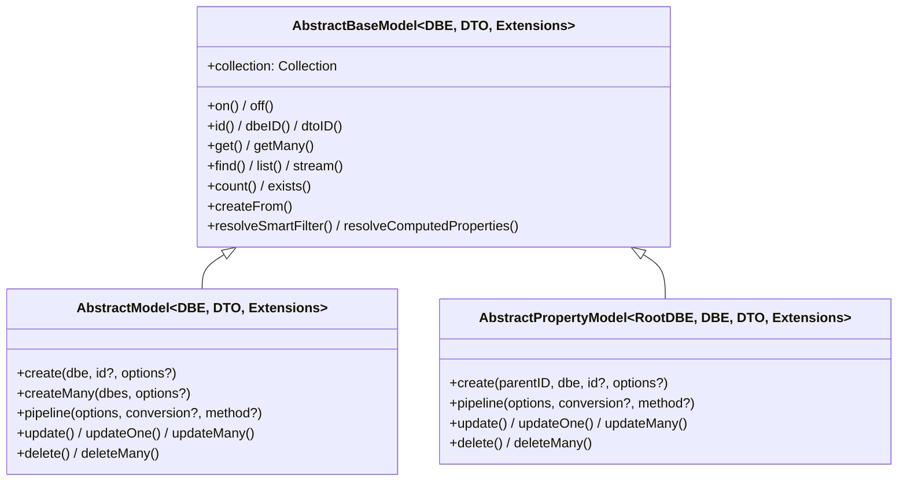
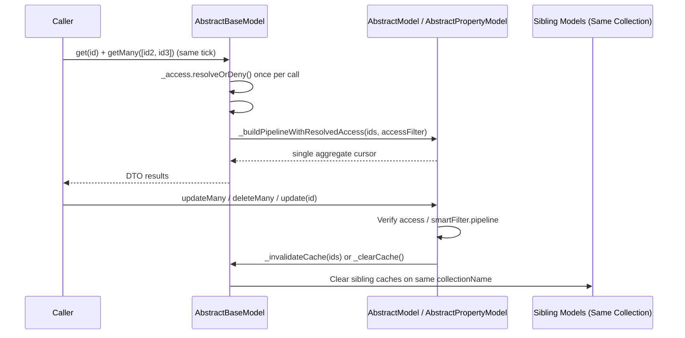
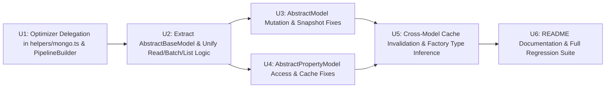

# Model Deduplication and Bug Fixes - Plan

## Goal Capsule

- **Objective:** Consumers of `@webergency-utils/mongodb-model` get consistent, access-safe, cache-coherent behavior and full TypeScript inference across root and subdocument models without duplicate maintenance across model implementations.
- **Means:** Extract a shared `AbstractBaseModel` base class extended by `AbstractModel` and `AbstractPropertyModel`, delegate pipeline stage and filter analysis to `@webergency-utils/mongodb-query-optimizer`, and resolve all eight v2 correctness, security, cache, typing, and documentation defects.
- **Product Authority:** Single coherent scope covering base-model deduplication, optimizer delegation in `src/helpers/mongo.ts`, and v2 bug fixes in `@webergency-utils/mongodb-model`.
- **Open Blockers:** None.

---

## Product Contract

### Summary

Extract `AbstractBaseModel` (`src/base-model.ts`) as the shared superclass of `AbstractModel` and `AbstractPropertyModel` to own collaborator state, lifecycle tracking, observability, cache invalidation, read batching, and shared read/conversion methods; delegate pipeline stage and filter inspection in `src/helpers/mongo.ts` to `@webergency-utils/mongodb-query-optimizer`; and resolve the eight v2 correctness, access-control, cache-invalidation, typing, and documentation bugs.

### Problem Frame

`src/model.ts` (1,457 lines) and `src/property-model.ts` (1,628 lines) currently duplicate collaborator fields, lifecycle tracking, event emission, cache invalidation, `OperationAggregator` wiring, and read/conversion methods across two independent root classes. Because `AbstractPropertyModel` requires a `parentID` parameter on `create()` and uses `id` rather than `_id`, it cannot directly extend `AbstractModel`, which led to copy-pasting the class body and allowing behavioral bugs to diverge between root and subdocument models.

At the same time, `src/helpers/mongo.ts` maintains hand-rolled filter and stage analyzers (`optimizeMatch`, `collectAddedFields`, `getUsedFields`) that throw on common MongoDB stages such as `$sort` and `$limit` even though `@webergency-utils/mongodb-query-optimizer` already ships a complete 25-stage analyzer (`getStageInfo`) and filter optimizer (`optimizeFilter`). Finally, eight concrete bugs affect v2 correctness and security: ignored `smartFilter.pipeline` stages in root filter mutations, subdocument access-control bypasses when sibling subdocuments share a root document, uninvalidated caches on non-ID filter mutations, dropped `documentBefore` payloads when combined with `documentAfter`, erased `Extensions` types and shared factory closure state in `defineModel`/`definePropertyModel`, split `get`/`getMany` batching with duplicate `accessFilter()` execution, faulty count pipelines in `AbstractPropertyModel.list()`, and outdated `README.md` API documentation.

### Key Decisions

- **Shared `AbstractBaseModel` superclass exported publicly** — Both `AbstractModel` and `AbstractPropertyModel` extend `AbstractBaseModel`, which owns shared collaborators, lifecycle tracking, caching, observability, batching, and read orchestration while leaving `create()` signatures and root-vs-subdocument pipeline/mutation mechanics on the subclasses. Governs R1, R2, R3.
- **Delegate stage and filter helpers to `@webergency-utils/mongodb-query-optimizer`** — `optimizeMatch`, `collectAddedFields`, and `getUsedFields` delegate to `optimizeFilter` and `getStageInfo` from `@webergency-utils/mongodb-query-optimizer` so smart-filter cleanup and subdocument root promotion work across all 25 MongoDB stages without custom AST walkers. Governs R4, R5.
- **Collection-wide cache invalidation on mutations** `(session-settled: user-approved — chosen over isolated single-model cache invalidation or pre-fetching matching _ids on every filter mutation: prevents parent and subdocument caches from serving stale data without extra read queries on root mutations)` — Non-ID filter mutations clear the mutating model's cache when documents are affected, and any mutation invalidates or clears sibling models registered on the same collection in `AbstractModels`. Governs R8, R9.
- **Pipeline-verified subdocument access control on ID mutations** `(session-settled: user-approved — chosen over inlining simple subdocument predicates into arrayFilters and $pull: supports all MongoDB operators and guarantees sibling subdocuments in the same root document cannot be mutated)` — `AbstractPropertyModel` verifies target subdocument IDs through its unwind and access pipeline whenever `access.filter` is present. Governs R7.

### Requirements

**Base Model Deduplication**

- R1. Extract `AbstractBaseModel` to hold shared collaborator state, lifecycle tracking, ID conversion helpers, optimizer and observability hooks, event emitters, cache invalidation, `OperationAggregator` batching, and shared read and inbound-conversion methods for `AbstractModel` and `AbstractPropertyModel`.
- R2. Preserve the existing public class signatures, generic parameters, and `instanceof` behavior of `AbstractModel` and `AbstractPropertyModel`, keeping `create()` and `createMany()` on `AbstractModel` and `create(parentID, ...)` on `AbstractPropertyModel`.
- R3. Export `AbstractBaseModel` from `src/index.ts` so consumers can type helpers that accept either a root model or a subdocument property model.

**Query Optimizer Delegation**

- R4. Delegate `collectAddedFields` and `getUsedFields` in `src/helpers/mongo.ts` to `getStageInfo` from `@webergency-utils/mongodb-query-optimizer` so all 25 MongoDB pipeline stages and nested expressions are supported without throwing on stages like `$sort`, `$limit`, or `$skip`.
- R5. Delegate `optimizeMatch` in `src/helpers/mongo.ts` to `optimizeFilter` from `@webergency-utils/mongodb-query-optimizer` after stripping `undefined` branches, removing the redundant custom filter-merging implementation.

**Mutation Correctness & Access Control**

- R6. When `smartFilter` resolves with a non-empty `pipeline` in `AbstractModel.updateOne`, `AbstractModel.updateMany`, or `AbstractModel.deleteMany`, resolve matching document `_id`s via `this.pipeline` (limiting to 1 for `updateOne`) and scope the write to those `_id`s, short-circuiting with zero counts when none match.
- R7. In `AbstractPropertyModel.update(id)`, `AbstractPropertyModel.updateMany(ids)`, and `AbstractPropertyModel.delete(id)`, verify target subdocument IDs via the model's unwind and access pipeline whenever `access.filter` is present so callers cannot mutate inaccessible sibling subdocuments stored in the same root document.
- R8. In `AbstractPropertyModel.#resolveBatchTargetIds`, include resolved `targetIds` in `cacheIdsToInvalidate` when `idsOrFilter` is a non-ID filter so `updateMany(filter)` and `deleteMany(filter)` evict cached entries and report affected IDs in mutation events.
- R9. Clear the model's `ModelCache` when a root filter mutation without statically extractable target IDs affects at least one document, and propagate cache invalidation across sibling models sharing the same `collectionName` in `AbstractModels`.
- R10. In `AbstractModel.update` and `AbstractModel.updateOne`, return both `documentBefore` and `documentAfter` whenever both `options.documentBefore` and `options.documentAfter` are `true`, matching `AbstractPropertyModel` behavior.

**Batching, Count Pipeline, Typing & Documentation**

- R11. Unify the `#findAggregator` batch key for `get` and `getMany` so concurrent calls in the same tick batch into a single `$in` query, and pass the already-resolved access filter into the aggregator so `accessFilter()` is not executed twice per read.
- R12. Pass `conversion` into the count pipeline build in `AbstractPropertyModel.list({ count: true })` and strip `$replaceWith` and `$replaceRoot` stages in `PipelineBuilder.buildCountPipeline`.
- R13. Preserve inferred `Extensions` generic types (`Converters`, `SmartFilters`, `ComputedProperties`) on `defineModel`, `Model`, `definePropertyModel`, and `PropertyModel` instead of widening to `any`, and initialize `dtoIDRef` and `extensions` per model instance inside the constructor.
- R14. Update `README.md` to document all v2 CRUD methods (`createFrom`, `createMany`, `updateOne`, `deleteMany`, `exists`, `getMany`), `ModelCache`, and observability events (`query`, `mutation`, `slowQuery`, `cache`, `error`).

### Acceptance Examples

- AE1. Root mutation with pipeline-backed smartFilter
  - **Covers:** R6
  - **Given:** A collection with documents `A` and `B`, and a `smartFilter` that returns `filter: undefined` and a `pipeline` matching only `A`.
  - **When:** `model.updateMany( { $set: { status: 'archived' } }, { smartFilter: { onlyA: true } } )` or `model.deleteMany( { smartFilter: { onlyA: true } } )` is called.
  - **Then:** Only document `A` is updated or deleted, and document `B` remains untouched.

- AE2. Subdocument sibling access-control isolation
  - **Covers:** R7
  - **Given:** A single root document containing two subdocuments `subAlice` (`ownerId: 'alice'`) and `subBob` (`ownerId: 'bob'`), and an `accessFilter` returning `{ ownerId: 'alice' }`.
  - **When:** Alice calls `propertyModel.update( subBob.id, { $set: { title: 'hacked' } } )`, `propertyModel.updateMany( [ subBob.id ], { $set: { title: 'hacked' } } )`, or `propertyModel.delete( subBob.id )`.
  - **Then:** The operation returns `matchedCount: 0` or `false`, and `subBob` is not modified or removed.

- AE3. Filter mutation and cross-model cache invalidation
  - **Covers:** R8, R9
  - **Given:** A root `OrganizationModel` and a subdocument `PlacementPropertyModel` on the same collection, both with `cache: true` and populated cache entries.
  - **When:** `organizationModel.updateMany( { $set: { active: false } }, { filter: { tier: 'free' } } )` or `placementPropertyModel.update( placementId, { $set: { status: 'closed' } } )` mutates a document.
  - **Then:** Subsequent `get()` calls on both the mutating model and the sibling model on the same collection fetch fresh data rather than returning stale cached entries.

- AE4. Combined `documentBefore` and `documentAfter` on `AbstractModel`
  - **Covers:** R10
  - **Given:** An existing root document `{ _id, name: 'before' }`.
  - **When:** `model.update( id, { $set: { name: 'after' } }, { documentBefore: true, documentAfter: true } )` is called.
  - **Then:** The returned `UpdateResult` includes both `documentBefore` with `name: 'before'` and `documentAfter` with `name: 'after'`.

- AE5. Same-tick `get` and `getMany` batching with single `accessFilter` evaluation
  - **Covers:** R11
  - **Given:** A model with an `accessFilter` spy and `Promise.all([ model.get( id1 ), model.getMany([ id2, id3 ]) ])` invoked in the same tick.
  - **When:** Both calls resolve with the same conversion and access options.
  - **Then:** Only one MongoDB aggregation query is executed for `[ id1, id2, id3 ]`, and `accessFilter` is invoked once per call rather than being re-invoked inside the aggregator callback.

### Scope Boundaries

- No changes to `@webergency-utils/mongodb-query-optimizer` — all changes are implemented in `@webergency-utils/mongodb-model`.
- No breaking changes to existing `AbstractModel` or `AbstractPropertyModel` public method signatures or constructor contracts used in `usage/`.

### Sources / Research

- `src/model.ts` and `src/property-model.ts` — current root and subdocument model implementations.
- `src/helpers/mongo.ts` and `src/pipeline-builder.ts` — pipeline construction, `collectAddedFields`, `getUsedFields`, and `optimizeMatch`.
- `src/define-model.ts`, `src/define-property-model.ts`, and `src/types/definition.ts` — factory builders and TypeScript inference types.
- `src/cache.ts` and `src/models.ts` — `ModelCache` implementation and `AbstractModels` registry.
- `node_modules/@webergency-utils/mongodb-query-optimizer/dist/index.d.ts` — exported `getStageInfo`, `optimizeFilter`, and `optimizePipeline` signatures.

---

## Planning Contract

Product Contract preservation: Product Contract unchanged.

### Key Technical Decisions

- KTD1. **Template-method hooks on `AbstractBaseModel` (`src/base-model.ts`)** — `AbstractBaseModel<DBE, DTO, Extensions>` owns protected collaborator instances (`_tracker`, `_converter`, `_access`, `_pipelineBuilder`, `_cache`, `_events`) plus `#findAggregator`, event subscription (`on`, `off`), `[GET_OPTIMIZER_OPTIONS]`, `[GET_OBSERVABILITY_OPTIONS]`, `[INVALIDATE_COLLECTION_CACHE]`, ID helpers (`id`, `dbeID`, `dtoID`), `ensureOpen`, `trackOperation`, `runOperation`, `resolveSmartFilter`, `resolveComputedProperties`, `createFrom`, and shared read methods (`get`, `getMany`, `find`, `list`, `stream`, `count`, `exists`). Subclasses provide protected `idField: '_id' | 'id'`, `abstract pipeline(options, conversion, method)`, and a protected `_buildPipelineWithResolvedAccess(options, conversion, method, accessFilter)` hook used by `#findAggregator` so `accessFilter()` is evaluated only once per `get`/`getMany` call. Governs R1, R2, R3, R11, R12.
- KTD2. **`getStageInfo` and `optimizeFilter` delegation in `src/helpers/mongo.ts`** — `collectAddedFields(pipeline)` iterates stages using `getStageInfo(stage, index)` from `@webergency-utils/mongodb-query-optimizer`, accumulating top-level roots of `info.producedFields` and deleting top-level roots of `info.removedFields` (stopping or clearing appropriately on `info.isDestructive && info.producedFields.size === 0`). `getUsedFields(pipeline, prefix)` iterates stages via `getStageInfo(stage, index)` and returns matching `usedFields` (splitting on `.` to extract the immediate field name after `prefix`). `optimizeMatch(filters)` strips `undefined` values from each filter via `cleanUndefinedFilter`, removes empty filter objects, and delegates non-empty filters directly to `optimizeFilter({ $and: validFilters })` (or `optimizeFilter(validFilters[0])` when single). Governs R4, R5.
- KTD3. **Cross-model cache coordination via internal symbol hook** `(session-settled: user-approved — chosen over isolated single-model cache invalidation or pre-fetching matching _ids on every filter mutation)` — `AbstractModels` registers a collection-scoped invalidation callback on every model (`[SET_COLLECTION_INVALIDATOR]`) or tracks models by `collectionName`. When any model executes `_invalidateCache(ids)` or `_clearCache()`, it invalidates/clears its own `#cache` and notifies `AbstractModels` to clear the caches of any other registered sibling models sharing the same `collectionName` (since parent `_id` and subdocument `id` namespaces differ, sibling models clear their cache when a sibling model on the same collection mutates). On non-ID filter mutations that affect $>0$ documents (`matchedCount > 0 || modifiedCount > 0 || upsertedCount > 0 || deletedCount > 0`) without explicit target IDs, `_clearCache()` is invoked. Governs R8, R9.
- KTD4. **Pipeline-verified subdocument IDs on `AbstractPropertyModel` ID mutations** `(session-settled: user-approved — chosen over inlining simple subdocument predicates into arrayFilters and $pull)` — In `AbstractPropertyModel.update(id)`, `AbstractPropertyModel.updateMany(ids)`, and `AbstractPropertyModel.delete(id)`, whenever `access.filter` is defined, pass `{ filter: { id } as any }` (or `{ filter: { id: { $in: ids } } as any }`) through `#findMatchingSubdocIds(filterOptions, access.filter, session)` before running `findOneAndUpdate`, `updateMany`, or `delete`. If the target `id` is not in the matched subdocument IDs, short-circuit immediately with `{ matchedCount: 0, modifiedCount: 0, upsertedCount: 0 }` or `false`. Governs R7.
- KTD5. **Pipeline-backed `smartFilter` resolution in `AbstractModel` filter mutations** — Replace `#resolveFilterMatch` with `#resolveFilterMutationTargets(options, accessFilter, session, limit?)` when `resolvedSmart?.pipeline?.length` is non-empty: execute `this.pipeline({ filter: options?.filter, smartFilter: options?.smartFilter, projection: ['_id'] as any, ...(limit ? { limit } : {}) }, false, 'find')` with `session`, collect matching `_id`s, and return `{ match: { _id: limit === 1 ? ids[0] : { $in: ids } }, targetIds: ids.map(id => this.id(id)), empty: ids.length === 0 }`. When `empty` is `true`, `updateOne`, `updateMany`, and `deleteMany` short-circuit without hitting MongoDB write commands. Governs R6.
- KTD6. **Dual `documentBefore` + `documentAfter` fetch on `AbstractModel.update` and `updateOne`** — When both `options?.documentBefore` and `options?.documentAfter` are `true` (and no pipeline update disables `findOneAndUpdate`, or consistently across both branches), fetch `beforeDoc` prior to the write and either use `findOneAndUpdate(..., { returnDocument: 'after' })` or fetch `afterDoc` so both `documentBefore` and `documentAfter` are populated on the returned `UpdateResult`. Governs R10.
- KTD7. **Generic-preserving `defineModel` and `definePropertyModel` factories** — Update `ModelConstructor` and `PropertyModelConstructor` in `src/types/definition.ts` to carry `Extensions extends ModelExtensions<DBE, DTO> = ModelExtensions<DBE, DTO>`, update `defineModel`/`Model` (`src/define-model.ts`) and `definePropertyModel`/`PropertyModel` (`src/define-property-model.ts`) return types to `ModelConstructor<DBE, DTO, InferredExtensions<...>>` and `PropertyModelConstructor<RootDBE, DBE, DTO, InferredExtensions<...>>`, and move `dtoIDRef` and `buildExtensions` initialization inside the generated `DefinedModel` / `DefinedPropertyModel` constructors so per-instance closures are isolated. Governs R13.

### High-Level Technical Design

### Sequencing

---

## Implementation Units

### U1. Query Optimizer Delegation & Count Pipeline Stage Stripping

- **Goal:** Replace custom AST inspection in `src/helpers/mongo.ts` with `@webergency-utils/mongodb-query-optimizer`'s `getStageInfo` and `optimizeFilter`, and add `$replaceWith` / `$replaceRoot` to `COUNT_IGNORE_STAGES` in `src/pipeline-builder.ts`.
- **Covers:** R4, R5, R12
- **Dependencies:** None
- **Owned Files:**
  - `src/helpers/mongo.ts`
  - `src/pipeline-builder.ts`
  - `test/units/mongo-helpers.test.ts`
- **Implementation Notes:**
  - In `src/helpers/mongo.ts`, import `{ getStageInfo, optimizeFilter }` from `'@webergency-utils/mongodb-query-optimizer'`.
  - Rewrite `collectAddedFields(pipeline)` using `getStageInfo(stage, i)`: for each stage, if `info.isDestructive && info.producedFields.size === 0` (such as `$count` or `$replaceRoot`), clear or skip appropriately; add top-level field names (`field.split('.')[0]`) from `info.producedFields` and delete top-level field names from `info.removedFields`.
  - Rewrite `getUsedFields(pipeline, prefix)` using `getStageInfo(stage, i)`: inspect `info.usedFields`; when `prefix` is provided, match fields starting with `prefix` and extract the immediate sub-key (`field.slice(prefix.length).split('.')[0]`); when `prefix` is empty, extract `field.split('.')[0]`.
  - Rewrite `optimizeMatch(filters)`: keep `cleanUndefinedFilter` to strip `undefined` values and empty filter objects, then return `undefined` when no valid filters remain, `optimizeFilter(validFilters[0])` when 1 filter remains, or `optimizeFilter({ $and: validFilters })` when multiple filters remain. Remove unused custom helpers (`isPlainMatchObject`, `mergeFieldCondition`).
  - In `src/pipeline-builder.ts`, add `'$replaceWith'` and `'$replaceRoot'` to `COUNT_IGNORE_STAGES`.
- **Verification:** `npx vitest run test/units/mongo-helpers.test.ts`

### U2. Extract `AbstractBaseModel` and Unify Read, Batching, and `list()` Count Logic

- **Goal:** Create `src/base-model.ts` (`AbstractBaseModel`) with all shared state, lifecycle, observability, cache, batching, and read/conversion methods, refactor `AbstractModel` and `AbstractPropertyModel` to extend it, unify `get`/`getMany` batching without duplicate `accessFilter()` calls, and pass `conversion` to `countPipeline` in `list()`.
- **Covers:** R1, R2, R3, R11, R12
- **Dependencies:** U1
- **Owned Files:**
  - `src/base-model.ts`
  - `src/model.ts`
  - `src/property-model.ts`
  - `src/index.ts`
- **Implementation Notes:**
  - Create `src/base-model.ts` exporting `AbstractBaseModel<DBE extends Document, DTO = DBE, Extensions extends ModelExtensions<DBE, DTO> = ModelExtensions<DBE, DTO>>`.
  - Move shared collaborators (`_tracker`, `_converter`, `_access`, `_pipelineBuilder`, `_cache`, `_events`), `#findAggregator`, `on`, `off`, `[GET_OPTIMIZER_OPTIONS]`, `[GET_OBSERVABILITY_OPTIONS]`, `_optimizePipeline`, `_emitQuery`, `_emitMutation`, `_emitCache`, `_emitError`, `_invalidateCache`, `_clearCache`, `id`, `dbeID`, `dtoID`, `ensureOpen`, `trackOperation`, `runOperation`, `resolveSmartFilter`, `resolveComputedProperties`, `createFrom`, `get`, `getMany`, `find`, `list`, `stream`, `count`, and `exists` into `AbstractBaseModel`.
  - Unify `#findAggregator` batch key: omit `method` from the batch key (use `conversion` + `accessFilter`) so `get()` and `getMany()` batch together in the same tick, and pass the pre-resolved `accessFilter` into `_buildPipelineWithResolvedAccess` so `accessFilter()` is only called once per `get()`/`getMany()` invocation.
  - In `AbstractBaseModel.list()`, pass `conversion` (not `undefined`) when building `countPipeline` via `this.pipeline(countOptions, conversion, 'count')`.
  - Export `AbstractBaseModel` from `src/index.ts`.
- **Verification:** `npx vitest run`

### U3. `AbstractModel` SmartFilter Pipeline Mutations and Combined `documentBefore` + `documentAfter`

- **Goal:** Support `smartFilter.pipeline` in `AbstractModel.updateOne`, `updateMany`, and `deleteMany`, and preserve both `documentBefore` and `documentAfter` when both options are requested in `AbstractModel.update` and `updateOne`.
- **Covers:** R6, R10, AE1, AE4
- **Dependencies:** U2
- **Owned Files:**
  - `src/model.ts`
- **Implementation Notes:**
  - In `AbstractModel`, when `resolvedSmart?.pipeline?.length` is non-empty in `updateOne`, `updateMany`, or `deleteMany`, resolve matching document `_id`s using `_buildPipelineWithResolvedAccess` (with `projection: ['_id'] as any` and `limit: 1` for `updateOne`), short-circuiting with zero counts when no documents match, and scoping the write filter to `{ _id: matchedIds[0] }` (for `updateOne`) or `{ _id: { $in: matchedIds } }` (for `updateMany`/`deleteMany`).
  - In `AbstractModel.update` and `AbstractModel.updateOne`, when both `options?.documentBefore` and `options?.documentAfter` are `true` in the standard `findOneAndUpdate` path, pre-fetch `beforeDoc` before executing `findOneAndUpdate(..., { returnDocument: 'after' })` (or fetch `afterDoc` after `returnDocument: 'before'`), convert both through `_converter.toDTO`, and include both `documentBefore` and `documentAfter` on the returned result.
- **Verification:** `npx vitest run test/integration/crud.test.ts`

### U4. `AbstractPropertyModel` Subdocument Access Verification and Batch Cache Invalidation

- **Goal:** Prevent mutating inaccessible sibling subdocuments in `AbstractPropertyModel.update(id)`, `updateMany(ids)`, and `delete(id)` when `access.filter` is present, and include `targetIds` in `cacheIdsToInvalidate` on non-ID filter mutations.
- **Covers:** R7, R8, AE2, AE3
- **Dependencies:** U2
- **Owned Files:**
  - `src/property-model.ts`
- **Implementation Notes:**
  - In `AbstractPropertyModel.update(id)`, when `access.filter` is defined, verify `id` via `#findMatchingSubdocIds({ filter: { id } as any }, access.filter, session)` before executing `findOneAndUpdate`; if `matchedIds.length === 0`, return `{ matchedCount: 0, modifiedCount: 0, upsertedCount: 0 }`.
  - In `AbstractPropertyModel.delete(id)`, when `access.filter` is defined, verify `id` via `#findMatchingSubdocIds({ filter: { id } as any }, access.filter, session)` before executing `findOneAndUpdate` / `updateOne`; if `matchedIds.length === 0`, return `false`.
  - In `AbstractPropertyModel.#resolveBatchTargetIds`, when `extracted !== undefined` (explicit ID array) AND `accessFilter` is defined, verify those IDs through `#findMatchingSubdocIds({ filter: { id: { $in: extracted } } as any }, accessFilter, session)` so inaccessible subdocument IDs are filtered out before `$set` / `$pull`. Also set `cacheIdsToInvalidate: targetIds` instead of `extracted` when `extracted === undefined` so non-ID filter mutations invalidate and emit all matched subdocument IDs.
- **Verification:** `npx vitest run test/integration/property-model.test.ts`

### U5. Collection-Wide Cache Invalidation and Factory Generic Inference

- **Goal:** Clear model cache on non-ID root filter mutations, propagate cache invalidation across sibling models sharing the same `collectionName` in `AbstractModels`, and preserve inferred `Extensions` generics and per-instance closure state in `defineModel` / `definePropertyModel`.
- **Covers:** R9, R13, AE3
- **Dependencies:** U3, U4
- **Owned Files:**
  - `src/base-model.ts`
  - `src/model.ts`
  - `src/models.ts`
  - `src/types/definition.ts`
  - `src/define-model.ts`
  - `src/define-property-model.ts`
- **Implementation Notes:**
  - Add an internal symbol `SET_COLLECTION_INVALIDATOR` (and `CLEAR_LOCAL_CACHE`) in `src/base-model.ts`. In `AbstractModels.#registerModel` (`src/models.ts`), wire a callback that notifies all other registered models with the same `collectionName` to call `[CLEAR_LOCAL_CACHE]()` whenever a model mutates documents.
  - In `AbstractModel.updateOne`, `updateMany`, and `deleteMany`, when a mutation affects $>0$ documents (`matchedCount > 0 || modifiedCount > 0 || upsertedCount > 0 || deletedCount > 0`), call `this._invalidateCache(targetIds)` if `targetIds.length > 0`, or `this._clearCache()` if `targetIds.length === 0`.
  - In `src/types/definition.ts`, parameterize `ModelConstructor` and `PropertyModelConstructor` with `Extensions extends ModelExtensions<DBE, DTO> = ModelExtensions<DBE, DTO>` and pass `Extensions` to `AbstractModel<DBE, DTO, Extensions>` and `AbstractPropertyModel<RootDBE, DBE, DTO, Extensions>`.
  - In `src/define-model.ts` and `src/define-property-model.ts`, return the strongly typed constructor (`ModelConstructor<DBE, DTO, InferredExtensions<...>>` and `PropertyModelConstructor<RootDBE, DBE, DTO, InferredExtensions<...>>`) and move `dtoIDRef` and `buildExtensions(...)` inside the `DefinedModel` and `DefinedPropertyModel` constructors.
- **Verification:** `npx vitest run && npm run check`

### U6. Regression Tests and `README.md` Documentation Update

- **Goal:** Add unit and integration tests covering `AE1`–`AE5`, `R1`–`R13`, and update `README.md` to document all v2 CRUD methods, `ModelCache`, `AbstractBaseModel`, and observability events.
- **Covers:** R1–R14, AE1–AE5
- **Dependencies:** U5
- **Owned Files:**
  - `test/units/mongo-helpers.test.ts`
  - `test/integration/crud.test.ts`
  - `test/integration/property-model.test.ts`
  - `README.md`
- **Implementation Notes:**
  - Add tests in `test/units/mongo-helpers.test.ts` verifying `collectAddedFields` and `getUsedFields` across `$sort`, `$limit`, `$skip`, `$replaceWith`, and nested expressions, plus `optimizeMatch` delegating to `optimizeFilter`.
  - Add integration tests in `test/integration/crud.test.ts` and `test/integration/property-model.test.ts` covering `AE1` (pipeline-backed `smartFilter` in `updateOne`/`updateMany`/`deleteMany`), `AE2` (sibling subdocument access control in `update`/`updateMany`/`delete`), `AE3` (filter mutation cache clearing and cross-model sibling cache invalidation), `AE4` (combined `documentBefore: true, documentAfter: true`), `AE5` (same-tick `get` + `getMany` batching and single `accessFilter` call), `PropertyModel.list({ count: true })` with `conversion` and `$replaceWith` stripping, and `defineModel`/`definePropertyModel` extension type inference and per-instance isolation.
  - Update `README.md` API table and sections to document `AbstractBaseModel`, `createFrom`, `createMany`, `updateOne`, `deleteMany`, `exists`, `getMany`, `ModelCache` configuration, and `.on()` / `.off()` observability events.
- **Verification:** `npm test && npm run check`

---

## Verification Contract

- **Automated Checks:**
  - `npm test` (runs Vitest unit and integration test suites)
  - `npm run check` (runs `tsc --noEmit` across `src/`, `test/`, and `usage/`)
- **Acceptance Example Mapping:**
  - `AE1` → `test/integration/crud.test.ts` (`smartFilter` with `pipeline` in `updateOne`, `updateMany`, `deleteMany`)
  - `AE2` → `test/integration/property-model.test.ts` (sibling subdocument `accessFilter` isolation in `update`, `updateMany`, `delete`)
  - `AE3` → `test/integration/crud.test.ts` & `test/integration/property-model.test.ts` (non-ID filter cache eviction and cross-model sibling cache invalidation)
  - `AE4` → `test/integration/crud.test.ts` (`update` and `updateOne` with `{ documentBefore: true, documentAfter: true }`)
  - `AE5` → `test/integration/crud.test.ts` (concurrent `get` + `getMany` batching and `accessFilter` call count)

---

## Definition of Done

- [ ] `AbstractBaseModel` is extracted in `src/base-model.ts`, extended by `AbstractModel` and `AbstractPropertyModel`, and exported from `src/index.ts`.
- [ ] `collectAddedFields`, `getUsedFields`, and `optimizeMatch` in `src/helpers/mongo.ts` delegate to `@webergency-utils/mongodb-query-optimizer`.
- [ ] All eight bugs (`R6`–`R14`) are fixed and covered by automated tests (`AE1`–`AE5`).
- [ ] All code strictly follows `radixxko-format` rules.
- [ ] `npm test` and `npm run check` pass with zero errors.
